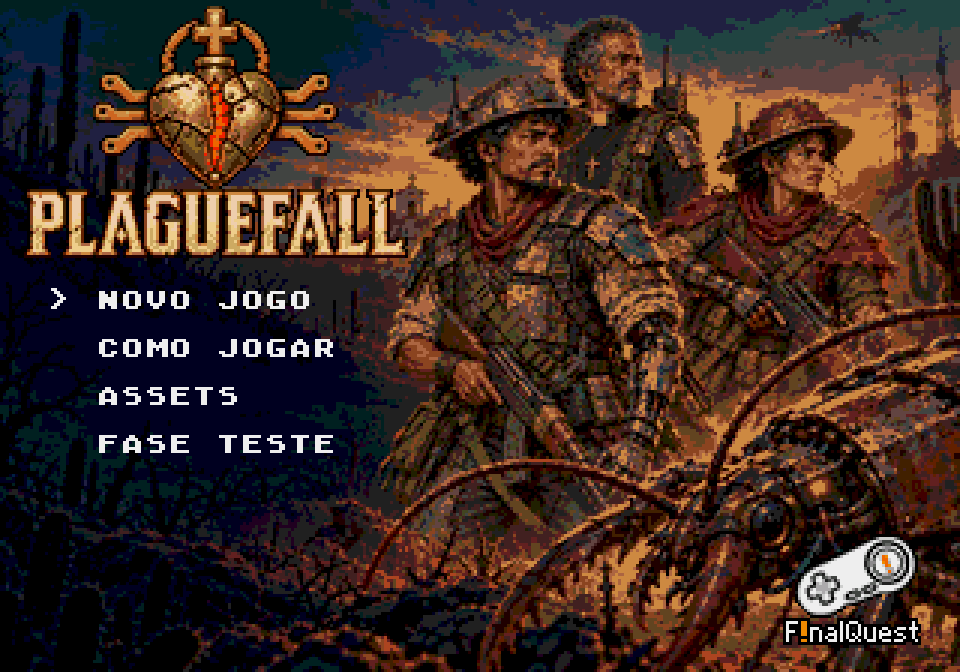

# Plaguefall

Shooter de arena para **Sega Mega Drive / Genesis**, escrito em C com o SGDK. Damião, um trabalhador com prótese cibernética, protege uma comunidade do sertão industrial dos insetos trazidos por foguetes. A direção mistura cangaço, cyberpunk brasileiro e religiosidade popular.



[Baixar Plaguefall.bin](game/out/release/Plaguefall.bin) · [Ver a abertura](game/art/intro-monologo-v2/emulator-ntsc/abertura.mp4) · [GDD](game/doc/GDD.md)

## Estado atual

- **Cenários da campanha:** [pátio da igreja aprovado](game/art/phase01-courtyard-v2/revisao.html) e [sete mapas dos capítulos 2 a 6 aprovados e integrados](game/art/phases02-06-v1/revisao.html), incluindo 2A/2B e 6A/6B. Cada arena tem tamanho, câmera, piso e perigos próprios. A lava das fases 3 e 6 ganha brilho por tiles; as músicas existentes permanecem. Na fase 5 e na sala de defesa, a [Santa redesenhada em perspectiva elevada de 60°](game/art/santa-iso60-v2/README.md) usa colisão e contato de 40×48, pisca inteira e recupera o brilho na coroa; a invulnerabilidade é de 2,5 s. [Músicas, arenas e integração](game/doc/fases-cenarios.md).
- **Damião** é o protagonista jogável, com oito direções e animações de repouso e movimento. **Dinorah** participa da escolta, da galeria e das conversas. Os dois têm [animação de morte em quatro poses](game/art/actor-deaths-v1/README.md), exibida antes do resultado da tentativa.
- **Campanha:** 16 etapas por partida, representadas por20 nós e quatro bifurcações. Há13 inimigos de combate, incluindo o chefe **Escorpião**, e dois tipos de treino. Os objetivos incluem eliminar ondas, sobreviver, coletar itens e proteger Nossa Senhora Aparecida.
- **Abertura:** FinalQuest → APRESENTA → logo Plaguefall → monólogo ilustrado em14 planos e18 cartelas, com101 segundos → menu. A música **O Sonho Atendido** começa no logo Plaguefall e segue continuamente pelas imagens. Somente **START** pula; A, B e C não completam textos nem avançam cenas. A abertura toca uma vez por boot.
- **Menu Assets:** três abas — Damião, Dinorah e Músicas. Permite ouvir **Baião de Ferrugem**, **Entardecer**, **Breu** e **Ladainha de Ferro**, com pausa e alternância entre calma e combate. Sair da audição restaura a música anterior.
- **Áudio:** síntese PSG em tempo real, com ritmo e acentos de combate ligados à ameaça. As versões nordestina industrial, melancólica, sombria e de inspiração em igreja permanecem preservadas.
- **Arte:** personagens32×48, inimigos16/24/32 pixels e chefe48×48, oito direções e perspectiva elevada. Os recursos ativos são exportados para tiles, paletas e frames na ROM; os cenários aprovados até o capítulo 6 usam mapas de tiles próprios, enquanto as etapas seguintes e parte dos efeitos mantêm a implementação anterior.
- **Interfaces:** diálogos em [console de holodeck](game/art/dialogue-holodeck-v1/README.md), com monitor preto, títulos dourados, descrições em cinza claro e dois retratos nos monitores inferiores. Quem fala mantém as cores originais; quem escuta fica escurecido. Objetivo, guia da fase e contagem usam o monitor único do rádio, conservando os retratos dos inimigos. As trocas conversa → objetivo → contagem e a navegação do guia preservam o fundo, com o próximo conteúdo preparado antes da troca em VBlank. Há uma única contagem 3/2/1, em dourado; o controle é liberado ao entrar na arena. [Validação das cores em NTSC/PAL](game/art/radio-text-colors-v1/validation/report.json).
- **Textos em português:** abertura, rádio, menus, guia, preparação, pausa, HUD, rotas e resultados usam maiúsculas com acentos. Os 12 caracteres `ÀÁÂÃÉÊÍÓÔÕÚÇ` reutilizam posições de minúsculas na fonte de 96 tiles, sem ampliar a reserva de VRAM. [Validação NTSC/PAL](game/art/texto-acentuado-v1/validation/report.json).
- **ROM principal:** inclui os cenários aprovados até o capítulo 6. A validação integrada NTSC/PAL foi concluída com 42 partidas novas, 12 partidas de regressão da fase 1 e 28 ensaios de carga a 60/50 FPS. Relatórios: [NTSC](game/art/phases02-06-v1/validation/ntsc/report.json) e [PAL](game/art/phases02-06-v1/validation/pal/report.json). Os ensaios isolados anteriores permanecem nas pastas de arte, identificados como históricos. O [relatório consolidado](game/doc/build-validation.json) registra a revisão a que seus hashes e resultados pertencem.

A revisão narrativa sobre a fuga da igreja, o resgate e a demolição dos ninhos está documentada como **proposta**, ainda não aplicada integralmente à campanha. Consulte [História](game/doc/historia/README.md) para distinguir o roteiro executável do tratamento futuro.

## Controles

| Botão | Partida | Outras telas |
|---|---|---|
| Direcional | Move em oito direções | Navega no menu e nas abas de Assets |
| A | Atira; segurar ativa autofire | Confirma opções; inicia a fase; completa/avança diálogos |
| B | Usa o item selecionado | Retoma na pausa; cancela a confirmação de saída; em Assets, sai |
| C | Troca o item selecionado | Em Assets, alterna variações |
| START | Pausa/retoma | Confirma no menu/final; repete na derrota; cancela na confirmação; pula abertura/conversas |

**Mira diagonal:** ao soltar o direcional depois de andar na diagonal, Damião conserva a mira e pode disparar parado com A. Uma tolerância de80ms entre soltar os dois eixos evita virar involuntariamente para uma direção reta. Segurar apenas um eixo confirma a mudança; um novo toque após parar muda a mira imediatamente.

**Durante o boot, somente START tem ação.** Na aba Músicas, CIMA/BAIXO escolhe a faixa, A pausa/retoma e C alterna calma/combate. ESQ/DIR troca de aba; B/START sai. A faixa da galeria não muda permanentemente a trilha da campanha.

## Itens

| Item | Efeito |
|---|---|
| Marmita do abrigo | Recupera15 pontos de vida |
| Divisor de disparo | Adiciona projéteis, até cinco por disparo |
| Servo de passada | Aumenta a velocidade |
| Carga de desmonte | Explosão de área |
| Capacitor de proteção | Invencibilidade temporária |
| Bobina de subestação | Tiros com reação em cadeia |
| Refil de arrefecimento | Congela inimigos |
| Refil de maçarico | Aplica queimadura |
| Bornal de recuperação | Sempre após derrota: recupera o equipamento anterior conforme a etapa |

**Resultados:** a derrota repete a mesma fase com vida cheia e equipamento básico, deixando sempre um **bornal de couro** perto da queda, em chão seguro e sem prazo para desaparecer. Ao recolher, nas etapas **1–5** recupera todo o equipamento anterior; nas **6–11**, recupera com uma melhoria de tiro e de velocidade a menos, sem o piso 3, e um item a menos (último espaço ocupado; depois, uma carga de bomba). Nas **12–16**, recupera no máximo **+1 projétil e +20% de velocidade**, de forma independente e apenas se possuía cada melhoria antes da morte; itens, bombas e efeitos não voltam. A bolsa usa uma fotografia do equipamento na hora da morte, preserva as novas coletas dentro dos tetos e guarda itens sem espaço para uma coleta posterior. Outra morte substitui a bolsa com os valores da queda mais recente, mesmo se a anterior não foi recolhida. As rotas A/B usam a mesma regra de sua etapa; as páginas 7/8 e 8/8 do **Como jogar** explicam a recuperação. Sair ao título exige confirmação. Conclusões e mudanças de rota aguardam uma nova pressão de A/START; o final aguarda a escolha. As trocas de resultado e mapa mantêm o fade; conversa, objetivo e contagem preservam a moldura do rádio, e botões segurados durante a carga não confirmam a próxima tela. A entrada de cada fase da campanha usa uma única contagem **3/2/1**, durante a preparação dos recursos, no monitor do rádio, com moldura metálica e letras amarelas. A música continua e a fase começa assim que a preparação e os três segundos terminam, sem segunda contagem dentro da arena. Jogar novamente limpa rotas, cenas e estatísticas e começa na fase 1. Atalhos de depuração exigem `DEV_SHORTCUTS` e estão desativados na ROM principal.

Marmita, divisor, servo e bornal aplicam seu efeito na coleta; os demais usam o inventário. C seleciona e B ativa. A vida persiste entre fases. A opção **Fase Teste** abre [dez salas configuráveis](game/art/training-v2/README.md): galeria de inimigos, bancada de itens, defesa da Santa, colisões/perigos, comportamento/chefe, carga/performance, deslocamento, proteção da Dinorah, animações de morte de Damião/Dinorah e **Regras de morte (sala 10)**. Nessa sala, **A** provoca a morte, **B** repõe o equipamento e **C** alterna as etapas 1–5, 6–11 e 12–16. O painel mostra atributos, inventário e mortes; START permite configurar tiro/velocidade/itens/bombas iniciais, reiniciar ou trocar a sala.

O [HUD da resistência](game/art/hud-resistencia-v1/integracao/README.md) está integrado: faixa de 24 px, objetivo, quatro espaços de itens, modo de tiro e vida com número e barra.

[Lava e lama modulares](game/art/terrain-modules-v1/README.md) possuem cantos, bordas e miolos conectáveis, com lava animada e transparência sobre qualquer piso. Estão aplicadas à sala de perigos, à travessia e à escolta; a mesma definição posiciona a arte e os efeitos de jogabilidade.

## Compilar e conferir

Requisitos: SGDK, `m68k-elf-gcc`, Make, Java e Python3. No macOS deste projeto:

```sh
git submodule update --init SGDK
export PATH="/opt/homebrew/opt/openjdk/bin:$PATH"
make -C game -j4 OUT_DIR_LIB="$PWD/SGDK/out/release"
python3 game/tools/check.py
```

O build gera **`game/out/release/Plaguefall.bin`** para abrir no emulador, acompanhado de `Plaguefall.png` para a capa da biblioteca e `Plaguefall.json` com identificação e hashes. `Plaguefall.bin` é a única ROM versionada; `rom.bin` permanece como saída interna local do SGDK, com conteúdo idêntico. Os testes nativos usam uma pasta temporária e verificam partituras, PAL/NTSC, envelopes, prioridade dos efeitos, as quatro faixas e a continuidade da abertura. [Configuração, emulador e testes de integração](game/doc/desenvolvimento.md).

## Organização

```text
game/
├── src/                 # código do jogo, telas, áudio e renderização
├── res/                 # recursos usados pelo SGDK
├── art/                 # fontes, exports, prévias e relatórios de arte/áudio
├── doc/                 # design, história e desenvolvimento
├── tests/audio/         # testes nativos mantidos
├── tools/               # geradores e validação
│   └── music-bench/     # bancada opcional; compartilha o áudio de produção
└── out/release/Plaguefall.bin  # ROM principal; rom.bin é saída local do SGDK
SGDK/                    # submódulo do SDK
```

Compilações experimentais, objetos, dependências e arquivos de sistema foram retirados do versionamento. As músicas preservadas e as artes de referência continuam em `game/art/`; relatórios históricos descrevem suas respectivas revisões.

## Documentação

- [GDD](game/doc/GDD.md) · [Desenvolvimento e validação](game/doc/desenvolvimento.md).
- [História e campanha](game/doc/historia/README.md) · [Storyboard](game/doc/historia/storyboard-abertura-v2.md).
- [Direção sonora e partituras](game/doc/musica.md) · [Abertura com música contínua](game/art/audio-abertura-v3/README.md).
- [Assets e galeria musical](game/art/gallery-v1/README.md) · [Inventário de sprites](game/art/INVENTARIO-SPRITES.md).
- [Itens e ícones atuais](game/art/cangaco-itens-v2/README.md) · [Arte do projeto](game/art/README.md).
- [Guia SGDK em português](game/doc/sgdk-guia.html).
