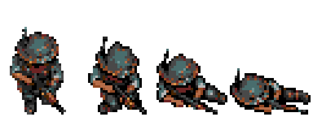
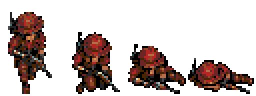

# Morte de Damião e Dinorah

Quatro quadros por personagem: sprite original, joelhos cedendo, queda lateral e corpo no chão. A animação ocorre no local da morte; movimento, tiros e inventário ficam suspensos. A tela de resultado aguarda a última pose por meio segundo. Pausar congela também a queda; reiniciar limpa os dois estados.




O primeiro quadro de cada sequência é copiado diretamente de `res/heroi/frames.bin` e `res/dinorah/frames.bin`: os mesmos pixels do repouso sudeste usado pelo jogo, sem redesenho. O exportador confere essa identidade e registra os hashes em [export.json](export.json).

As três poses seguintes foram editadas com o **image_gen integrado** a partir de uma [ampliação dos sprites extraídos desses binários](source/runtime-reference-8x.png). [Prompt da correção](prompts/deaths-corrected.txt) e [fonte corrigida](source/deaths-corrected.png). A geração anterior em `source/deaths.png` foi substituída e não entra na ROM. O exportador recorta, registra, reduz por vizinho mais próximo, converte para PAL2 e empacota os desenhos. São células de 32×48 e uma queda para sudeste, espelhada para personagens voltados a oeste. Não há oito sequências direcionais distintas de morte.

Os oito quadros acrescentam 6144 bytes à ROM, sem nova paleta ou reserva de VRAM: cada ator reutiliza seus 24 tiles. As poses iniciais duram 150 ms (9 quadros NTSC / 8 PAL), e a última dura 500 ms. O relógio aguarda a transferência da pose quando o DMA está ocupado, evitando saltar desenhos. Os estados independentes permitem a morte simultânea dos dois.

```sh
python3 game/art/actor-deaths-v1/export.py --check
arch -x86_64 /usr/bin/python3 game/tools/test_actor_deaths_emulator.py
arch -x86_64 /usr/bin/python3 game/tools/test_actor_deaths_emulator.py --pal
```

Os testes usam RAM para preparar dano fatal por projétil e lava; a animação, o DMA, a pausa e o reinício executam o código de produção. Os relatórios em `validation/ntsc` e `validation/pal` registram o hash da ROM validada, poses na VRAM, presença das duas peças de sprite, espelhamento, morte simultânea e limpeza ao reiniciar.

As duas regiões passaram também por `test_training_emulator.py --only-routes`: travessia e escolta completas, falha por projétil, quatro poses antes do resultado congelado e reinício com vida cheia. Resultados: [NTSC](validation/ntsc/training-report.json) e [PAL](validation/pal/training-report.json). A suíte `game/tools/check.py` passou nas verificações gerais de recursos, mira, inimigos e áudio.

## Prévia na fase de teste

No título, abra **FASE TESTE → 9. ANIMAÇÕES DE MORTE**. A sala mostra os dois personagens e inicia a morte dos dois em repetição. **A** reproduz novamente; **C** alterna Damião, Dinorah e os dois, reiniciando a prévia imediatamente; **START → CONFIGURAR TESTE** escolhe Damião/Dinorah/os dois, lado da queda, velocidade 1×/½×/¼× e repetição. Com repetição desligada, a última pose permanece visível. A pausa congela a sequência e reiniciar/trocar de sala limpa os estados. Os inimigos continuam na sala 1, com o comando **MOSTRAR MORTE**.

A prévia usa o mesmo renderizador e os mesmos frames da campanha; não reduz vida nem encerra a tentativa. Validação por controles, sem escrever na RAM: [NTSC](validation/training-ntsc/report.json) e [PAL](validation/training-pal/report.json).

```sh
arch -x86_64 /usr/bin/python3 game/tools/test_training_emulator.py --only-deaths --output game/art/actor-deaths-v1/validation/training-ntsc
arch -x86_64 /usr/bin/python3 game/tools/test_training_emulator.py --only-deaths --pal --output game/art/actor-deaths-v1/validation/training-pal
```

A regressão completa do treino na revisão anterior passou na galeria de inimigos, nas mortes, nos menus e nos percursos, mas apontou falha em `item-bench` (`dummy did not freeze`). O [relatório](validation/training-regression-ntsc.json) mantém essa falha explícita; a suíte completa não está marcada como aprovada.
