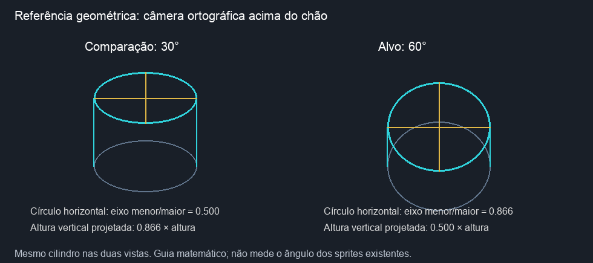

# Auditoria da câmera — 19/10/2026

Esta auditoria trata da versão 1. O [redesenho atual está na versão 2](../camera-60-redraw-v2/README.md).

**Resultado: nenhum dos 14 personagens atuais está aprovado para a câmera a 60° acima do chão.** A inspeção identifica inconsistência de perspectiva; não atribui um ângulo numérico aos desenhos.

Foram inspecionadas as 700 poses desenhadas: cinco direções × (quatro repouso + seis movimento) × 14 personagens. As outras 420 referências são espelhos horizontais exatos; os validadores verificam essa equivalência. Total: 112 direções e 1120 referências de quadro.

## Resultado por nome do projeto

| ID | Nome | Resultado visual |
|---|---|---|
| `heroi` | Damião | [Reprovado](contact-sheets/heroi.png): Rosto e tronco permanecem muito frontais; o topo do chapéu aparece estreito. |
| `sq_red` | Torreão | [Reprovado](contact-sheets/sq_red.png): N/S exibem bastante dorso, mas L/O expõem um perfil muito mais baixo. |
| `sq_yellow` | Batedor | [Reprovado](contact-sheets/sq_yellow.png): L/O têm corpo quase horizontal de perfil e pouca área dorsal. |
| `sq_purple` | Baluarte | [Reprovado](contact-sheets/sq_purple.png): Área visível das placas dorsais muda muito de N/NE para L/O. |
| `sq_orange` | Aríete | [Reprovado](contact-sheets/sq_orange.png): As vistas laterais achatam o dorso e mostram o corpo de perfil. |
| `tri_red` | Fuzileiro | [Reprovado](contact-sheets/tri_red.png): L/O mostram tórax e abdômen de perfil; as vistas N/S têm maior leitura dorsal. |
| `tri_yellow` | Caçador | [Reprovado](contact-sheets/tri_yellow.png): L/O e SE/SO mantêm uma elevação visual baixa do corpo. |
| `tri_purple` | Escudeiro | [Reprovado](contact-sheets/tri_purple.png): A proporção dorsal/lateral do tórax muda entre direções e quadros. |
| `tri_orange` | Adaga | [Reprovado](contact-sheets/tri_orange.png): As vistas laterais mostram mais flanco do que dorso. |
| `pen_red` | Artilheiro | [Reprovado](contact-sheets/pen_red.png): Cabeça e abdômen aparecem de perfil em L/O, com pernas altas sob o corpo. |
| `pen_yellow` | Alcateia | [Reprovado](contact-sheets/pen_yellow.png): L/O mostram o corpo baixo de perfil, enquanto N/S exibem o topo do abdômen. |
| `pen_purple` | Fortaleza | [Reprovado](contact-sheets/pen_purple.png): Placas do abdômen e a grande cabeça mudam de exposição entre N/NE e L/O. |
| `pen_orange` | Meteoro | [Reprovado](contact-sheets/pen_orange.png): O corpo em L/O permanece quase de perfil. |
| `boss` | Lacraia | [Reprovado](contact-sheets/boss.png): N/NE têm leitura dorsal mais elevada, mas L/O mostram cauda e corpo de perfil. |

Os espelhos SO, O e NO herdam os mesmos problemas de SE, L e NE. Ter oito arquivos/direções não demonstra a elevação da câmera. Os resultados detalhados, limites da análise e hashes das folhas inspecionadas estão em [audit.json](audit.json). As pranchas mostram todas as poses canônicas, sem alterar os pixels dos desenhos.

## Critério para corrigir

A referência é câmera ortográfica a **60° acima do plano do chão**, isto é, 30° em relação à vertical. A câmera permanece fixa; o personagem gira no chão. Não é o ângulo de uma diagonal da grade.

Para uma câmera alinhada com o eixo Y, uma projeção possível é `tela_x = x` e `tela_y = y·sin(60°) − z·cos(60°)`, com sinais adaptados à orientação dos eixos. Um círculo horizontal projeta razão eixo menor/maior de `sin(60°) ≈ 0,866`; uma altura vertical projeta fator `cos(60°) = 0,5`. Estes valores valem para a geometria do guia, não são medições do chapéu ou dos insetos.

É necessário redesenhar o topo do chapéu/cabeça, ombros, dorso, volumes e oclusões das pernas sob esta mesma referência. Girar ou achatar o PNG inteiro não recompõe esses volumes. Antes de animar novamente, as vistas-base precisam manter a mesma construção; a aprovação numérica exata exige uma referência 3D ou geometria conhecida.

## Outros personagens ainda no projeto

Os nove mechs antigos da galeria (`AZUL PEQ/MED/ELITE`, `VERM PEQ/MED/ELITE`, `VERDE PEQ/MED/ELITE`) também não constituem vistas calibradas a 60°. O código em [chars.c](../../src/system/video/chars.c) gira um desenho no plano e aplica espelhamento vertical para as vistas ao sul. Eles permanecem como arte legada. `dummy` (Dummy) e `target` (Alvo) mantêm o placeholder de teste, sem conjunto novo de oito vistas.

## Estado dos arquivos e testes

Esta revisão não redesenhou os sprites nem alterou a ROM. Os testes de formato PNG, paleta, transparência, quadros, espelhamento, empacotamento e orçamento de sprites continuam separados da aprovação artística. Os relatórios dos dois pacotes passam a indicar explicitamente **checagens técnicas aprovadas; câmera reprovada**. Memória e tamanho da ROM não mudaram nesta revisão.

Para reproduzir as pranchas, execute `python3 game/art/camera-60-audit/build_contacts.py` a partir do projeto. `review.py` só associa o parecer ao PNG cujo SHA-256 corresponde ao arquivo inspecionado; uma nova versão fica sem revisão até nova inspeção.
