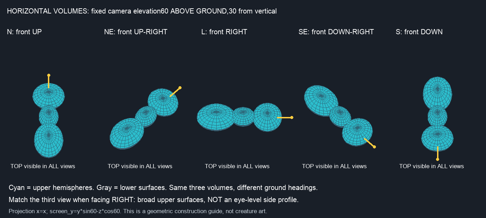
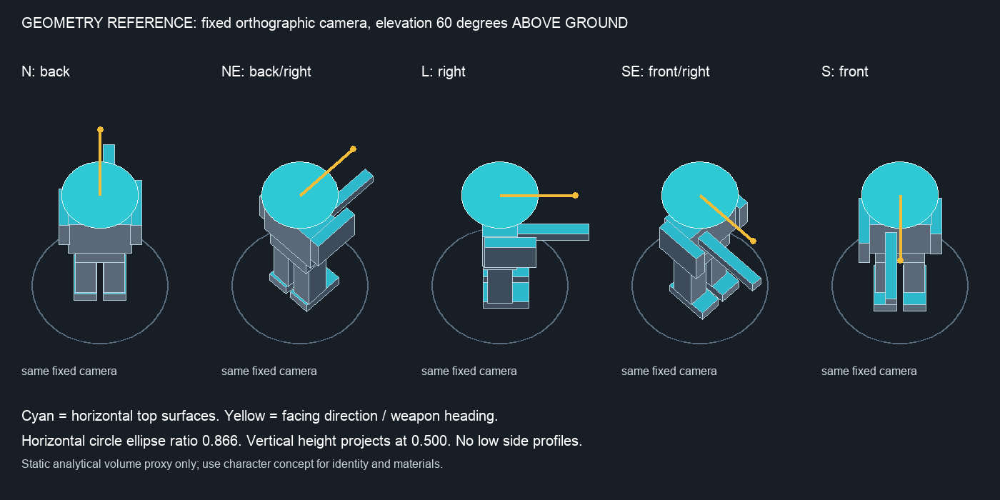

# Redesenho da câmera — versão2

Damião e os 13 inimigos foram redesenhados usando uma **câmera ortográfica a 60° acima do chão** como referência. O guia foi calculado por projeção; os sprites são desenhos 2D comparados visualmente com ele, sem certificação numérica de câmera 3D.

O topo do chapéu, ombros, dorso, cabeça e carapaças passa a orientar as vistas; as laterais também são vistas de cima. Foram revistas todas as 700 referências de quadros canônicos na resolução nativa. As 420 restantes são espelhos horizontais verificados por código.

## Arquivos atuais

- [Damião: PNGs, animações, paleta, declaração SGDK e ZIP](../cangaco-protagonista-iso60-v2/README.md).
- [13 inimigos: PNGs, animações, paleta, declarações SGDK e ZIP](../cangaco-insects-iso60-v2/README.md).
- [Parecer por personagem e hashes exatos](audit.json).
- [Inventário das folhas revisadas](inventory.json).

| ID | Nome do projeto | Todas as poses nativas |
|---|---|---|
| `heroi` | Damião | [Prancha](contact-sheets/heroi.png) |
| `sq_red` | Torreão | [Prancha](contact-sheets/sq_red.png) |
| `sq_yellow` | Batedor | [Prancha](contact-sheets/sq_yellow.png) |
| `sq_purple` | Baluarte | [Prancha](contact-sheets/sq_purple.png) |
| `sq_orange` | Aríete | [Prancha](contact-sheets/sq_orange.png) |
| `tri_red` | Fuzileiro | [Prancha](contact-sheets/tri_red.png) |
| `tri_yellow` | Caçador | [Prancha](contact-sheets/tri_yellow.png) |
| `tri_purple` | Escudeiro | [Prancha](contact-sheets/tri_purple.png) |
| `tri_orange` | Adaga | [Prancha](contact-sheets/tri_orange.png) |
| `pen_red` | Artilheiro | [Prancha](contact-sheets/pen_red.png) |
| `pen_yellow` | Alcateia | [Prancha](contact-sheets/pen_yellow.png) |
| `pen_purple` | Fortaleza | [Prancha](contact-sheets/pen_purple.png) |
| `pen_orange` | Meteoro | [Prancha](contact-sheets/pen_orange.png) |
| `boss` | Lacraia | [Prancha](contact-sheets/boss.png) |

## Construção e limites da revisão

A projeção do guia usa `tela_x=x` e `tela_y=y·sin60°−z·cos60°`. Um círculo horizontal projeta razão de eixos 0,866; uma altura vertical projeta fator 0,5. A câmera fica fixa enquanto os volumes giram no chão.

As oito direções são N, NE, L, SE, S, SO, O e NO. Cinco são desenhadas; SO/O/NO espelham SE/L/NE horizontalmente. A simetria também muda o lado aparente de implantes e armas. Não se aplica espelhamento vertical para simular frente/costas.

A versão 1 continua preservada e [reprovada na auditoria anterior](../camera-60-audit/README.md). Os nove mechs antigos e os placeholders `dummy`/`target` permanecem legados; este redesenho cobre o protagonista humano e os 13 inimigos atuais. A projeção do cenário não foi alterada neste trabalho.

## Fontes e animação

Os prompts exatos estão nos dois pacotes, nas pastas `prompts/`; os resultados originais e revisões estão em `originals/`. Toda a arte foi criada/editada com `image_gen` integrado. Os scripts fazem apenas segmentação por alfa, registro, escala por vizinho mais próximo, indexação e empacotamento. Os guias são diagramas geométricos, não sprites substitutos.

As folhas geradas têm espaçamento aproximado e podem incluir poses extras ou cortadas. O exportador separa corpos pelo alfa, descarta poses incompletas e registra o quadro de origem em `validation/export.json`. Meteoro compartilha uma pose neutra de passagem entre repouso e corrida L/O; Fortaleza tem seis poses extras dedicadas à corrida L/O. Cada animação exportada mantém quatro quadros distintos de repouso e seis distintos de movimento.

`review.py` associa a revisão ao SHA-256 exato do PNG. Qualquer nova exportação que mude o PNG perde automaticamente o parecer até nova revisão. Os testes técnicos e a auditoria de memória ficam separados da revisão visual.
