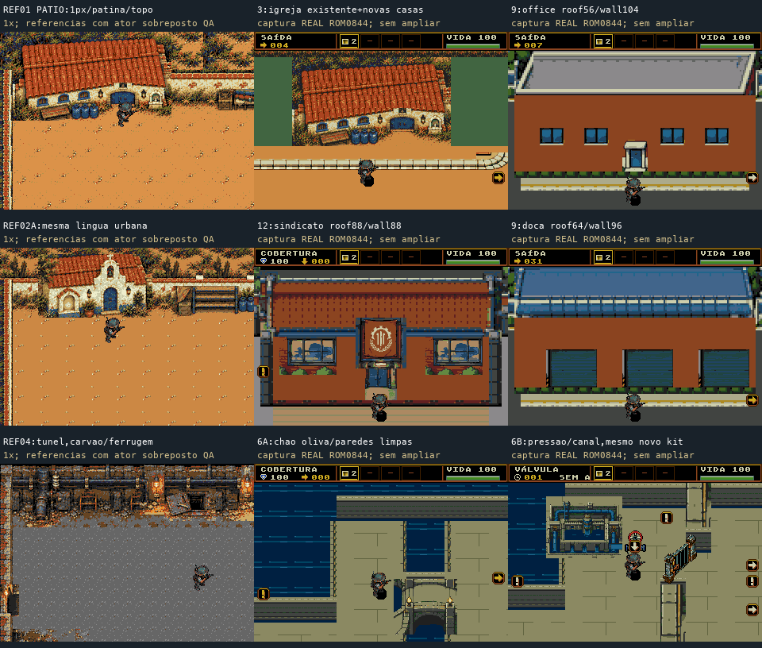
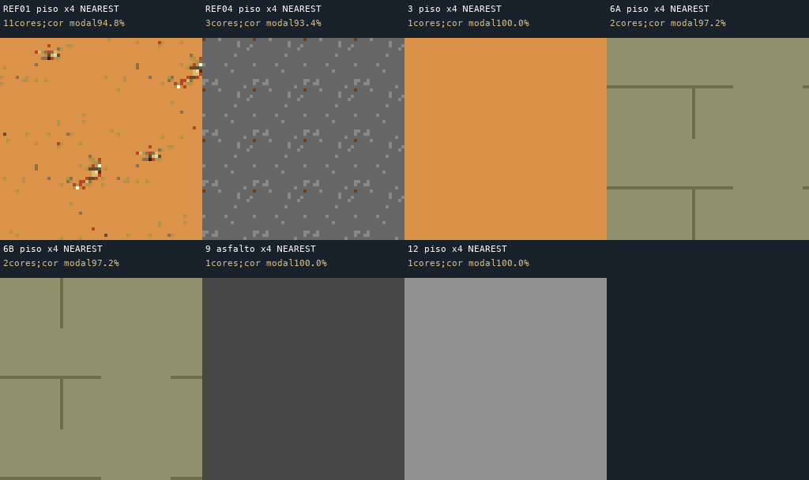

# Auditoria de estilo dos cinco corredores v3

O conjunto se afastou do estilo aprovado. A fase 9 é o desvio mais forte; 12 também muda projeção e materiais. 3 preserva a igreja, mas mistura seu acabamento com superfícies novas lisas. 6A e 6B compartilham um kit entre si, porém perderam a linguagem dos túneis existentes.

A aprovação anterior de marcos inteiros confirmou recorte, enquadramento e funcionamento. Ela deixou passar câmera/proporções, textura, escala relativa e continuidade do kit. Os pareceres `visual_runtime_accepted` anteriores não valem como aprovação desses critérios de estilo.

A prancha usa capturas reais da ROM 0844. Apenas os quadros das referências antigas receberam o mesmo sprite existente como sobreposição de escala para QA.

## Evidências principais

- **Câmera:** o guia, linha 11, exige visão ortográfica elevada próxima de 60°. A igreja de referência privilegia o telhado, com cerca de 60–65 px de topo e 25–30 px de fachada. Na 9, o escritório 304×160 usa 56 px de telhado e 104 px de frente; a doca usa 64/96. Na 12, o sindicato usa 88/88. São indicadores de predominância frontal, não medições de ângulo. Ajustar a câmera para caber o prédio manteve essa projeção diferente.
- **Escala:** o humano existente tem cerca de 33 px de tinta visível. A fachada do escritório 9 tem 104 px, aproximadamente três humanos, enquanto a frente da igreja antiga tem menos de um. Manter a célula 32×48 e uma porta alcançável não preservou a escala aparente do mundo.
- **Materiais:** nas referências, contornos, reboco, telhas e tubos têm desgaste irregular de 1 px. 9/12 usam estrutura reduzida em grade 2 px e grandes amostras de parede uniformes. A leitura ficou limpa e frontal, semelhante a outro pacote de assets.
- **Piso:** “quieto” virou “liso”. O recorte 64×64 do pátio antigo tem 94,8% de cor base, mas 11 cores em grãos esparsos. O túnel antigo tem 93,4% de base e 3 cores. Nos recortes 3/9/12, 100% dos pixels são da mesma cor. 6A e 6B têm duas cores usadas sobretudo em juntas retas. Esses números descrevem as amostras, não são notas de qualidade.

## Diagnóstico por fase

| Fase | O que preservou | O que precisa mudar |
|---|---|---|
|3|Igreja reconhecível, ocre, portas azuis, destino.|Piso extraído de 1 px e reboco de 1 px produzem campos lisos junto à igreja detalhada; recuperar materiais do próprio kit.|
|6A|Canal, caminho seco, ponte e destino.|Pavimento oliva, água em traços regulares e limites finos têm acabamento muito diferente do túnel carvão/ferrugem de referência.|
|6B|Mesmo ramo visual de 6A, válvulas/portões e consequência.|Herda a ruptura de materiais de 6A; equipamento detalhado fica isolado em pavimento limpo.|
|9|Intenção industrial e volumes funcionais.|Prioridade máxima: projeção frontal, paredes chapadas, paisagismo limpo e nova biblioteca de ruas. Reutilizar kit urbano da 3 e metal/tubos existentes, como pede o guia 528–539.|
|12|Entrada sindical, faixa vermelha, percurso e escolta.|Fachada frontal e piso cinza sem placas/canais. Seis anexos iguais preencheram vazios, mas deram ritmo de garagens repetidas; falta ligação visual com infraestrutura do estaleiro.|

## Ordem recomendada

1. Produzir uma prova isolada 320×224 em 1x/2xcom atores existentes e o kit original, antes de ampliar o corredor inteiro. Aprovar projeção e materiais nessa escala.
2. Corrigir 9 primeiro, reutilizando arquitetura/pisos/portões nativos. Texturar os mesmos prédios frontais não corrige a câmera.
3. Recuperar grão esparso 1 px, reboco gasto e ferrugem localizada em juntas e contatos. Preservar o piso de baixo contraste; não aplicar ruído aleatório global.
4. Normalizar 12 para o estaleiro e 6A/Bpara o túnel existente. Em 3, preservar a igreja e corrigir a transição dos materiais.
5. Revisar o panorama e os pares de chegada 3→4,9→10/11 e 12→13. Depois validar novamente runtime e desempenho.

Esta auditoria não mede novos FPS. Caber em 640 tiles comprova orçamento de VRAM; não demonstra fluidez em combate normal. O relato de engasgo exige investigação de desempenho separada.

Somente os arquivos desta pasta de revisão foram criados. Nenhuma arte, manifesto, banco, C, ROM ou emulador foi alterado. Coordenadas, linhas e referências detalhadas estão em [report.json](report.json).
