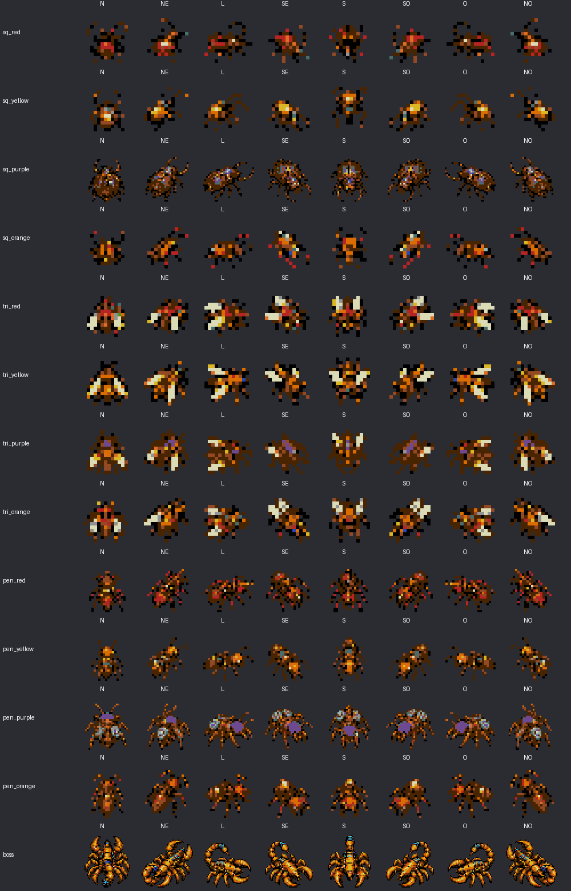

# Revisão de sprites e orientação — 22/10/2026

Foram inspecionadas as 390 poses canônicas dos treze insetos e suas 234 referências espelhadas. As direções seguem N, NE, L, SE, S, SO, O, NO. A conferência visual usa cabeça, antenas/mandíbulas, abdômen e pinças para identificar a frente do personagem.



| Inimigo | Resultado |
|---|---|
| Torreão | Vistas e poses mantidas, conferidas |
| Batedor | A fonte SE apontava para NO; seis poses SE redesenhadas |
| Baluarte, besouro grande | Três primeiras poses SE apontavam para SO; corrigidas por HFLIP individual, incluindo os espelhos SO |
| Aríete | Vistas e poses mantidas, conferidas |
| Fuzileiro | Vistas e poses mantidas, conferidas |
| Caçador | Vistas e poses mantidas, conferidas |
| Escudeiro | Vistas e poses mantidas, conferidas |
| Adaga | A fonte NE apontava para SO; seis poses NE redesenhadas |
| Artilheiro | Vistas e poses mantidas, conferidas |
| Alcateia | Vistas e poses mantidas, conferidas |
| Fortaleza | HFLIP das linhas NE/L/SE efetivamente aplicado; o exportador usava o índice da iteração anterior, sempre 4 |
| Meteoro | Vistas e poses mantidas, conferidas |
| Escorpião | Vistas mantidas; investida segue a velocidade travada; recuo à distância continua encarando o jogador |
| Dummy e alvo frágil | Sprites estáticos 24×24, posição e ausência de HFLIP/VFLIP conferidas na ROM |

As quatro folhas de conferência mostram as seis poses por direção: [Baluarte](sq_purple-all-poses.png), [Fortaleza](pen_purple-all-poses.png), [Batedor](sq_yellow-all-poses.png) e [Adaga](tri_orange-all-poses.png).

Na orientação em jogo, gelo e recuo após impacto conservam a direção anterior; preparação e execução da investida usam a velocidade travada. Inimigos parados respeitam o alvo da perseguição, inclusive nos objetivos com aliado. Sobrepor os centros não escolhe uma diagonal arbitrária. Mudanças que exigem apenas HFLIP acontecem mesmo sem banda de DMA para a próxima pose. Reutilizar um slot com outro tipo reinicia a detecção de movimento.

As duas novas linhas foram produzidas com **image_gen integrado**, preservando a identidade e a transparência. Fontes: [Batedor SE](../../originals/sq_yellow-se-direction-fix.png) e [Adaga NE](../../originals/tri_orange-ne-direction-fix.png). Prompts exatos: [Batedor](../../prompts/sq_yellow-direction-fix.txt) e [Adaga](../../prompts/tri_orange-direction-fix.txt). O [manifesto](../../direction_corrections.json) registra substituições e espelhamentos por pose; o exportador mantém a escala e a paleta nativas e registra hashes em [export.json](../export.json).

Validação atual:

- [Assets](../assets.json): 624 referências, dimensões, margens, paleta, transparência, HFLIP e igualdade com os bytes de ROM.
- Teste nativo com AddressSanitizer/UndefinedBehaviorSanitizer: 1248 combinações na galeria e cenários de movimento, gelo, recuo, investida, alvo, falha de DMA e espelhamento, a 50/60 Hz.
- [Emulador NTSC](ntsc/report.json) e [PAL](pal/report.json): 624 combinações por região; cada upload em VRAM comparado byte a byte com o recurso empacotado; posições e flags verificadas na lista ativa de sprites do hardware. Os dois tipos de alvo legado também foram conferidos.
- Build e verificações de recursos, jogador e áudio em `game/tools/check.py`. Os relatórios históricos `runtime.json`/`combat.json` pertencem à integração anterior; o antigo harness C completo não faz parte deste ensaio.

Os testes do emulador entram na galeria pelo controle e usam RAM para fixar direção e relógio da animação. Não alteram a ROM. São verificações em Genesis Plus GX, sem teste em console físico. Os hashes da build estão nos relatórios por região e em [summary.json](summary.json).

```sh
python3 game/tools/check.py
arch -x86_64 /usr/bin/python3 game/tools/test_enemy_facing_emulator.py
arch -x86_64 /usr/bin/python3 game/tools/test_enemy_facing_emulator.py --pal
```
