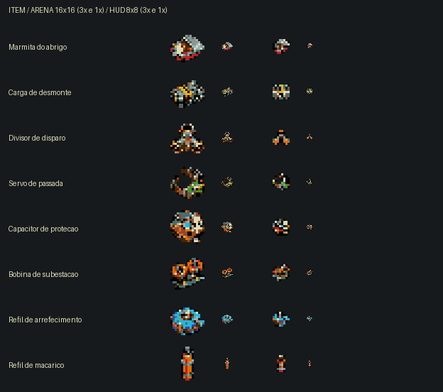

# Itens de Plaguefall — sprites e ícones v1

> Versão anterior preservada para comparação. A revisão aplicada agora é
> [v2 — formas simples e contorno claro](../cangaco-itens-v2/README.md).

Oito objetos do concept aprovado, aplicados nos pickups da arena, na ajuda,
no inventário, nos modos de tiro e nos objetivos de coleta. Os IDs internos,
efeitos, áreas de coleta, pesos e quantidades permanecem iguais.



| ID do projeto | Objeto | Arena 16×16 | Interface 8×8 |
|---|---|---|---|
| `heart` | Marmita do abrigo | [PNG](native/heart-world.png) | [PNG](native/heart-hud.png) |
| `bomb` | Carga de desmonte | [PNG](native/bomb-world.png) | [PNG](native/bomb-hud.png) |
| `shots` | Divisor de disparo | [PNG](native/shots-world.png) | [PNG](native/shots-hud.png) |
| `speed` | Servo de passada | [PNG](native/speed-world.png) | [PNG](native/speed-hud.png) |
| `shield` | Capacitor de proteção | [PNG](native/shield-world.png) | [PNG](native/shield-hud.png) |
| `chain` | Bobina de subestação | [PNG](native/chain-world.png) | [PNG](native/chain-hud.png) |
| `ice` | Refil de arrefecimento | [PNG](native/ice-world.png) | [PNG](native/ice-hud.png) |
| `fire` | Refil de maçarico | [PNG](native/fire-world.png) | [PNG](native/fire-hud.png) |

As duas versões preservam os sinais principais: pano vermelho e comida na marmita,
faixa amarela na carga, três saídas no divisor, abertura do servo, núcleo ciano
do capacitor, dois anéis de cobre da bobina e proporções diferentes dos refis.
Na ajuda, a coluna “ICONE” permite comparar o objeto com seu símbolo pequeno.

## Arquivos e exportação

- [Atlas nativo da arena — 64×32](native/items-world.png).
- [Atlas nativo da interface — 32×16](native/items-hud.png).
- [Paleta RGB](palette.json) e [paleta Mega Drive](palette-md.bin), idênticas à PAL1 existente.
- [Prompts e procedência](generation.json); originais e prompts individuais em `source/`.
- [Exportador reproduzível](export.py).

Arte criada com **image_gen integrado**, usando os concepts de `art/concepts/itens/`
como referência. O gerador entregou imagens ampliadas: o exportador recorta cada
desenho, registra por vizinho mais próximo e converte para a paleta do jogo.
O ícone usa o segundo desenho simplificado gerado para cada item, separado do
desenho da arena. A perspectiva da arena tem como direção artística a câmera
a 60° acima do chão; estes assets não alteram o sistema de projeção do jogo.

Todos os PNGs em `native/` são indexados, 4 bits por pixel, índice 0 transparente,
até 15 cores visíveis, sem pixels semitransparentes. As prévias ampliadas são
arquivos separados e usam exclusivamente vizinho mais próximo.

Os char-maps 16×16 exportados alimentam o pintor de tiles existente em
`src/system/video/sprites/items_data.h`; os ícones são palavras 4bpp em
`src/system/video/sprites/item_icons_data.h`. Não se usa o motor SPRITE do SGDK
para o HUD: ele continua no plano de tiles. Os oito objetos usam seus antigos
32 tiles; seis ícones usam os endereços anteriores e dois novos tiles atendem
ao divisor e ao servo.

## Verificação

Build release limpo realizado em cópia temporária das fontes atuais. ROM testada:
[`game/out/itens/rom.bin`](../../out/release/rom.bin). Não substitui a saída de outros
trabalhos em `out/release/`.

- [Validação dos arquivos](validation/assets.json): dimensões, indexação, transparência e paleta.
- [Teste no Genesis Plus GX](validation/emulator/report.json): os oito objetos na arena,
  oito ícones na ajuda, cinco tipos no inventário e três modos ativos; 3.168 comparações
  de pixels opacos com os PNGs nativos. Coletas e ativação executam o código real;
  o teste apenas posiciona o jogador pela RAM volátil do emulador.
- [Memória](validation/memory.json): ROM 768 KiB; RAM estática total 6.159 bytes;
  heap livre observado 47.338 bytes. Crescimento dos itens: 64 bytes de VRAM,
  64 bytes no buffer temporário de boot, zero RAM persistente, zero peças extras
  de sprite e zero DMA adicional de arte dos itens por quadro. Não é uma medição
  nova do desempenho com 15 inimigos.
- [Captura dos itens na arena](validation/emulator/arena-items-3x.png).
- [Captura da ajuda](validation/emulator/help-inventory-3x.png).
- [Captura do inventário](validation/emulator/hud-fire-chain-ice-3x.png).

Reproduzir a exportação a partir desta pasta:

```sh
python3 export.py
```

O teste do emulador recebe caminhos explícitos da ROM e do ELF com símbolos:

```sh
arch -x86_64 /usr/bin/python3 tests/emulator.py --rom ../../out/itens/rom.bin --symbols ../../out/itens/rom.out
```
