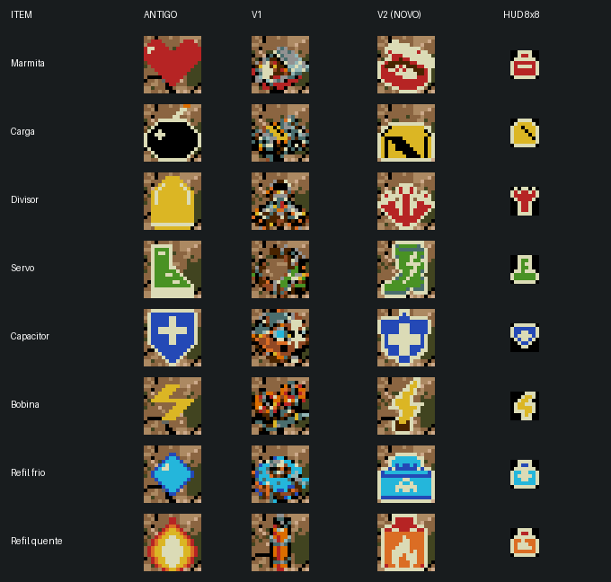
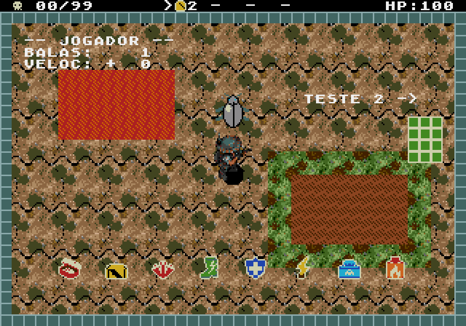

# Itens v2 — leitura de coletáveis

Revisão aplicada nos pickups da arena e nos ícones da interface. Mantém os IDs,
nomes, efeitos, áreas de coleta, dimensões e paleta da versão anterior.



## Mudança visual

- Formas pictográficas, com **duas ou três cores por item**.
- Contorno contínuo no **índice 1 da PAL1**, o mesmo branco claro dos antigos.
- Símbolos grandes para a função: três disparos, bota, escudo, raio, gelo e fogo.
- Marmita vermelha e carga amarela mantêm silhuetas simples de recipientes.
- Sem ferrugem, parafusos, peças pequenas ou sombreamento com muitas cores.

O contorno ocupa pixels dentro das células existentes. Não é um sprite adicional.

## Arquivos finais

| ID do projeto | Item | Arena 16×16 | Interface 8×8 |
|---|---|---|---|
| `heart` | Marmita do abrigo | [PNG](native/heart-world.png) | [PNG](native/heart-hud.png) |
| `bomb` | Carga de desmonte | [PNG](native/bomb-world.png) | [PNG](native/bomb-hud.png) |
| `shots` | Divisor de disparo | [PNG](native/shots-world.png) | [PNG](native/shots-hud.png) |
| `speed` | Servo de passada | [PNG](native/speed-world.png) | [PNG](native/speed-hud.png) |
| `shield` | Capacitor de proteção | [PNG](native/shield-world.png) | [PNG](native/shield-hud.png) |
| `chain` | Bobina de subestação | [PNG](native/chain-world.png) | [PNG](native/chain-hud.png) |
| `ice` | Refil de arrefecimento | [PNG](native/ice-world.png) | [PNG](native/ice-hud.png) |
| `fire` | Refil de maçarico | [PNG](native/fire-world.png) | [PNG](native/fire-hud.png) |

[Atlas nativo da arena](native/items-world.png), [atlas do HUD](native/items-hud.png),
[paleta RGB](palette.json) e [paleta Mega Drive](palette-md.bin).
PNGs indexados de 4 bits, índice 0 transparente, mesma PAL1 dos inimigos/objetos.
As prévias ampliadas usam vizinho mais próximo e são arquivos separados.

## Origem e edição

Desenhos simplificados gerados com **image_gen integrado**, com os
[prompts completos e procedência](generation.json). Os originais estão em `source/`.
Os desenhos passaram por revisão direta nas grades nativas, usando a mesma
representação ASCII dos assets antigos: [16×16](source/world-glyphs.json) e
[8×8](source/hud-glyphs.json). Essas grades são os dados finais editáveis, não
as miniaturas ampliadas geradas pela ferramenta.

Essa revisão fecha o contorno que se perdia na redução e simplifica o HUD na
resolução em que ele realmente aparece. O [exportador](export.py) codifica as
grades em PNGs indexados, char-maps C e palavras 4bpp, e verifica dimensões,
paleta, limite de três cores e **100% dos pixels do perímetro no branco claro**.
A referência dos antigos foi extraída do commit `63fabb6` e está preservada em
[legacy-items_data.h](source/legacy-items_data.h).

```sh
python3 export.py
python3 compare.py
```

## Build e jogo real

[ROM testada](../../out/release/rom.bin), compilada em cópia temporária das fontes
atuais. A saída anterior em `out/itens/` permanece preservada.

- [Arquivos e contornos](validation/assets.json): oito sprites e oito ícones;
  100% dos pixels de perímetro em branco claro, semitransparência ausente.
- [Genesis Plus GX](validation/emulator/report.json): **4.730 comparações de pixels**
  com os PNGs finais. Oito pickups sobre terra/pedra e verde/lama, oito ícones
  na ajuda, cinco tipos no inventário e três modos ativos. O teste usa o código
  real para coleta e ativação; só posiciona jogador/itens pela RAM volátil.
- [Memória](validation/memory.json): **zero tiles, VRAM ou RAM persistente extras
  nesta revisão**, zero peças de sprite adicionais e zero DMA extra por quadro.
  Mantém os dois tiles de HUD já acrescentados na v1; em relação ao jogo antigo,
  esses dois tiles continuam custando 64 bytes. A ROM atual tem 896 KiB.
- [Build release](validation/build.log).



[Piso verde/lama](validation/emulator/arena-green-floor-3x.png) ·
[Inventário](validation/emulator/hud-fire-chain-ice-3x.png) ·
[Ajuda](validation/emulator/help-inventory-3x.png)

```sh
arch -x86_64 /usr/bin/python3 tests/emulator.py --rom ../../out/itens-v2/rom.bin --symbols ../../out/itens-v2/rom.out
```
