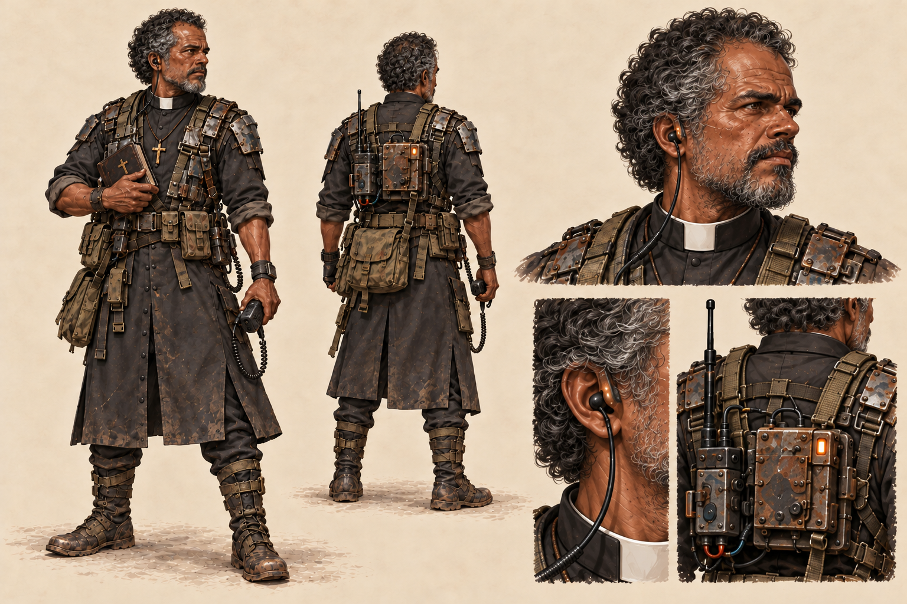

# Comando — padre da resistência

Comando é um padre brasileiro que coordena a rede de abrigos e rádios do Bando do Último Chão. Sua fé aparece no cuidado com as pessoas e na presença junto à comunidade. O indicativo de rádio continua sendo COMANDO.

A prancha segue a pintura digital realista, o fundo bege e os materiais recuperados dos concepts de [Rex](../protagonista/README.md) e da [parceira](../parceira/README.md). Mostra corpo inteiro em três quartos, costas, estudo de rosto e detalhes do rádio e do colarinho/crucifixo.

## Identidade visual

- Homem adulto de cerca de 55–60 anos, pele morena, cabelo encaracolado grisalho e barba curta com fios brancos.
- Camisa clerical preta e colarinho romano branco, batina adaptada, calça e bolsas de tecido.
- Crucifixo de metal gasto, livro de orações, rádio e fone com microfone.
- Cabeça descoberta, testa visível e cabelo grisalho; rádio na mochila, placas de proteção reaproveitadas e pequenos indicadores âmbar.

O colarinho branco e a barba grisalha distinguem o personagem no retrato de 48×48. O [sprite de conversa está integrado](../../dialogue-portraits-v1/README.md) no ID `P_COMANDO = 1`. Não foi adicionado um ator de Comando à arena.

Arte gerada com **image_gen integrado**, usando os concepts aprovados dos outros dois personagens como referências de estilo e materiais. O [prompt da revisão sem chapéu](prompt-v2.txt) está preservado. O PNG é uma prancha de concept de 1536×1024, com fundo opaco; o sprite usa uma geração própria com transparência e exportação técnica para Mega Drive.

A versão 2 remove o chapéu em todas as vistas e transfere a antena para o rádio da mochila, diferenciando a silhueta do padre da de Rex. A [primeira versão](comando-padre-cangaco-cyberpunk-v1.png) e seu [prompt](prompt-v1.txt) permanecem como histórico.
