# Concept art dos cenários de Plaguefall

21 pranchas de ambiente: uma para cada um dos 20 nós da campanha e uma do epílogo com duas condições da igreja. Cada prancha reúne uma vista da arena e estudos de elementos. Foco em cenário, materiais e história contada pelo espaço, sem personagens ou interface.

- [Galeria visual](galeria.html): pranchas em ordem, filtros e ampliação.
- [Guia de narrativa ambiental](guia-cenarios.md): o que preservar ao desenhar as telas.
- [Manifesto dos arquivos](manifest.json): imagens finais, prompts e referências de origem.
- [Campanha que orienta os ambientes](../../../doc/historia/campanha.md).

Criadas com **image_gen integrado**. Os prompts completos de geração e de revisão estão na pasta prompts. São referências de pré-produção: as imagens ainda não foram convertidas em tiles nem integradas à ROM. Câmera, escala e silhuetas precisam ser normalizadas na futura arte final.

## Pranchas

### Prólogo e fase 1 — Pátio da igreja

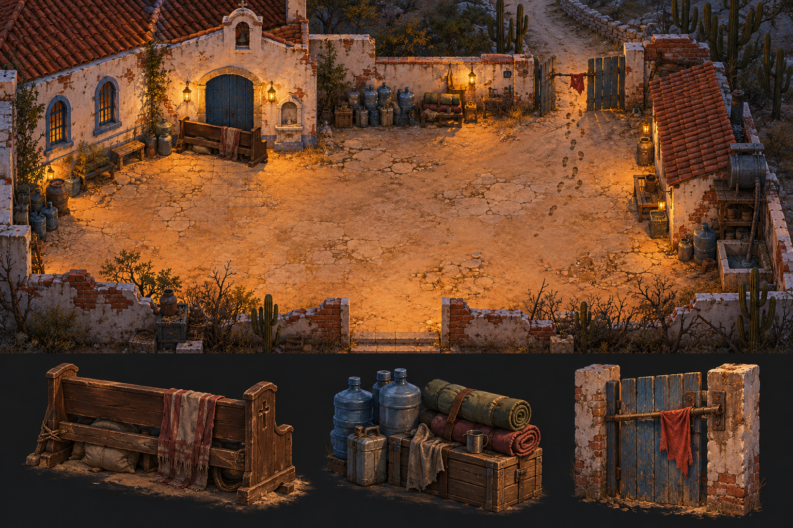

A fila saiu por aqui: bancos viraram barricada, recipientes de água ficaram junto à porta e o caminho dos fundos permanece aberto.

[Imagem completa](imagens/01-patio-igreja.png) · [Prompt da geração](prompts/01.txt)

### Fase 2A — Rua de serviço

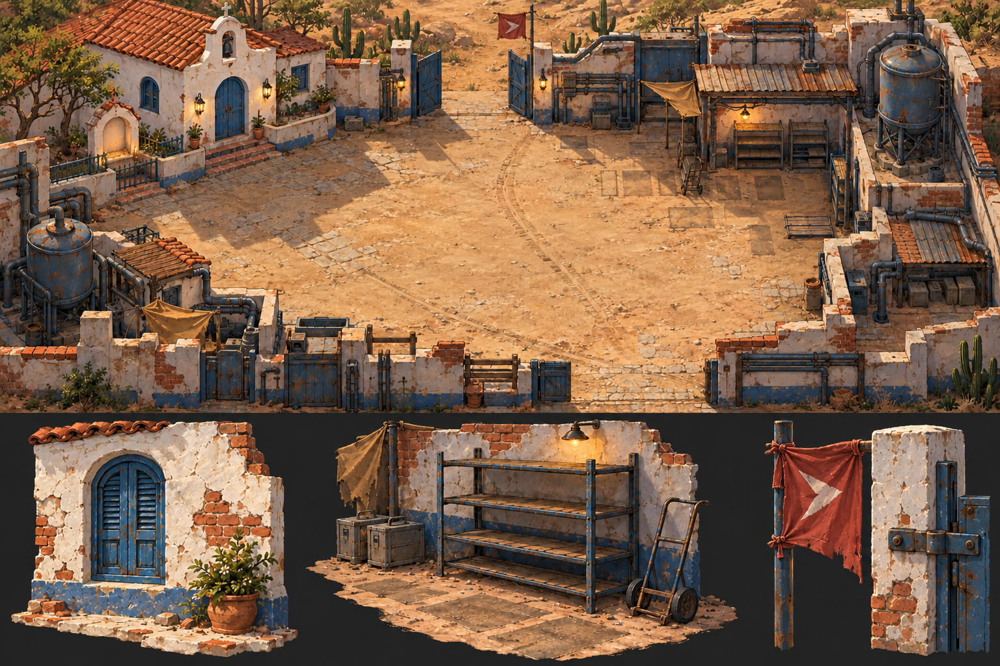

A igreja continua inteira; marcas ordenadas de passagem e espaços vazios dos suprimentos mostram uma evacuação concluída.

[Imagem completa](imagens/02a-rua-servico-v2.png) · [Prompt da geração](prompts/02a.txt)

### Fase 2B — Baixio da igreja danificada

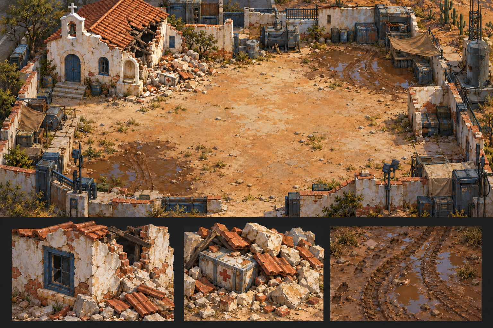

Telhas e reboco recém-caídos identificam o dano da bomba; suprimentos presos sob a parede explicam a perda e o desvio.

[Imagem completa](imagens/02b-igreja-danificada-v2.png) · [Prompt da geração](prompts/02b.txt)

### Fase 3 — Abrigo no galpão de manutenção

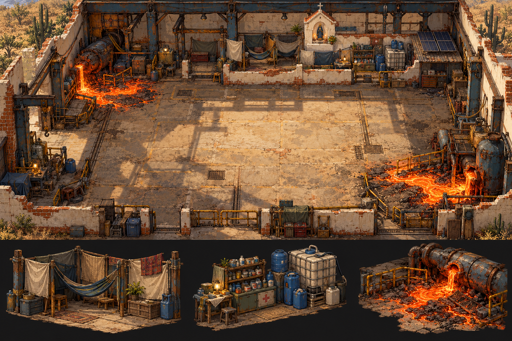

Redes, biombos e uma farmácia improvisada mostram quem depende da defesa; o passado industrial continua perigoso.

[Imagem completa](imagens/03-abrigo-manutencao.png) · [Prompt da geração](prompts/03.txt)

### Fase 4 — Túneis de manutenção

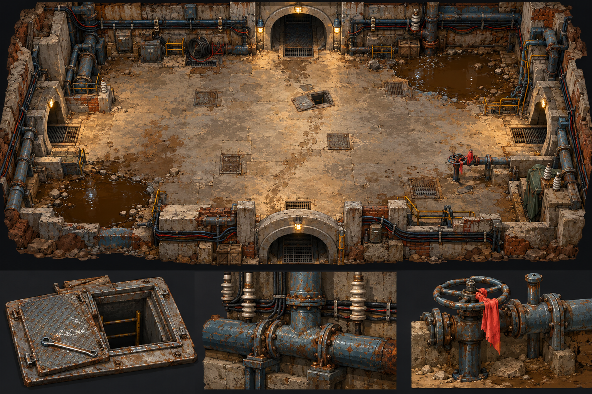

A passagem foi limpa para outras pessoas cruzarem depois: tampas abertas, marcas de ferramentas e uma rota seca ligam entrada e saída.

[Imagem completa](imagens/04-tuneis.png) · [Prompt da geração](prompts/04.txt)

### Fase 5 — Plataforma do sinalizador

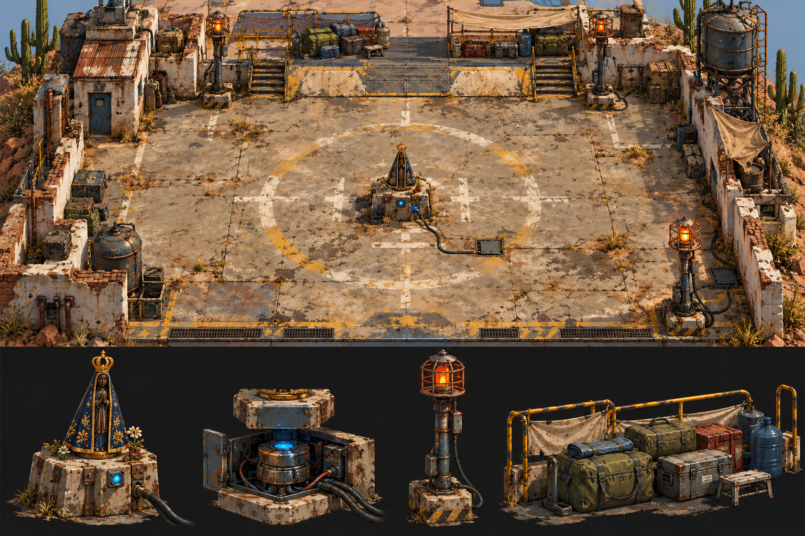

A santa retirada da igreja torna-se o centro da composição; os preparativos do embarque revelam a função do sinal.

[Imagem completa](imagens/05-sinalizador-santa.png) · [Prompt da geração](prompts/05.txt)

### Fase 6A — Perímetro do resgate

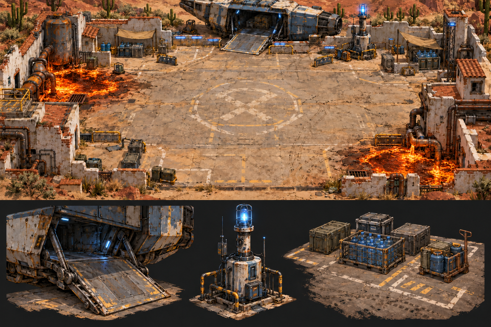

Marcas de embarque, a rampa recolhendo e o sinal confirmado contam que o povo conseguiu partir.

[Imagem completa](imagens/06a-resgate-v2.png) · [Prompt da geração](prompts/06a.txt)

### Fase 6B — Corredor da retirada

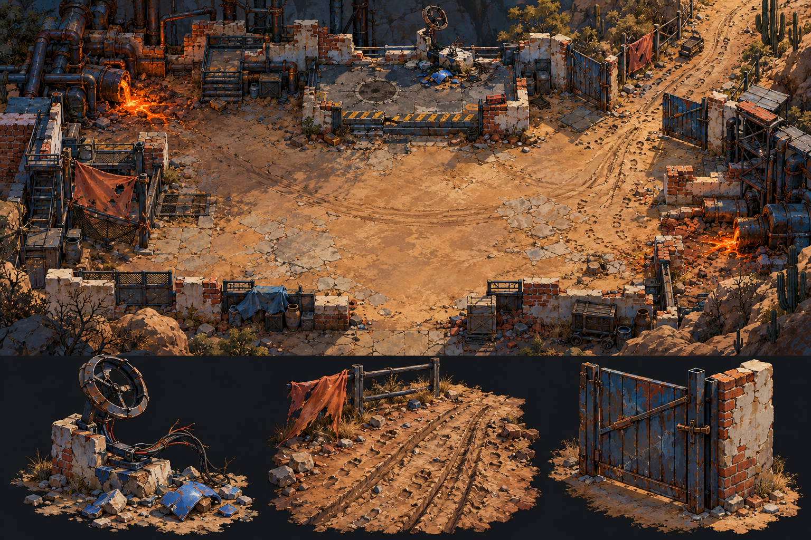

O sinal quebrado e as bagagens arrastadas para longe do pouso mostram que o resgate falhou e a saída passou a ser por terra.

[Imagem completa](imagens/06b-retirada.png) · [Prompt da geração](prompts/06b.txt)

### Fase 7 — Baixio das antenas

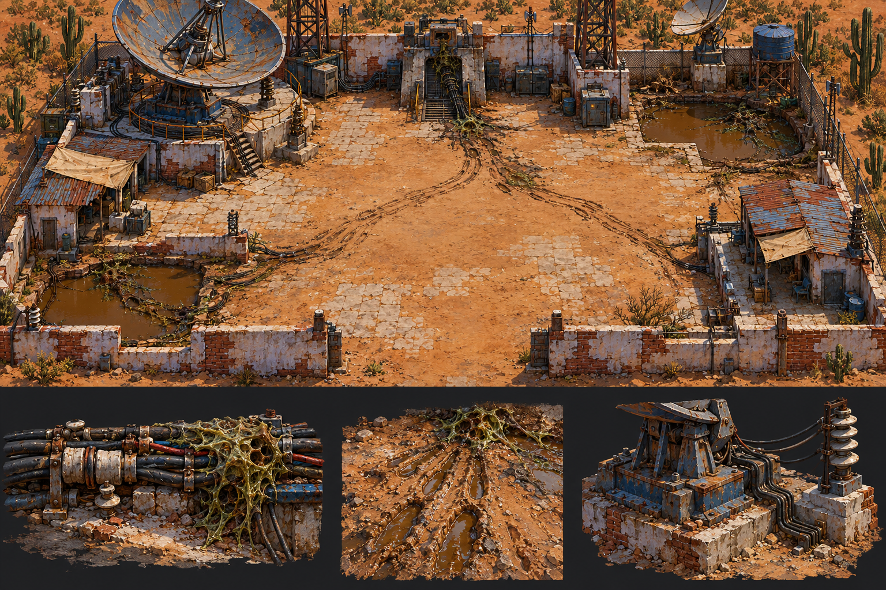

Rastros orgânicos seguem os mesmos cabos que antes ligavam a comunidade à base; a infraestrutura revela o rumo da investigação.

[Imagem completa](imagens/07-antenas.png) · [Prompt da geração](prompts/07.txt)

### Fase 8 — Fornalha e dutos de criação

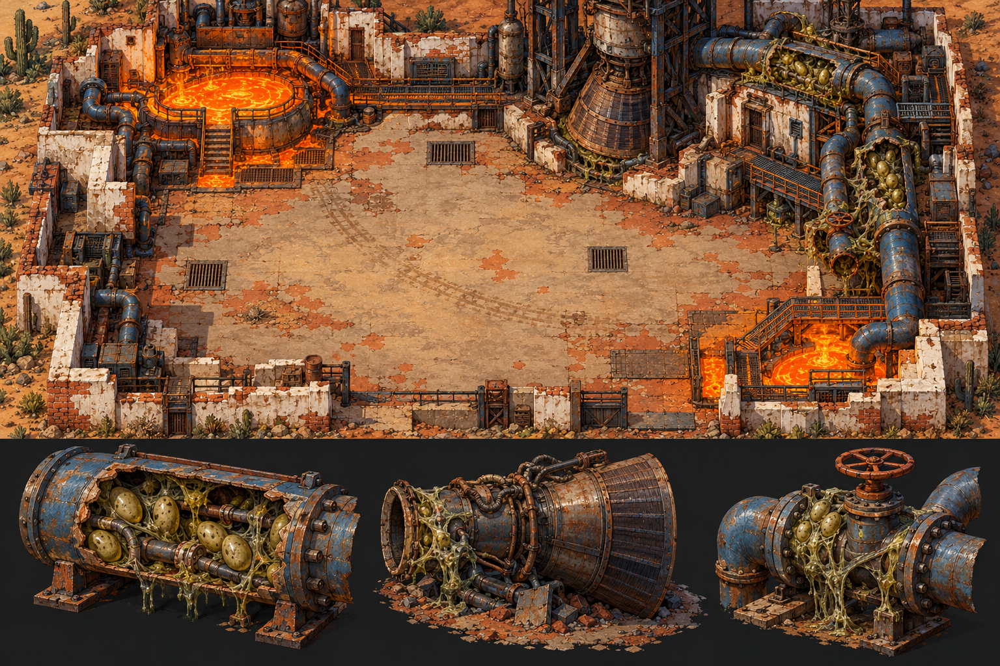

O jogador vê pela primeira vez como a máquina virou criadouro: ovos crescem no calor e na água dos dutos.

[Imagem completa](imagens/08-fornalha.png) · [Prompt da geração](prompts/08.txt)

### Fase 9 — Alfândega ocupada

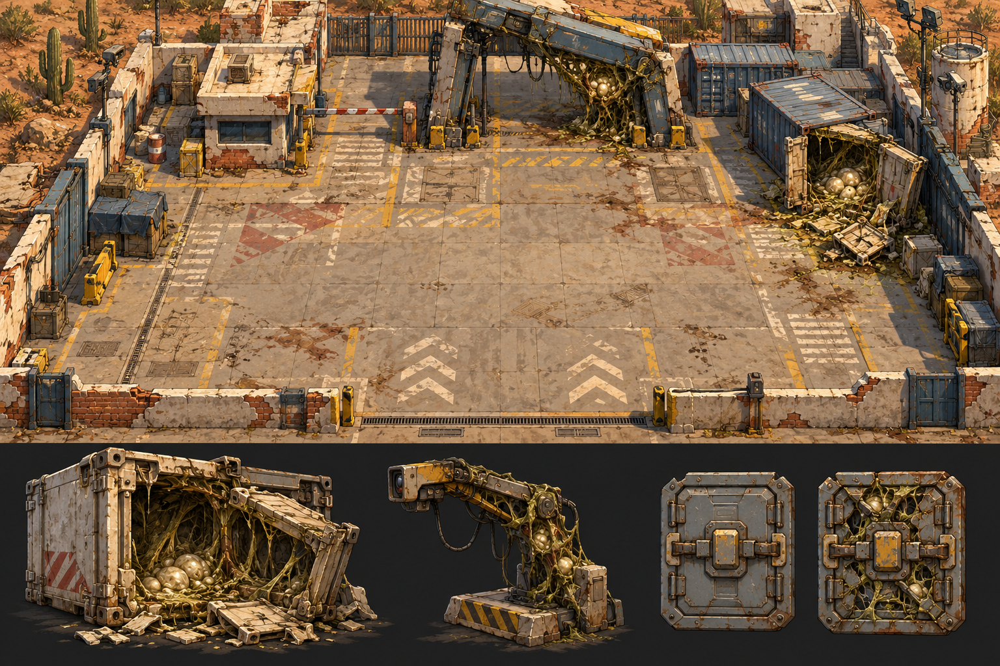

Caixas de carga abertas por dentro e equipamentos humanos incorporados à defesa mostram a origem e a adaptação da infestação.

[Imagem completa](imagens/09-alfandega.png) · [Prompt da geração](prompts/09.txt)

### Fase 10A — Acesso dos técnicos

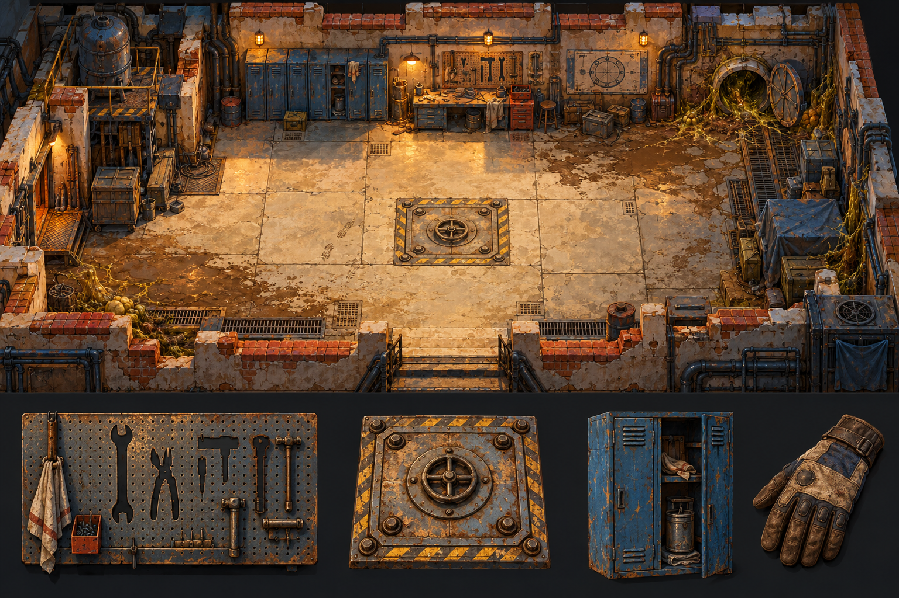

Armários e ferramentas identificam a antiga vida de Damião; a rota humana de manutenção ainda permite atravessar a instalação.

[Imagem completa](imagens/10a-acesso-tecnicos.png) · [Prompt da geração](prompts/10a.txt)

### Fase 10B — Dreno térmico

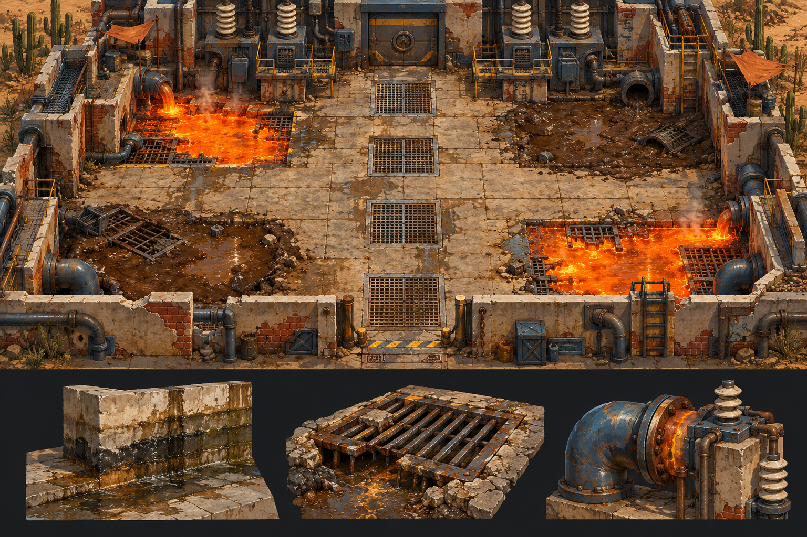

Níveis antigos de enchente, grades arrebentadas e calor vazando mostram o custo do desvio sob a base.

[Imagem completa](imagens/10b-dreno-termico.png) · [Prompt da geração](prompts/10b.txt)

### Fase 11 — Depósito de demolição

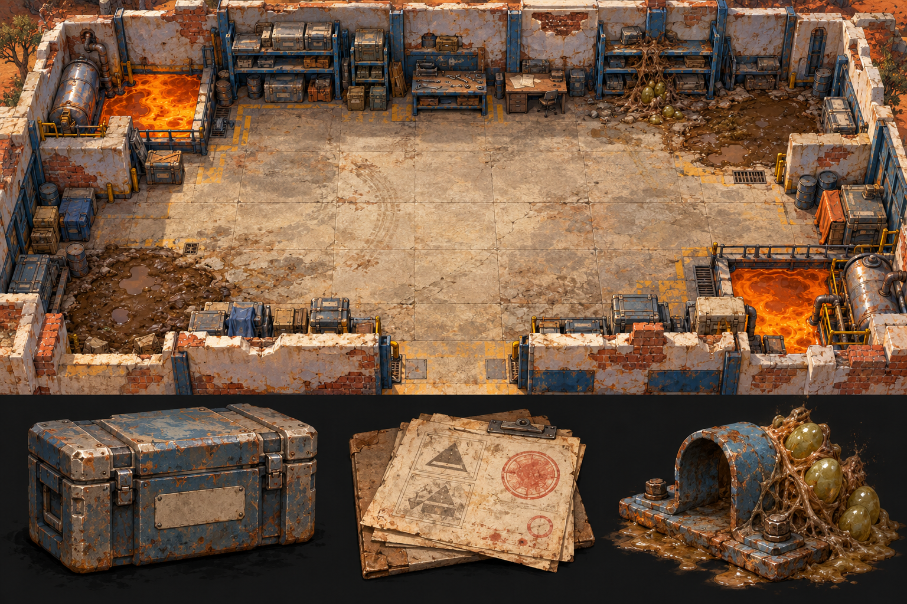

Cargas industriais, caixas ainda lacradas e alertas abandonados contam que havia recursos e conhecimento, mas as operações continuaram.

[Imagem completa](imagens/11-deposito.png) · [Prompt da geração](prompts/11-v2.txt)

### Fase 12 — Comporta de carga

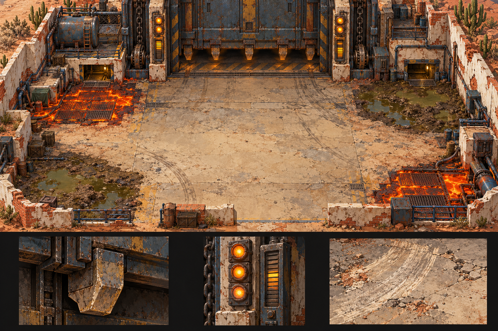

A comporta em movimento e os sinais mecânicos de fechamento tornam a janela de tempo visível antes do desvio.

[Imagem completa](imagens/12-comporta.png) · [Prompt da geração](prompts/12.txt)

### Fase 13A — Linha quente aberta

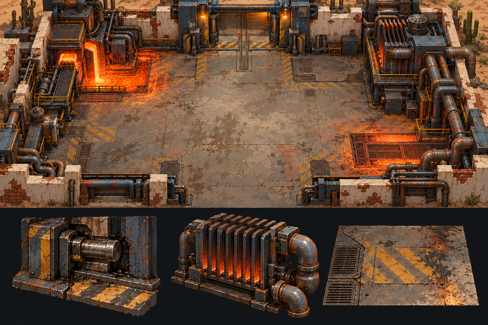

A passagem ainda aberta e o metal em resfriamento registram que Damião chegou dentro da janela.

[Imagem completa](imagens/13a-linha-quente.png) · [Prompt da geração](prompts/13a.txt)

### Fase 13B — Canal de decantação

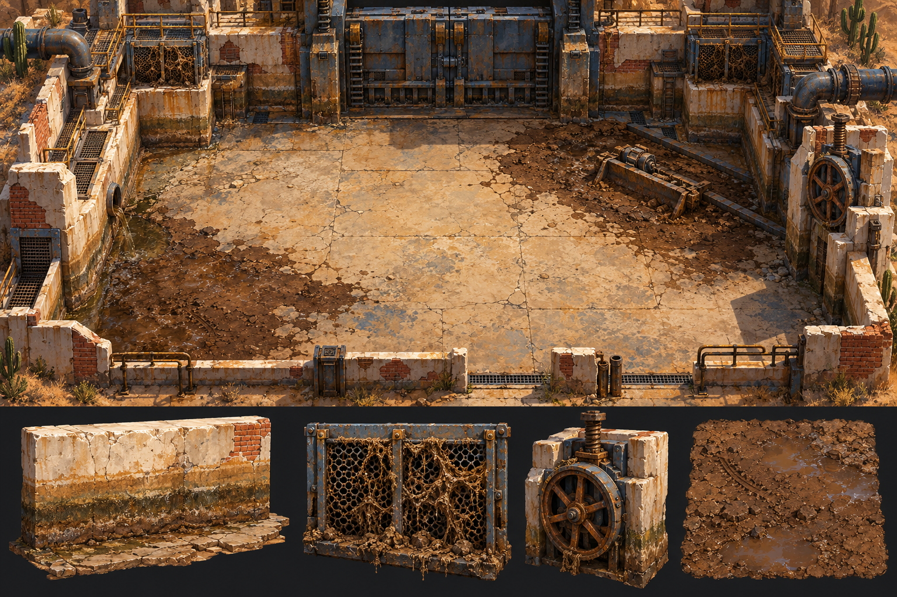

A comporta fechada aparece ao fundo; sedimento e ferrugem indicam a passagem mais lenta que precisou ser usada.

[Imagem completa](imagens/13b-decantacao.png) · [Prompt da geração](prompts/13b.txt)

### Fase 14 — Pátio dos enxames

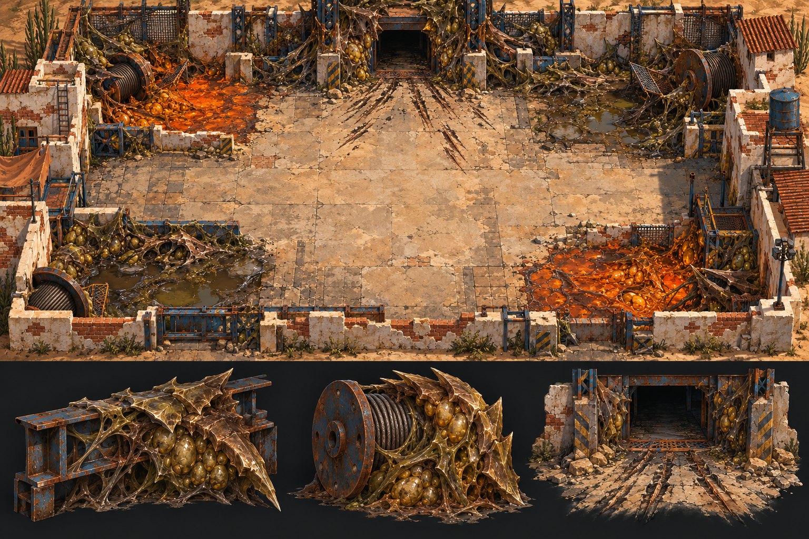

A ocupação passa de manchas a arquitetura: carapaças usam aço e cabos para fechar a aproximação da câmara.

[Imagem completa](imagens/14-patio-enxames.png) · [Prompt da geração](prompts/14.txt)

### Fase 15 — Boca das galerias

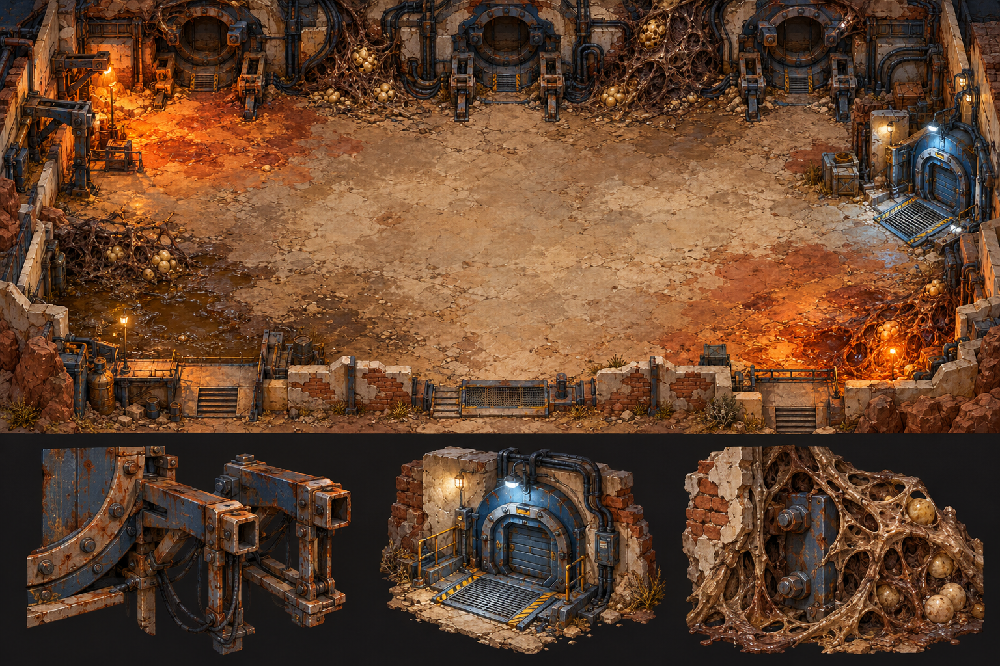

Suportes e pontos de inspeção revelam onde as cargas poderão entrar; a saída pelos túneis continua reconhecível.

[Imagem completa](imagens/15-galerias.png) · [Prompt da geração](prompts/15.txt)

### Fase 16 — Câmara do Escorpião

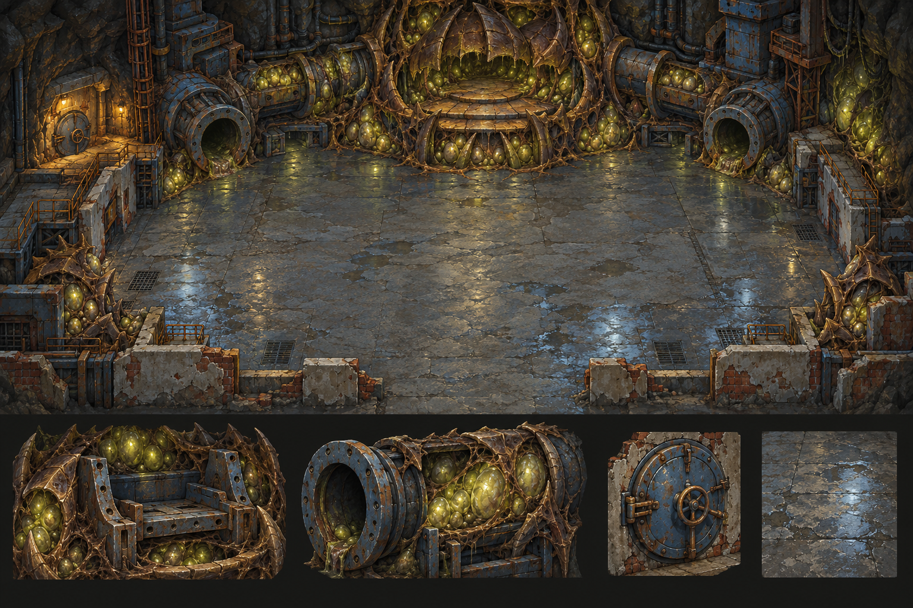

O ninho ocupa o coração da instalação; os acessos humanos sobreviventes tornam visível como Damião poderá destruí-lo.

[Imagem completa](imagens/16-camara-escorpiao.png) · [Prompt da geração](prompts/16.txt)

### Epílogo e variantes da igreja — Retorno à igreja

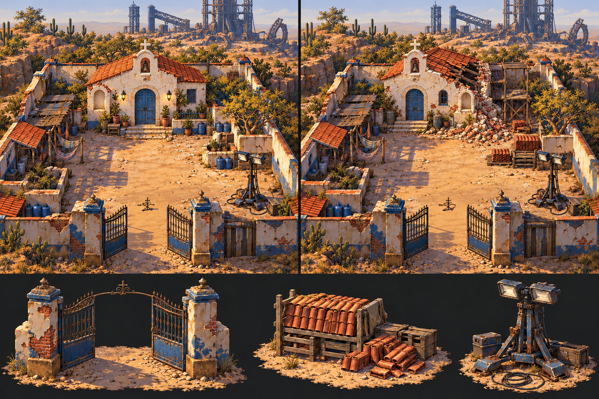

O mesmo lugar do prólogo reaparece livre dos ninhos: a versão preservada recebe o retorno, e a versão danificada mostra reparos.

[Imagem completa](imagens/epilogo-retorno-igreja-v2.png) · [Prompt da geração](prompts/epilogo.txt)
