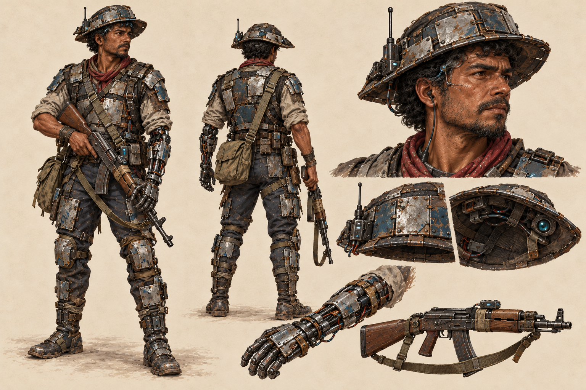

# Protagonista — cangaço cyberpunk brasileiro — concept v3

[Sprites derivados deste concept, já integrados ao jogo](../../cangaco-protagonista-iso60-v2/README.md).

## Direção visual

Guerreiro humano brasileiro com proporções realistas, rosto e olhos expostos,
implantes cibernéticos e proteção feita de pedaços de armadura reaproveitados.
A referência ao cangaço aparece na silhueta do chapéu e no lenço, com poucos
ornamentos. Esta revisão substitui os trajes de couro por placas metálicas sobre
tecido e elimina o visor ocular.

A prancha reúne corpo inteiro em três quartos, vista de costas, estudo de rosto e
detalhes do equipamento. É concept art anterior aos sprites, não uma spritesheet SGDK.

## Elementos do personagem

- Chapéu baixo de metal segmentado, com sensores sob a aba e rádio lateral.
- Peitoral, ombreiras, quadril, joelhos, canelas e botas protegidos por placas
  menores, fixações aparentes, tecido e tiras utilitárias.
- Camisa de tecido, calça escura, lenço vermelho queimado e bolsa de lona.
- Antebraço e mão esquerdos cibernéticos; braço direito biológico.
- Interface neural discreta na têmpora, sem óculos nem visor diante dos olhos.
- Conectores, cabos protegidos e módulos pequenos entre as placas.
- Arma de fogo com coronha de madeira, metal gasto, módulo eletrônico e
  bandoleira de tecido.

A paleta combina aço escuro, alumínio oxidado, azul petróleo desbotado e tecido
neutro, com vermelho queimado no lenço e luzes discretas nos eletrônicos.
As peças são assimétricas e reparadas, mantendo o corpo humano legível.

## Função proposta para o chapéu

Sensores ópticos sob a aba, antena e módulo de rádio ligados à interface neural
apoiam percepção do ambiente, navegação e comunicação. Não há visor ocular.
A prancha mostra o exterior e a face inferior do chapéu. Essas funções pertencem
ao concept e ainda não representam mecânicas implementadas no jogo.

## Continuidade com o jogo

A futura adaptação mantém a câmera elevada a 60° acima do chão e as oito direções.
O protagonista será consolidado nesta etapa antes da produção de sprites.
As folhas anteriores de robôs permanecem como estudos históricos.

## Arquivos

- [Concept atual em PNG — v3](protagonista-cangaco-cyberpunk-v3.png).
- [Prompt completo da revisão v3](prompt-v3.txt).
- [Concept anterior — v2](protagonista-cangaco-cyberpunk-v2.png).
- [Prompt da revisão v2](prompt-v2.txt).
- [Concept anterior — v1](protagonista-cangaco-cyberpunk-v1.png).
- [Prompt da primeira versão](prompt-v1.txt).

Revisão gerada com a ferramenta integrada **image_gen**, usando o concept v2
como referência. As versões anteriores foram preservadas. O PNG atual mede
1536 × 1024 pixels; é uma prancha de concept, sem exportação técnica para Mega Drive.
