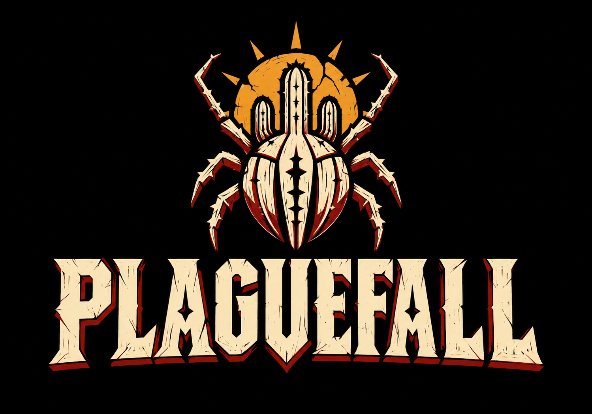
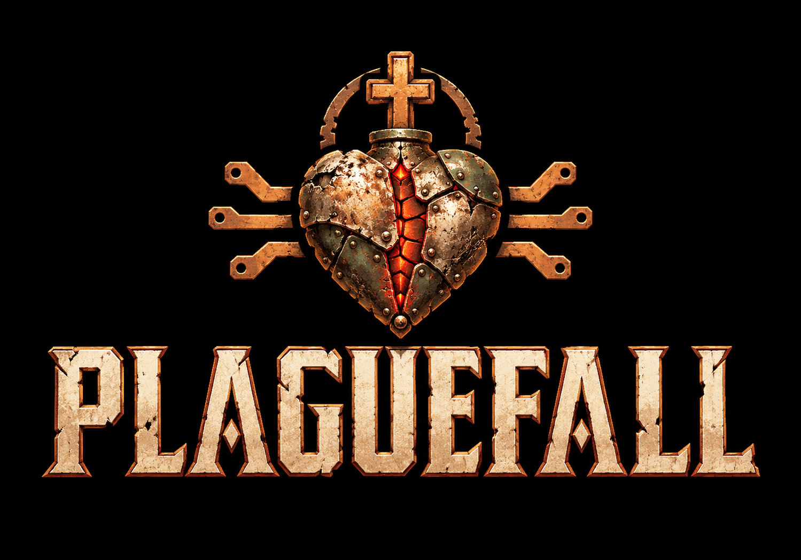
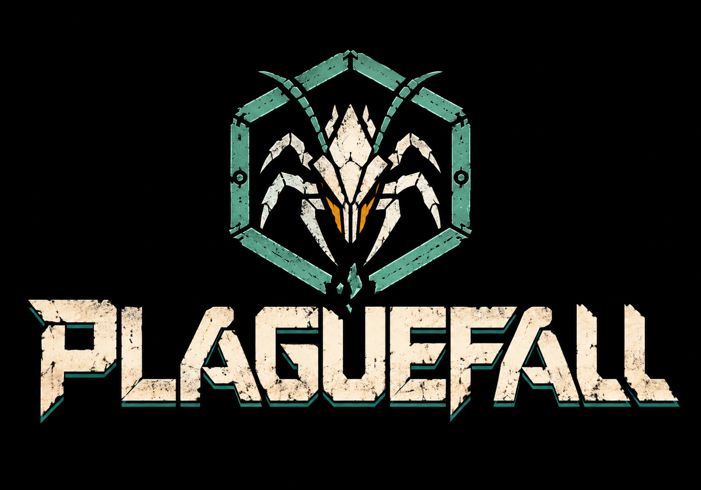
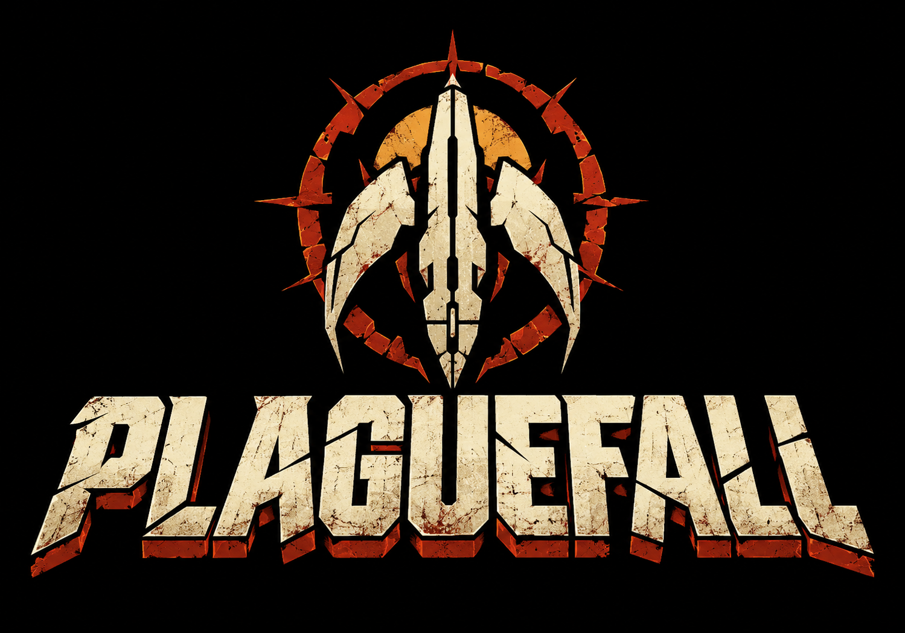

# PLAGUEFALL — propostas de título e símbolo

Quatro concepts para uma tela com o nome do jogo **antes do monólogo**, sem personagens nem cenário. Todas as propostas usam fundo preto, um símbolo e o título estilizado PLAGUEFALL. A opção **B — Ex-voto de metal** foi escolhida e integrada; a [versão de produção](../../title-exvoto-v1/README.md) preserva o desenho aprovado na resolução do Mega Drive.

| A · Xilogravura do sertão | B · Ex-voto de metal |
|---|---|
|  |  |
| **C · Selo do enxame** | **D · Queda da Ascensão** |
|  |  |

## As quatro direções

- **A — Xilogravura do sertão:** besouro com formas de mandacaru, sol rachado e letras de cordel. Marfim, vermelho queimado e âmbar. Reúne a caatinga e os insetos numa identidade mais brasileira. É a recomendação inicial para o projeto.
- **B — Ex-voto de metal:** coração de placas reaproveitadas com cruz e ramificações de circuito. Tipografia gravada, cobre, marfim e brasa. Destaca fé popular, feridas e resistência.
- **C — Selo do enxame:** carapaça dentro de um selo hexagonal rompido, letras industriais e verde-azulado. Destaca contaminação e ocupação tecnológica.
- **D — Queda da Ascensão:** foguete apontado para baixo que também sugere uma carapaça, cercado por um anel solar quebrado. Destaca a promessa espacial que retorna como ameaça.

O título está completo nas quatro imagens. Os símbolos são emblemas gráficos; não há retratos, personagens, menus ou subtítulos. A opção B foi convertida para 320×224 com cores reservadas ao brilho da fenda do coração.

## Arquivos e geração

Concepts gerados com **image_gen integrado**. Uma chamada independente por proposta, sem imagens de referência. Os prompts descrevem o universo atual do jogo e ficam preservados para revisão:

| Opção | PNG original salvo | Prompt |
|---|---|---|
| A | [Xilogravura](a-xilogravura.png) | [Prompt A](prompts/a-xilogravura.txt) |
| B | [Ex-voto](b-ex-voto.png) | [Prompt B](prompts/b-ex-voto.txt) |
| C | [Enxame](c-selo-enxame.png) | [Prompt C](prompts/c-selo-enxame.txt) |
| D | [Ascensão](d-queda-ascensao.png) | [Prompt D](prompts/d-queda-ascensao.txt) |

O [manifesto](manifest.json) registra dimensões e hashes dos originais. Os PNGs gerados foram copiados integralmente, sem edição. A integração da opção B está documentada na versão de produção; os quatro originais continuam preservados.

## Opção aprovada

**B — Ex-voto de metal.** Fluxo implementado: logo da desenvolvedora → APRESENTA → PLAGUEFALL com partículas e coração pulsante → monólogo → menu. [Arte final, prévia e verificação](../../title-exvoto-v1/README.md).
