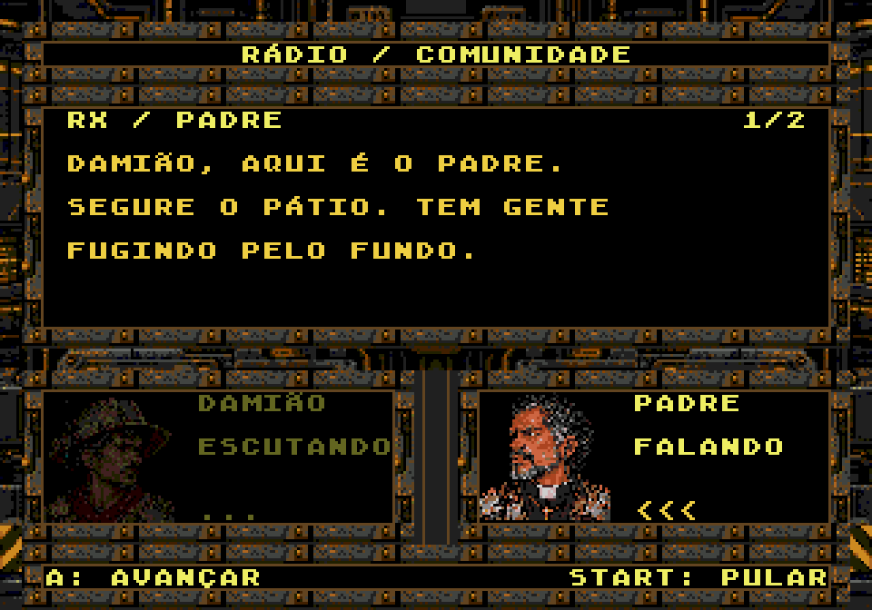
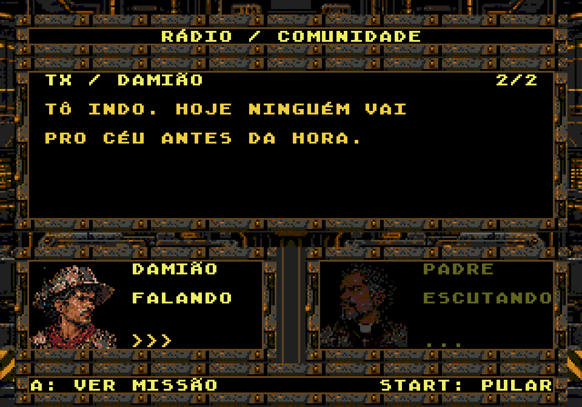

# Diálogos em holodeck — opção C integrada

A opção C foi escolhida, revisada para escurecer quem escuta e autorizada para implementação em 22/10/2026. A ROM principal usa o console em todas as conversas: monitor superior preto, títulos dourados, falas em cinza claro e dois monitores inferiores para Damião e seu interlocutor. O cenário da fase deixa de aparecer durante o diálogo. A revisão de contraste de 23/10/2026 está registrada em [cores do rádio](../radio-text-colors-v1/validation/report.json); as capturas abaixo documentam a integração original.





## Composição nativa

A composição adapta a [prévia C v2 aprovada](propostas/c-console-central-v2-interlocutor-escuro.png) para 320×224. A moldura mecânica vem do concept; seus textos e retratos gerados são cobertos por monitores opacos. O runtime desenha somente a fonte original 8×8 com acentos e os quatro retratos originais 48×48, sem espelhamento ou redesenho.

Damião fica em (16,144) e o interlocutor em (176,144). O monitor principal recebe quatro linhas de 26 caracteres em (24,56), com entrelinha de 16 pixels. Nome e estado FALANDO/ESCUTANDO acompanham o falante. A paleta de quem fala é idêntica à original; cada canal de quem escuta é reduzido para aproximadamente um terço, arredondado aos níveis de cor do Mega Drive. A troca ocorre junto da nova fala, inclusive quando Padre, Dinorah e Escorpião se alternam no monitor remoto.

São 155 tiles estáticos, 144 para os quatro retratos carregados na entrada e uma reserva de 400 para composição de texto (máximo observado: 216). O console começa depois dos 89 tiles básicos, sem sobrescrevê-los; a reserva termina antes do tile 1440 da fonte. PAL0 é dedicada ao console, PAL1 e PAL2 aos dois retratos visíveis. O cache conserva o orçamento anterior: 12.800 bytes de pixels e 2.240 bytes de mapa. Não é necessário carregar a fase para mostrar a conversa. Ao sair, os planos são limpos e os recursos gráficos de jogo são restaurados pelo mesmo caminho de transição existente.

A completa o texto, uma nova pressão avança e START pula. Roteiro e controles são os existentes.

## Troca de falas sem apagar a tela

A primeira integração desligava a imagem e limpava BG_A em `RADIO_line`, remontando o console inteiro a cada fala. O teste quadro a quadro reproduziu 12 quadros de fundo incorreto em NTSC e 10 em PAL na primeira troca, cerca de 0,2 segundo. As capturas estáticas anteriores só verificavam a tela pronta e não detectavam esse problema.

Agora o mapa do fundo, o título e o aviso START são montados uma vez por cena. Os quatro retratos ficam na VRAM desde a entrada. As células de texto têm índices fixos e são reutilizadas sem limpar o plano ou desligar a imagem. A próxima fala é composta na RAM enquanto a anterior continua visível; texto, comando e paletas são enviados juntos na próxima VBlank. Ao mudar o interlocutor, apenas as referências do monitor remoto mudam. Cada troca envia no máximo 6.088 bytes, abaixo do limite NTSC de 7.200 bytes, usando buffers que permanecem válidos até a transferência.

O teste agora compara todos os pixels fora das áreas de conteúdo em cada quadro da troca e confere os tiles estáticos da moldura. As 29 trocas internas às cenas passaram em cada região, incluindo mudanças de interlocutor: 696 quadros NTSC e 580 PAL sem alteração indevida no fundo. A entrada e a saída completas da cena mantêm a transição existente.

## Reprodução e validação

```sh
python3 game/art/radio-dialogos-ux-v1/exportar.py
python3 game/art/dialogue-holodeck-v1/exportar.py --check
python3 game/tools/check.py
arch -x86_64 /usr/bin/python3 game/tools/test_radio_emulator.py --output game/art/dialogue-holodeck-v1/validation/ntsc
arch -x86_64 /usr/bin/python3 game/tools/test_radio_emulator.py --pal --output game/art/dialogue-holodeck-v1/validation/pal
```

O exportador principal preserva a contagem e delega os tiles/mapa/paleta do rádio a `exportar.py` deste pacote. Os recursos ativos ficam em `game/res/radio/`, usados por `screens/radio.c`.

O [relatório desta integração](validation/report.json) identifica a ROM por SHA-256. No Genesis Plus GX, em cada região:

- 51 falas: todos os glifos, retratos e posições conferidos pixel a pixel, com paleta original de quem fala e escurecida de quem escuta; monitor preto, texto amarelo, ausência de fundo de fase e simulação congelada.
- 29 trocas de fala: fundo, título e molduras idênticos quadro a quadro, inclusive durante a composição da próxima fala e a troca de interlocutor.
- 20 entradas em combate: 3/2/1, liberação de movimento e disparo no zero, restauração do HUD e pausa; START pula texto parcial, e A segurado no menu não dispara ao entrar.
- Regressão de resultados: derrota/repetição nas 20 etapas, saída, conclusão, mapa, chegada ao rádio, preparação, vitória e nova campanha.
- Recursos reproduzíveis e verificações nativas de texto, jogador, inimigos, terreno e áudio aprovados em `game/tools/check.py`.

RAM foi usada apenas para preparar fases/metas/morte/chefe nos testes. A navegação das conversas e as contagens executam o código normal da ROM. As capturas são do emulador; não foi realizado teste em hardware físico.

## Histórico visual

- [A — Terminal industrial](propostas/a-terminal-industrial.png).
- [B — Sala holográfica](propostas/b-sala-holografica.png).
- [C — Console central inicial](propostas/c-console-central.png).
- [C v2 — Retrato de quem escuta escurecido](propostas/c-console-central-v2-interlocutor-escuro.png), escolhida para integração.

As propostas foram criadas com image_gen integrado usando a captura anterior do rádio e os retratos originais como referências. Prompts: `prompts.json` e `prompt-c-v2.txt`. Elas são conceitos ampliados; as capturas em `validation/` mostram a adaptação nativa efetivamente implementada.
