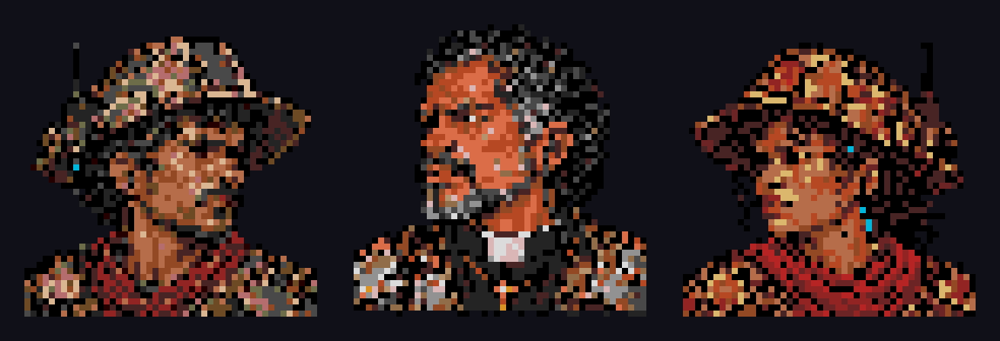

# Retratos de conversa — Damião, Comando e Dinorah

Criados com **image_gen integrado** a partir dos concepts de [Damião v3](../concepts/protagonista/protagonista-cangaco-cyberpunk-v3.png), do [Comando como padre](../concepts/comando/README.md) e da [Dinorah v2](../concepts/parceira/parceira-cangaco-cyberpunk-v2.png). Um retrato estático de cada personagem, com identidade e equipamento preservados. Damião olha para a direita; o padre e Dinorah, para a esquerda. A câmera é de retrato, na altura do rosto.



## Arquivos prontos

| Personagem | PNG nativo | Prévia 8× | Paleta | ID |
|---|---|---|---|---|
| Damião | [48×48](damiao.png) | [384×384](damiao-8x.png) | [JSON](damiao-palette.json) | `P_DAMIAO` = 0 |
| Comando (padre) | [48×48](comando.png) | [384×384](comando-8x.png) | [JSON](comando-palette.json) | `P_COMANDO` = 1 |
| Dinorah | [48×48](parceira.png) | [384×384](parceira-8x.png) | [JSON](parceira-palette.json) | `P_DINORAH` = 3 |

[Pacote completo](redrex-dialogue-portraits-v1.zip) · [ROM de prévia](../../out/release/rom.bin) · [Validação técnica](validation.json).

Os PNGs nativos são indexados de 4 bits, com índice 0 transparente, alfa binário e componentes RGB nos oito níveis do Mega Drive. Damião usa 13 cores opacas; o Comando usa 13; Dinorah usa 10. As fontes geradas em `originals/` têm 1254×1254 e não são os arquivos nativos. O Comando usa a revisão sem chapéu de `originals/comando-v2.png`, com recorte quadrado de 8% nas laterais e 16% no topo para manter o rosto legível. A exportação faz recorte, amostragem por vizinho mais próximo e quantização de paleta; não desenha o personagem por código.

## Integração

O exportador atualiza `game/src/system/video/sprites/portraits_data.h`. Damião substitui o retrato antigo no ID 0. Dinorah recebe o ID 3 e aparece por rádio na cena `rede`, antes da fase 7. `P_COMANDO` mantém o ID 1 e recebe o retrato do padre, que já aparece na abertura. `P_LACRAIA` mantém o ID 2 e a arte anterior. O cabeçalho original está preservado em `legacy/`.

O nome exibido é **DINORAH**. Os arquivos de arte mantêm o identificador técnico `parceira`. Sua participação na conversa não adiciona um ator móvel à arena.

O motor carrega apenas os dois retratos em tela: 36 tiles por retrato, 72 tiles/2304 bytes no total, na região já emprestada do chefe. Não há reserva adicional de VRAM nem novos buffers de RAM. A biblioteca cresce na ROM; cada retrato tem 2304 índices de pixel, ponteiros de linhas e uma paleta de 32 bytes.

## Reprodução e procedência

```sh
python3 game/art/dialogue-portraits-v1/export_portraits.py
python3 game/art/dialogue-portraits-v1/export_portraits.py --check
```

Os prompts exatos estão em [damiao.txt](prompts/damiao.txt), [comando-v2.txt](prompts/comando-v2.txt) e [parceira.txt](prompts/parceira.txt). Cada personagem usa seu concept para identidade; os dois retratos posteriores também usam Damião como referência de estilo. As fontes foram geradas/editadas com fundo transparente e preservadas em `originals/`; a primeira versão do Comando permanece como histórico. A revisão 2 remove o chapéu, preservando a identidade do padre e seu fone de rádio.

## Verificação no jogo

A ROM compilou com o SGDK do projeto. O teste no Genesis Plus GX executou 1443 quadros e confirmou Damião/Comando (IDs 0/1) na abertura e Damião/Dinorah (IDs 0/3) na cena da fase 7. Para chegar diretamente à fala de Dinorah, o teste redirecionou apenas o ponteiro da cena na RAM volátil do emulador para o registro real da fase 7. O código e a ROM testados não receberam cenas artificiais.

- [Damião na abertura](emulator/damiao-dialogue-2x.png).
- [Damião e padre na abertura](emulator/damiao-comando-dialogue-2x.png).
- [Damião e Dinorah na tela de conversa](emulator/damiao-parceira-dialogue-2x.png).
- [Relatório da compilação, memória e texto](build-validation.json).
- [Relatório do emulador e hash da ROM](emulator/report.json).

Esta entrega não inclui animação de boca, expressões alternativas ou novo retrato da Lacraia.
