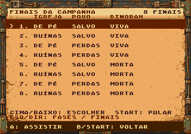
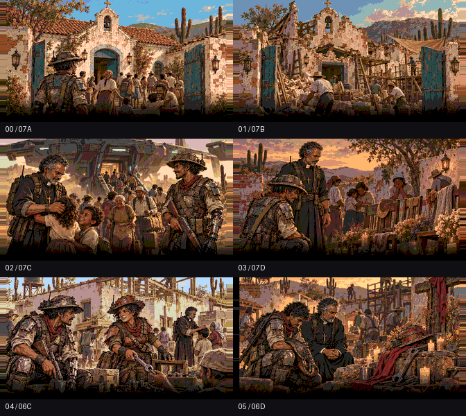

# Encerramento ilustrado

[Vídeo completo dos oito finais, com condições e capítulos](videos/todos-os-finais.mp4). Capturado na ROM real, com música e partículas, acessando o seletor somente pelo controle.

| Vídeo | Igreja | População | Dinorah |
|---|---|---|---|
| [Final 1](videos/final-01.mp4) | Preservada | Salva | Viva |
| [Final 2](videos/final-02.mp4) | Ruínas | Salva | Viva |
| [Final 3](videos/final-03.mp4) | Preservada | Com perdas | Viva |
| [Final 4](videos/final-04.mp4) | Ruínas | Com perdas | Viva |
| [Final 5](videos/final-05.mp4) | Preservada | Salva | Morta |
| [Final 6](videos/final-06.mp4) | Ruínas | Salva | Morta |
| [Final 7](videos/final-07.mp4) | Preservada | Com perdas | Morta |
| [Final 8](videos/final-08.mp4) | Ruínas | Com perdas | Morta |

Para acessar no jogo: **FASE TESTE → direita → FINAIS DA CAMPANHA**. Cima/baixo escolhem entre os oito finais; A reproduz. A prévia termina ou é pulada com START e volta ao mesmo item do seletor. Esquerda/direita alternam entre as fases e os finais. B/START no seletor voltam; após assistir a uma prévia, voltam ao título. Na campanha normal, o encerramento continua levando à tela de vitória.



Depois da derrota do Escorpião, o jogo apresenta três slides automáticos em 25 segundos. Usa os quadros existentes das pranchas 06 e 07, as falas do storyboard, enquadramento fixo, fades de 0,4 s, texto centralizado com acentos e 12 partículas de poeira, brasas e fuligem, como na introdução. A trilha Entardecer acompanha a sequência; a vinheta de vitória toca na tela seguinte.

As escolhas são independentes e vêm de `campaignFlags`, gravadas durante a campanha:

| Condição | Slide |
|---|---|
| Igreja preservada / destruída, fase 1 | 07A / 07B, 8 s |
| Resgate completo / perdas civis, fase 5 | 07C / 07D, 7 s |
| Dinorah viva / morta, fase 12 | 06C / 06D, 10 s |

Dinorah viva tem duas cartelas de cinco segundos, com resposta de Damião, sem recarregar a imagem. Morta, aparece somente seu memorial, sem fala dela. O memorial dos civis é independente. O roteiro está em [storyboard.json](storyboard.json); a tabela das oito sequências e os hashes dos recursos estão em [export.json](export.json).



START pula a sequência com fade. A, B e C não avançam os slides nem completam as falas. A tela seguinte permite voltar ao título ou jogar novamente; um botão segurado não confirma essa escolha. Jogar novamente limpa as consequências e começa a fase 1.

`export_ending.py` recorta os quadros existentes, aplica a mesma conversão de duas paletas da abertura e gera os tiles, grupos, paletas e cartelas da ROM. Não há nova ilustração. Cada imagem usa 924 tiles; as partículas acrescentam três. A fonte com acentos é compartilhada com a abertura. O cenário e os tiles do jogo são restaurados antes da tela de vitória.

```sh
python3 game/art/ending-slides-v1/export_ending.py --check
python3 game/tools/test_campaign_rules.py
arch -x86_64 /usr/bin/python3 game/tools/test_ending_emulator.py \
  --output game/art/ending-slides-v1/validation/ntsc
arch -x86_64 /usr/bin/python3 game/tools/test_ending_emulator.py --pal \
  --output game/art/ending-slides-v1/validation/pal
arch -x86_64 /usr/bin/python3 game/tools/test_ending_selector_emulator.py --movie \
  --output game/art/ending-slides-v1/videos
python3 game/tools/build_ending_video.py
```

Os [testes NTSC](validation/ntsc/report.json) e [PAL](validation/pal/report.json) verificam todas as oito combinações, tiles completos na VRAM, letras nos pixels exibidos, movimento das 12 partículas, A/B/C ignorados, salto com START, proteção contra botão segurado, tela de vitória e reinício na fase 1. A RAM prepara somente a vitória do chefe e as três consequências; a reprodução e a navegação usam o código normal. `check.py` também verifica a reprodução dos exports e as regras de seleção no C real.

O novo acesso direto também passou em [NTSC](videos/report.json) e [PAL](validation/selector-pal/report.json), sem escritas na RAM: oito prévias completas, 25 segundos de slides, retorno ao mesmo item, abas, navegação circular, START segurado, cancelamento e novo jogo sem consequências de teste. As 19 fases e a pausa passaram novamente em [NTSC](validation/phases-ntsc/report.json) e [PAL](validation/phases-pal/report.json).
