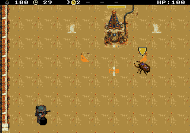
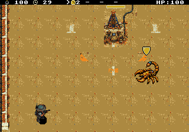
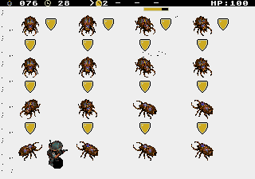

# Escudo flutuante dos inimigos

Registro da versão de 16×16. A [revisão atual usa 8×8](../enemy-shields-v2/README.md), conforme redução solicitada pelo jogador.

A blindagem dos três inimigos roxos e do Escorpião usa um escudo dourado de 16×16 acima do corpo. Contorno escuro e borda clara mantêm a forma legível sobre os cenários. O corpo deixa de piscar durante a invulnerabilidade; o flash breve de dano conserva o corpo visível. O ícone aparece somente enquanto a blindagem está ativa. Os tempos, imunidades, colisões e vida dos inimigos continuam regidos pelas mesmas regras.

Perto do topo da tela, o escudo fica ao lado da cabeça, abaixo do HUD. Não usa mudanças de paleta ou transferência de animação durante a partida. São quatro tiles residentes, 128 bytes; o atlas das fases começa agora no tile 785. A reserva final termina no tile 1440, onde começa a fonte, com limite verificado em compilação.

Corpos e projéteis entram na lista antes dos escudos. Sob excesso de sprites, um marcador só é admitido se seu corpo também foi admitido. A lista mantém registros de oito bytes para evitar multiplicações no caminho de renderização; os marcadores reaproveitam posições e tamanhos já calculados no desenho dos corpos.

## Validação na ROM distribuída

[NTSC](validation/ntsc/report.json) · [PAL](validation/pal/report.json) · [Resumo e identificação da ROM](validation/summary.json).

- 12 tentativas comuns nas fases 3 e 5, três por fase e região, sem escrever na RAM depois da preparação. Todas terminaram em derrota do jogador, sem travamentos ou tempo esgotado. Três tentativas observaram blindagem natural de inimigos roxos.
- Ensaios isolados verificaram os três tipos roxos e o chefe, presença contínua do corpo, ciclo natural de ativação/expiração, cores do escudo e posicionamento junto ao HUD. Os testes verificam a lista de sprites real do emulador; as capturas foram inspecionadas visualmente.
- 16 ensaios comparativos de 300 quadros físicos, além do aquecimento: quatro, oito ou 16 inimigos grandes, com/sem blindagem, incluindo 16 concentrados numa mesma faixa horizontal. Nos casos distribuídos, todos os corpos e todos os escudos permaneceram na lista. Nenhum marcador deslocou um corpo; os limites de 80 sprites por quadro, 20 por linha e 320 pixels por linha foram respeitados.
- Regressões das fases 3 e 5: atlas, fonte, HUD opaco, lava, tiros nas paredes, circulação, pausa e retomada. A Santa continua piscando ao receber dano e sai do cenário ao ser destruída; sucesso e falha do objetivo foram verificados separadamente.
- Compilação, `tools/check.py`, exportação determinística das fases, pacote e hash da ROM conferidos.

### Performance e limites encontrados

Os ensaios controlados já existentes, com quatro inimigos pequenos/mistos, seis tiros por grupo e rolagem, mantiveram 60 FPS NTSC e 50 FPS PAL. A nova bateria com inimigos grandes mede um caso mais pesado:

| Carga artificial | NTSC sem/com escudo | PAL sem/com escudo |
|---|---:|---:|
| 4 inimigos grandes | 57,8 / 55,8 FPS | 49,67 / 49,67 FPS |
| 8 inimigos grandes | 37 / 30 FPS | 39 / 33,33 FPS |
| 16 inimigos grandes distribuídos | 28,4 / 26 FPS | 24,83 / 24,67 FPS |
| 16 inimigos grandes na mesma faixa | 24 / 17,2 FPS | 20 / 18,5 FPS |

Portanto, a nova apresentação está funcional e legível, mas a carga extrema **não atende a 60/50 FPS**. O custo aumenta com os marcadores e a lentidão também existe nos casos sem blindagem. Os quatro inimigos grandes simultaneamente blindados já ficam abaixo de 60 FPS em NTSC. Os limites atuais das fases 3 e 5 não foram aumentados: quatro inimigos e seis tiros por grupo.

Na faixa superlotada, o limite físico de pixels por linha admite dez dos 16 corpos grandes. A prioridade rotativa existente distribui essa omissão entre os atores; só aparecem escudos dos corpos admitidos. Isso é diferente da antiga ocultação periódica pelo estado de blindagem e permanece uma limitação do caso extremo.

As médias das tentativas comuns, incluindo dano e transição para derrota, ficaram entre 57,51–58,79 FPS NTSC e 47,96–48,77 FPS PAL. Os relatórios conservam as medidas por tentativa; não se extrapola o resultado dos ensaios controlados para toda a campanha.







Para reproduzir:

```sh
arch -x86_64 /usr/bin/python3 game/tools/test_campaign_stages_emulator.py --nodes 4,6 --matches 3 --shield-tests --output game/art/enemy-shields-v1/validation/ntsc
arch -x86_64 /usr/bin/python3 game/tools/test_campaign_stages_emulator.py --pal --nodes 4,6 --matches 3 --shield-tests --output game/art/enemy-shields-v1/validation/pal
```
