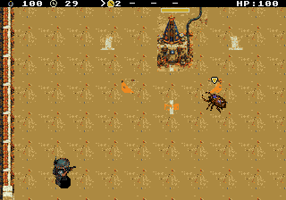
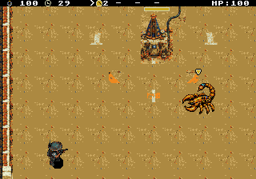

# Escudo flutuante — 8×8

Redução solicitada de 50% na largura e na altura: de 16×16 para 8×8 pixels. O escudo mantém dourado, borda clara e contorno escuro, centralizado sobre o inimigo com dois pixels de distância. A posição alternativa junto ao topo também foi ajustada. O sprite de hardware agora usa um único tile. A reserva de VRAM permanece no mesmo lugar para preservar os endereços dos demais recursos.

Os ensaios em [NTSC](validation/ntsc/report.json) e [PAL](validation/pal/report.json) passaram na ROM identificada pelo hash de cada relatório. Conferiram as dimensões reais de 8×8 na lista de sprites, os três roxos e o chefe, o ciclo natural da blindagem, posicionamento no limite superior, HUD e presença do corpo sem piscar. Também passaram os ensaios comparativos com 4, 8 e 16 inimigos, incluindo uma faixa superlotada, além das regressões de circulação, tiros, pausa e objetivo da Santa. Não foram repetidas partidas comuns nesta revisão de tamanho.

A redução do ícone preserva as limitações de performance registradas na [primeira revisão](../enemy-shields-v1/README.md): 16 inimigos grandes distribuídos e blindados mediram 25,8 FPS NTSC e 24,67 FPS PAL. Os relatórios trazem todos os casos; não representam uma garantia de 60/50 FPS sob carga extrema.

