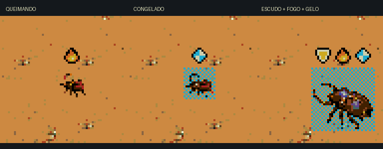

# Bomba no HUD e estados dos inimigos

Revisão de 22/10/2026 integrada na ROM principal.

- A carga de desmonte no HUD usa uma caixa retangular amarela com faixa escura.
  A grade editável de 8×8 fica em `../cangaco-itens-v2/source/hud-glyphs.json`.
- Queimadura mostra uma chama laranja/amarela; congelamento mostra um cristal
  ciano/branco. Os dois ícones têm 8×8 pixels, com contorno escuro como o escudo.
- Os indicadores acompanham os temporizadores reais `burn` e `frozen`. A chama
  permanece entre os pulsos de dano; os indicadores somem ao terminar o efeito.
- Estados simultâneos aparecem em uma linha com dois pixels entre os ícones.
  No limite superior, a linha vai para o lado do corpo, abaixo do HUD.
- Os marcadores usam os tiles reservados 87 e 88: sem aumentar a reserva de
  VRAM, sem nova paleta e sem transferências de tiles por quadro. Cada estado
  acrescenta um sprite de hardware, submetido aos mesmos limites do escudo.
  Corpos e tiros têm prioridade sobre os indicadores em linhas superlotadas.




## Validação

Genesis Plus GX, ROM de produção: [NTSC](validation/ntsc/report.json) e
[PAL](validation/pal/report.json). Cada relatório registra o SHA-256 executado.
São 21 combinações entre fogo, gelo e três estados simultâneos, em insetos
pequenos/médios/grandes, chefe e dois alvos de treino. As verificações leem
a lista real de sprites, dimensões, paleta, coexistência do corpo, espaçamento,
limites da tela e expiração natural dos efeitos. A bomba é comparada pixel a
pixel com o HUD composto. RAM é usada apenas para preparar as sondas isoladas.

Também passaram a regressão do HUD em NTSC (inventário, ativação de item,
vida/dano, pausa, câmera, objetivos e derrota) e `python3 game/tools/check.py`.

```sh
arch -x86_64 /usr/bin/python3 game/tools/test_hud_emulator.py \
  --status-tests --output /private/tmp/plaguefall-status-ntsc
arch -x86_64 /usr/bin/python3 game/tools/test_hud_emulator.py \
  --status-tests --pal --output /private/tmp/plaguefall-status-pal
```
