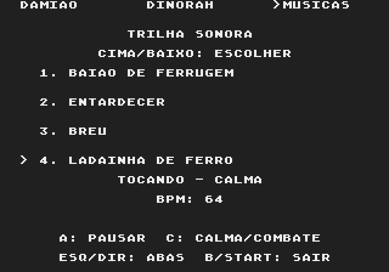
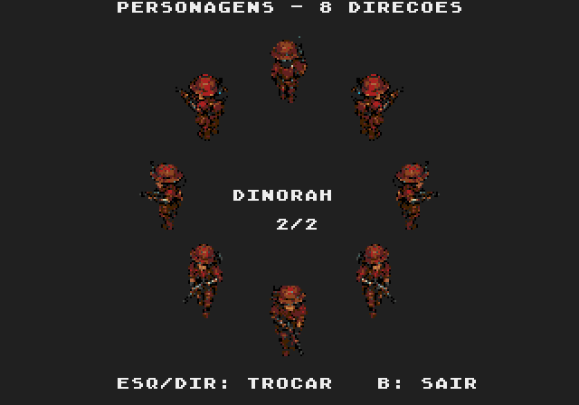

# Assets — Damião, Dinorah e Músicas

O menu **ASSETS** tem três abas: **Damião (1/3)**, **Dinorah (2/3)** e **Músicas**. ESQ/DIR percorre as abas nos dois sentidos, dando a volta na lista. B ou START retorna ao menu principal; A também sai nas abas dos personagens.



Na aba MÚSICAS, CIMA/BAIXO seleciona **Baião de Ferrugem**, **Entardecer**, **Breu** ou **Ladainha de Ferro** e começa a tocar a faixa escolhida. A pausa/retoma, e C alterna CALMA/COMBATE. O nome, o cursor, o estado de reprodução e o BPM são mostrados na tela. A faixa toca em loop. A seleção da galeria é apenas uma audição: ao trocar de aba ou sair, a música anterior retoma com o mesmo andamento, posição, vozes e curva de ameaça.



[Damião na galeria](emulator/damiao-idle-0-2x.png) · [ROM com as três abas](../../out/release/rom.bin).

Cada personagem aparece em oito direções, com dois quadros de repouso de 32×48. A animação usa a cadência existente: 24 ticks por quadro em NTSC e 20 em PAL. SO/O/NO usam os espelhos horizontais das vistas SE/L/NE, preservando as matrizes dos sprites aprovados.

## Integração

A galeria é implementada em `src/system/video/screens/chardemo.c`. Os mechs antigos saíram da lista. Seus estudos de arte permanecem no repositório como acervo.

Dinorah usa o [binário reduzido já existente](../cangaco-parceira-iso60-v1/runtime/frames.bin), declarado em `res/dinorah.res`. Os 30 quadros canônicos ocupam 23040 bytes de ROM. A paleta é exatamente a mesma de Damião e usa PAL2.

As cinco vistas e os dois quadros de repouso do personagem em exibição ficam em 240 tiles temporários (7680 bytes), dentro do cache existente de 320 tiles dos inimigos. Uma checagem no compilador impede exceder essa reserva. As oito direções usam 16 sprites de hardware, duas peças por figura. Não há DMA de imagens durante a animação: somente o índice do quadro muda.

Os auxiliares de prévia saíram do módulo de renderização de Damião e passaram para a galeria. A partida continua usando o renderizador e o carregamento de Damião existentes.

As quatro partituras originais ficam juntas na ROM em `src/system/audio/song_catalog_data.h`, gerado por `tools/compose_music.py --catalog`. O motor escolhe a faixa em execução sem mudar a partitura, os timbres ou os andamentos de cada versão. `MUSIC_previewTrack()` salva o estado normal uma única vez; `MUSIC_endPreview()` restaura esse estado ao encerrar a audição. A aba de músicas esconde os sprites; ao voltar a um personagem, a galeria recarrega suas poses no mesmo cache já existente. A nova interface usa texto, sem novos tiles de arte.

## Verificação

- [Teste no Genesis Plus GX](emulator/report.json): navegação pelos dois personagens, volta nas duas direções, duas poses por personagem, oito vistas, espelhos e saída ao menu/início da campanha.
- [Comparação de pixels](pixel-validation.json): as 32 vistas capturadas (2 personagens × 2 poses × 8 direções) correspondem exatamente aos PNGs nativos, considerando a paleta do emulador.
- [Compilação, recursos e memória](build-validation.json).
- [Teste da aba musical em NTSC](assets-player/ntsc/report.json) e [PAL](assets-player/pal/report.json): navegação, quatro faixas com gravações distintas e opção ASSETS no menu, andamentos de calma/combate, pausa silenciosa, retomada, saídas e início da campanha após a audição.
- O teste de áudio nativo verifica que a reprodução após a audição tem exatamente as mesmas frequências e envelopes da reprodução sem interrupção, incluindo a curva personalizada de fase.

Para reproduzir a verificação da nova aba:

```sh
arch -x86_64 /usr/bin/python3 game/art/gallery-v1/verify_music_tab.py \
  --rom game/out/assets/rom.bin --symbols game/out/assets/rom.out \
  --output /private/tmp/plaguefall-music-tab-ntsc
arch -x86_64 /usr/bin/python3 game/art/gallery-v1/verify_music_tab.py \
  --rom game/out/assets/rom.bin --symbols game/out/assets/rom.out \
  --output /private/tmp/plaguefall-music-tab-pal --pal
```
