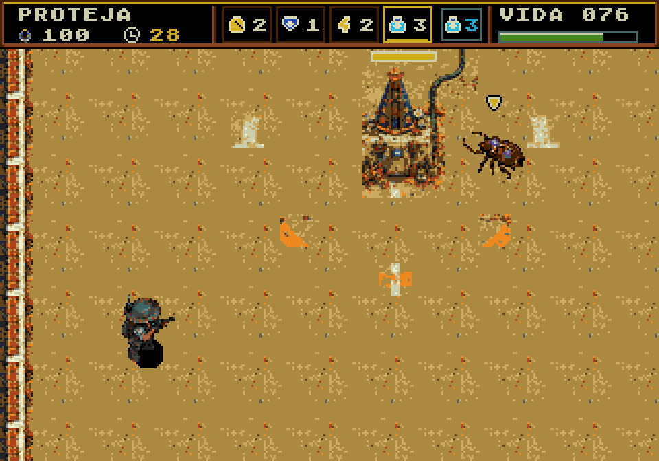
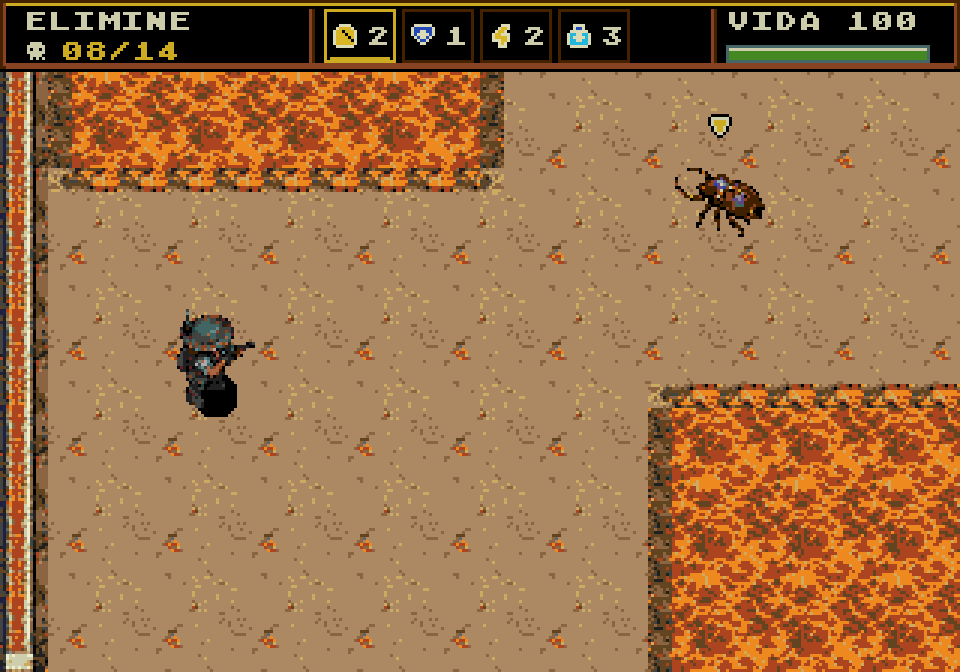
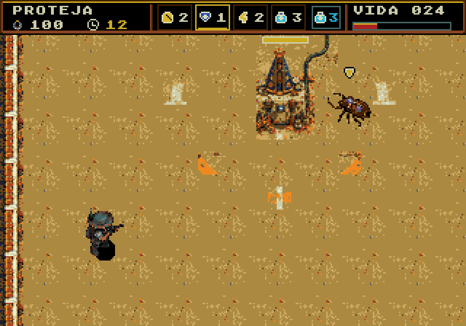

# HUD da resistência

**Implementado no jogo.** [Capturas reais, ROM testada e validação](integracao/README.md) · [Revisão da integração](integracao/revisao.html).

O material abaixo preserva a proposta original: [comparação visual](revisao.html) · [especificação da proposta](especificacao.json).

Painel superior de 24 px para a tela nativa de 320×224. O objetivo ocupa a esquerda, quatro espaços do inventário ficam no centro e a vida aparece à direita, em número e barra. A borda dourada indica a seleção. O modo de tiro ativo usa uma caixa menor em azul, com suas cargas. Ícones e fonte permanecem em 8×8.

Os três desenhos mostram proteção, eliminação e vida baixa. Os valores e o inventário cheio são ilustrativos. A proteção inclui um deslocamento visual do cenário de 16 px para baixo para demonstrar a folga necessária sobre a Santa. Essa câmera ainda não foi implementada nem validada no jogo.

`desenhar.py` gera SVGs com geometria inteira, usando a fonte existente de resultados e os ícones existentes dos itens. Os PNGs de 960×672 são renderizações dos SVGs, sem suavização dos pixels. Os cenários são capturas da ROM de produção; o hash da ROM e os hashes das imagens de referência constam na especificação. A captura usa preparação de nó e inimigo estático em RAM, sem alterar a ROM. Não são novas partidas ou medições de performance.

A composição, fonte, ícones e limites dos textos foram inspecionados nos PNGs. A sintaxe do JavaScript da página foi conferida; a interação da página não foi validada no navegador nesta revisão. A proposta não exporta recursos para o jogo nem altera seus fontes ou executável. Orçamento de tiles, paletas, câmera e performance precisam ser resolvidos na implementação aprovada.

