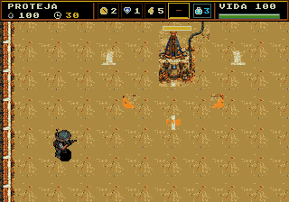
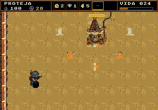
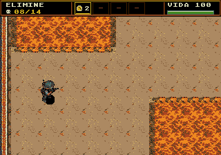

# HUD da resistência integrado

[Revisão com capturas reais](revisao.html) · [ROM testada](rom/Plaguefall.bin) · [Resumo de validação](validation/summary.json).

O painel da proposta foi implementado nas fases da campanha e nas seis salas de teste. É uma faixa opaca de **320×24**, com cores da paleta existente, fonte e ícones de **8×8**.

- Objetivo à esquerda: eliminações/meta, vida e tempo da Santa, travessia, estado/vida de Dinorah ou vida do Escorpião.
- Quatro espaços fixos de equipamento no centro. A borda dourada acompanha a seleção com C; B usa o selecionado.
- Caixa azul para o modo de tiro ativo e suas cargas. Ela some quando as cargas acabam.
- Vida em número e barra, vermelha em 25 HP ou menos e vazia em zero.

As capturas abaixo saíram da ROM no emulador. O inventário foi preparado em RAM para preencher os espaços; seleção e ativação usam os comandos reais. A vida de **100 → 76 → 24** foi alterada por projéteis reais preparados para o ensaio.







## Enquadramento e integração

A câmera considera os 24 px do painel. Perto da Santa, reserva espaço acima dela; no limite sul, mantém Damião dentro da tela, com a vida do sinalizador sempre disponível no HUD. A barra do alvo também respeita o topo visível. Os sprites do mundo ficam sob a faixa opaca.

Nas arenas fixas, o muro começa abaixo do painel e o limite superior dos pés deixa espaço para o corpo de Damião. O Escorpião nasce dentro desses limites. Nas salas técnicas, as informações de diagnóstico ficam abaixo da faixa; os limites superiores também preservam a visibilidade do personagem.

O HUD usa **120 tiles** da reserva de ícones de menu. O cache completo dos inimigos continua disponível no combate. Durante a contagem regressiva, 180 tiles da cauda desse cache são emprestados, e o alocador protege essa área até o aviso de início desaparecer. O chefe inicial cabe na parte livre. Não há nova paleta nem sprites adicionais para o painel.

A composição usa buffer e área de comparação fora da pilha do 68000. Retirou-se uma cópia temporária grande que podia ultrapassar os 2,5 KiB reservados à pilha. A validação confere o sentinela do heap após os ensaios. Retângulos e letras são desenhados por palavras de tiles; mudanças de tempo/vida do objetivo editam somente seus números. A fila envia até **512 bytes por quadro**, respeitando a margem de DMA dos sprites e da câmera.

## Validação

Na mesma ROM preservada em `rom/`, com símbolos correspondentes:

| Verificação | NTSC | PAL |
|---|---|---|
| HUD nativo: opacidade, fonte, seleção, modo/cargas, barra, vida zero | Passou | Passou |
| Pausa, cobertura dos sprites, câmera da Santa e limite superior clássico | Passou | Passou |
| Seis salas de teste, itens e sucesso/falha da Santa | Passou | Passou |
| 51 falas de rádio e 20 contagens regressivas | Passou | Passou |
| 16 casos de mira/tiro diagonal | Passou | Passou |
| Derrota e repetição nas 20 fases, transições e final | Passou | Passou |
| Fases 3 e 5: colisão, terrenos, proteção e seis tentativas comuns por região | Funcional passou | Passou |
| Meta de desempenho ≥99% dos quadros nos ensaios pesados | Abaixo da meta | Passou |

Os testes de campo usam preparação explícita em RAM para escolher fases, posicionar os casos e preparar projéteis. As 12 tentativas comuns de campanha proíbem escritas em RAM durante a partida e incluem vitórias e derrotas. A navegação das salas, seleção de itens, prévias e uso do inventário exercitam os comandos reais. Os relatórios identificam a ROM por SHA-256. Os FPS vêm de atualizações da simulação por VBlank emulado, não da velocidade do computador.

**Limites observados:** com quatro inimigos e seis projéteis por grupo, os ensaios pesados registraram **58,6 FPS na fase 3** e **57,8 FPS na fase da Santa**, em NTSC. Esses dois testes continuam marcados como falha da meta de desempenho no relatório. Em PAL, os equivalentes passaram a 50 FPS. A configuração extrema da sexta sala, com 16 inimigos grandes, escudos e 32 projéteis, indicou cerca de **19 FPS NTSC / 18 FPS PAL**. A implementação não declara 60 FPS estáveis nessas cargas.

A ferramenta de travessia completa foi executada, mas seus arquivos de referência já descreviam mapas de 2048 px, enquanto esta cópia da ROM contém a revisão de 1024 px. A comparação foi registrada como incompatível com essa versão; não conta como validação completa das rotas novas. Os readouts de travessia e escolta desta ROM foram verificados pela suíte do HUD.

Exportação determinística, build sem avisos, pacote da ROM, cenários, verificações nativas e `git diff --check` também passaram. `out/release` pode receber builds de outros trabalhos; a pasta `rom/` preserva o executável exato usado nestes relatórios.

```sh
python3 game/art/hud-resistencia-v1/integracao/exportar.py --check
arch -x86_64 /usr/bin/python3 game/tools/test_hud_emulator.py --build-dir game/art/hud-resistencia-v1/integracao/rom
arch -x86_64 /usr/bin/python3 game/tools/test_hud_emulator.py --build-dir game/art/hud-resistencia-v1/integracao/rom --pal
```
