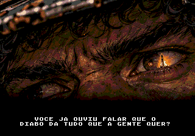

> **Versão anterior preservada.** A abertura atual é a [montagem aprovada de 14 planos e 18 cartelas](../intro-monologo-v2/README.md). Os dados e relatórios abaixo descrevem a revisão anterior.

# Abertura animada — monólogo de Damião



O boot segue **[FinalQuest redesenhado](../finalquest-logo-v2/README.md) → APRESENTA → [título ex-voto pulsante](../title-exvoto-v1/README.md) → monólogo ilustrado → menu PLAGUEFALL**. Os 12 quadros do [storyboard](../storyboard-abertura-v1/README.md) apresentam o monólogo completo com texto branco centralizado e transições em fade de0,4s. A câmera fica fixa;12 partículas de poeira, brasa e fuligem se movem sobre a arte. A trilha original [O Sonho Atendido](../audio-abertura-v2/README.md) começa no logo Plaguefall e segue continuamente pelos12 planos, sem reinícios nem redução de volume nas trocas de imagem.

- [Vídeo do boot real com a nova trilha](../audio-abertura-v2/ntsc/abertura.mp4), com logo, áudio PSG, monólogo e chegada ao menu. O monólogo tem89s mais as trocas de imagem; o último quadro passou de17 para5s.
- [ROM atualizada](../../out/release/Plaguefall.bin).
- [Roteiro e tempos dos 12 planos](../../doc/historia/storyboard-abertura.md).
- [Todos os recortes na paleta do hardware](contact-sheet.png).

## Controles e fluxo

A sequência avança sozinha. **START** pula tudo e vai para o menu, também a partir de APRESENTA ou do logo Plaguefall. A, B e C não completam o texto nem avançam os planos. Segurar START não confirma uma opção no menu. A animação toca uma vez por boot; voltar da partida ao menu não a repete.

Antes da fase 1, a conversa mantém apenas o chamado do padre para segurar o pátio e a resposta de Damião. As outras falas da campanha continuam em `src/levels/story.c`. O texto integral da animação vem do storyboard, convertido em `intro_shots.h` pelo exportador. A revisão de 21/10/2026 aplica as 12 falas aprovadas, incluindo “As naves voltaram. Quem foi nelas, não.” e “Já foi um braço e quase uma perna, mas esse povo precisa de mim!”. A montagem mantém os 89 segundos e as ilustrações existentes.

## Arte e implementação

Os PNGs das duas pranchas existentes foram recortados, redimensionados e quantizados; não houve nova geração de imagens. Cada quadro mede **336×176**, com área visível de **320×176** e recorte lateral fixo de8 pixels. A arte escurece progressivamente nos últimos48 pixels até o preto, evitando uma borda dura sobre as legendas. Alguns planos priorizam rosto e equipamento em vez de mostrar todo o painel original.

Cada imagem ocupa **924 tiles / 29568 bytes** temporários de VRAM e duas paletas, PAL1 e PAL2. As partículas usam3 tiles adicionais e12 sprites de8×8, com cores apagadas de poeira, laranja para brasa e cinza escuro para fuligem em PAL3. Suas posições acumulam frações de pixel; o deslocamento visível é de no máximo1 pixel por frame, com reaparição apenas ao sair da área. Elas ficam acima da faixa de texto. A fonte conserva os glifos do SGDK com fundo preto opaco e é restaurada ao terminar. As falas têm até36 colunas ×4 linhas, com quebras equilibradas e cada linha centralizada pela largura final; o bloco também é centralizado na área preta inferior. A digitação não desloca o texto. Não há nome do falante, contador de quadros, moldura ou instruções de controle na tela. Somente START pula a abertura.

Os dados binários ficam em `res/intro/`, declarados por `res/intro_data.res`. O módulo `src/system/video/screens/intro.c` carrega uma imagem por plano, com o display temporariamente desligado. Durante a animação, só atualiza paleta, letras e os96 bytes da lista de partículas. Os fades usam32 níveis de interpolação até as cores permitidas pelo VDP. Não mantém framebuffer nem faz upload da imagem inteira por frame. As durações usam `fps` (50/60Hz).

O fundo do menu agora vem pronto em4bpp na ROM: a transição não converte mais71680 pixels em tempo de execução. A geração do chão só ocorre ao sair do menu, quando os tiles serão usados. Nos testes, o menu apareceu em0,57s (NTSC) /0,56s (PAL) após o começo do fade final; esses tempos incluem o restante do fade. O subtítulo **ARENA SHOOTER** foi removido do menu.

## Reprodução e conferência

```sh
python3 game/art/intro-monologo-v1/export_intro.py
python3 game/art/intro-monologo-v1/export_intro.py --check
```

- [Exportação](export.json): recortes, textos completos, quebras de linha, tempos, paletas e hashes dos binários.
- [Teste NTSC](emulator-ntsc/report.json) e [teste PAL](emulator-pal/report.json): reprodução completa, A, START, botões segurados, menu, galeria de Damião/Dinorah, chamado de missão, fase 1 e retorno ao título. Somente entrada de controle e leitura de RAM; nenhum estado do jogo é injetado.
- [Comparação de pixels](pixel-validation.json): 48 capturas mantêm o fundo exatamente igual à arte nativa fora dos sprites, com até72 pixels de diferença reservados às partículas. Toda a área inferior das24 capturas de fala contém apenas o texto branco centralizado sobre preto. Os sprites foram lidos em quadros consecutivos para conferir o movimento de no máximo1 pixel por frame. O menu é idêntico após reprodução, pulo ou retorno da partida, e o empacotamento preservou a imagem pixel a pixel. O novo logo foi comparado integralmente às capturas PAL/NTSC. Reproduza com [verify_pixels.py](verify_pixels.py).
- [Compilação e memória](build-validation.json).

O teste [verify_emulator.py](verify_emulator.py) usa o Genesis Plus GX já instalado e aceita `--rom`, `--symbols`, `--pal`, `--movie`, `--output` e `--opening-audio`. Os [testes da trilha de abertura](../audio-abertura-v2/README.md) verificam a continuidade do relógio desde o logo até o fim do monólogo em ambas as regiões e mantêm capturas separadas. Neste Mac, execute com `arch -x86_64 /usr/bin/python3`, pois o core instalado é Intel. PAL é verificado com o override de região do core e uma cópia em memória do cabeçalho E; o arquivo ROM original permanece igual.
