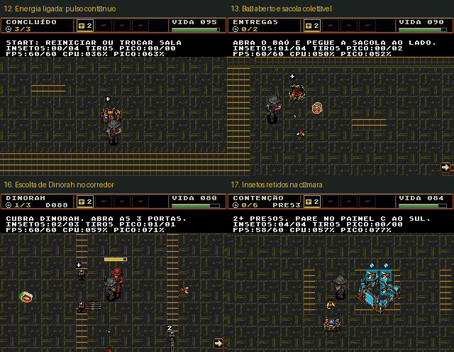
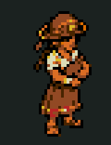
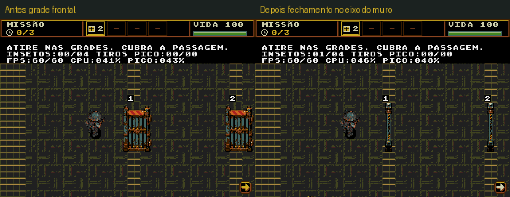
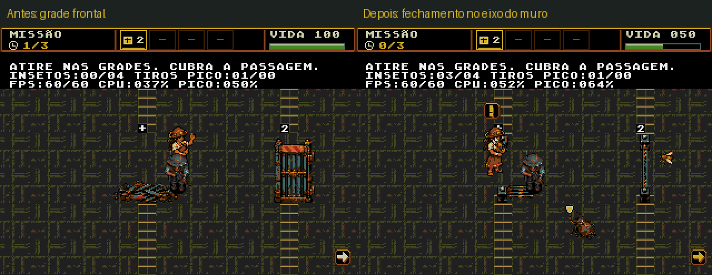
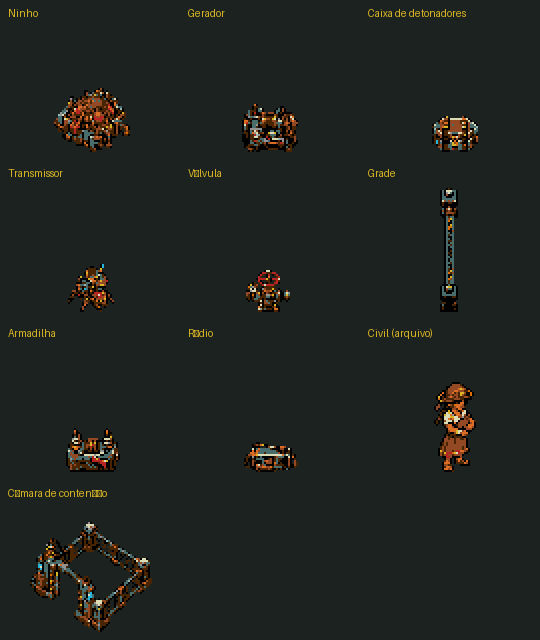
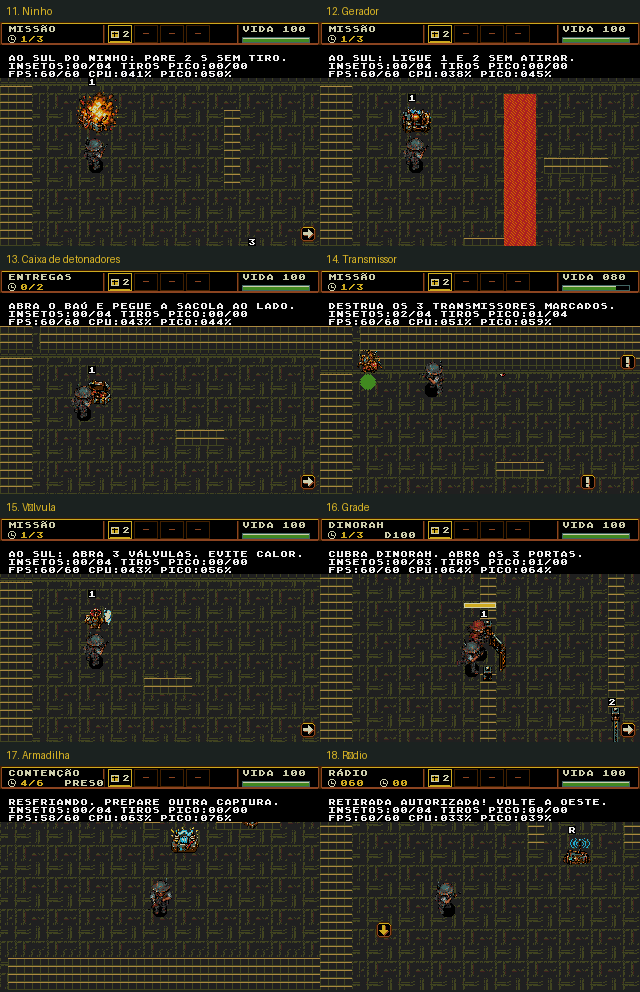

# Sprites e animações dos objetivos

Dez folhas, com **60 quadros de autoria**, no pacote das salas de teste 11–18.
O civil anterior fica como arte de arquivo; a evacuação usa a Dinorah existente.
A campanha permanece com seus objetivos e sua arte anteriores.

## Revisão atual dos objetivos

- **Subestação:** equipamentos ligados repetem o pulso 5 → 4 → 3 → 4. O ciclo
  continua após o resultado e congela na pausa.
- **Carregamento:** o baú abre e revela uma sacola ao lado. A coleta usa a
  área de 16×16 da sacola, depois de um breve tempo de exposição. Damião
  carrega o bornal até o depósito; o baú fica vazio. O desenho reutiliza o
  bornal existente, sem ativar a recuperação de inventário após derrota.
- **Evacuação:** extensão da escolta da sala 8, com a Dinorah completa em uma
  rota de 11 pontos e três portas em alturas alternadas. Ela conserva suas
  animações, tiros, vida e espera por cobertura. A vitória exige as portas
  abertas e os dois vivos na saída. A versão estendida fica na sala 16.
- **Enxame:** a nova câmara tem entrada a oeste, campo de retenção, luzes de
  ocupação e processamento. Cada inseto atraído é puxado para um ponto interno
  e fica preso. Com dois ou mais retidos, o painel C em `(216,240)` carrega por
  1 s e processa a carga em 1,5 s. Há 2 s de resfriamento; a meta é seis.
  Matar um inseto por tiros comuns não conta como processamento da câmara.

A câmara torna a captura gradual visível, enquanto a abertura oeste permite
ao jogador entrar e sair para atrair os insetos. O painel próximo mantém o
equipamento no enquadramento. A arte foi gerada com ImageGen integrada;
[fonte e prompt completo](containment.json).



[NTSC atual](validation/mission-polish/ntsc/report.json) ·
[PAL atual](validation/mission-polish/pal/report.json) ·
[Regras das salas](../../doc/fases-experimentais.md).

A escolta usa três insetos simultâneos, reservando orçamento para Dinorah e
seus dois tiros; as demais salas usam quatro. Os dois grupos de tiros mantêm
o limite de seis. Os limites e as perdas de VBlank aparecem nos relatórios.

## Medições da revisão atual

**130 verificações passaram**, 65 por região, além de `tools/check.py` e da
regressão de travessia/escolta original em NTSC/PAL. As quatro capturas da
revisão atual e seus relatórios correspondem ao SHA-256 desta ROM.

| Sala | NTSC ações | NTSC normal | NTSC estresse | PAL ações | PAL normal | PAL estresse |
|---|---:|---:|---:|---:|---:|---:|
| 11 | 60.00 | 59.80 | 59.47 | 50.00 | 50.00 | 49.63 |
| 12 | 59.69 | 60.00 | 59.23 | 50.00 | 50.00 | 49.50 |
| 13 | 59.68 | 60.00 | 59.40 | 49.76 | 50.00 | 49.57 |
| 14 | 60.00 | 59.97 | 58.93 | 50.00 | 50.00 | 49.63 |
| 15 | 59.86 | 60.00 | 58.77 | 50.00 | 50.00 | 49.53 |
| 16 | 59.96 | 59.23 | 58.20 | 50.00 | 50.00 | 49.67 |
| 17 | 59.54 | 59.93 | 59.53 | 49.88 | 49.93 | 49.63 |
| 18 | 60.00 | 59.97 | 58.33 | 50.00 | 50.00 | 49.43 |

As médias normais/de estresse usam janelas de 30 s. O estresse mantém o teto
da sala preenchido: três insetos na escolta, quatro nas demais, 6 + 6 tiros
e equipamento máximo; Dinorah conserva até dois tiros aliados. Rádio e vida
de Dinorah são repostos nesses ensaios de carga, separadamente dos testes
reais de falha. As rotas de solução usam reforços pausados e proteção contra
derrota de Damião. O bot de dificuldade usa vida normal e não substitui o
playtest humano.

O alvo estrito continua em 60/50 FPS. `target_met` e as perdas de VBlank
permanecem nos relatórios; a aprovação usa 98% da cadência normal e 95% no
estresse contínuo. A escolta com quatro insetos ficou abaixo desse orçamento;
o teto jogável foi ajustado para três. A sonda de visão de Dinorah também
passou a consultar obstáculos sem causar dano às portas, com nova tentativa
a 6 Hz quando não há alvo visível.

- SHA-256 atual: `415b2aa635f51626f067e0bd7bc57ba7929d178a8c978f26bd3d2cc28d08d88a`.
- ROM: 1835008 bytes; arte de objetivos: 54528 bytes em 4bpp.
- Data: 23/10/2026. Não houve teste em hardware físico.
- [Escolta original NTSC](validation/mission-polish/original-routes-ntsc/report.json) e [PAL](validation/mission-polish/original-routes-pal/report.json).

## Histórico da revisão do civil

Na revisão anterior à escolta, a personagem civil foi transformada em uma mulher sertaneja: trança escura, chapéu de
couro em meia-lua, blusa em tom de areia, saia em ferrugem e sandálias.
Os tons terrosos do cangaço usam a paleta existente, mantendo a escala 32×48,
as seis poses e o apoio dos pés. A edição usou a ferramenta ImageGen integrada,
com a parceira existente como referência de estilo;
[prompt completo e origem](refugee-woman.json).
As duas folhas masculinas anteriores foram preservadas em
`history/refugee-v1/` e `history/refugee-v2/`.



Os testes da personagem estão em [NTSC](validation/refugee-woman/ntsc/report.json)
e [PAL](validation/refugee-woman/pal/report.json), com a identificação da ROM
correspondente. Os relatórios completos abaixo documentam a revisão inicial
dos objetivos. A [revisão masculina anterior](refugee-correction.json) mantém
seus próprios [testes](validation/refugee-correction/ntsc/report.json).

A revisão feminina passou em **16 verificações**, oito por região, incluindo
poses de caminhada, gesto de chegada, pausa e integridade dos quadros em VRAM.
As ações e a carga normal mantiveram 60 FPS em NTSC e 50 FPS em PAL. Sob
estresse com quatro insetos e 6 + 6 tiros, as médias foram 58,13 e 49,30 FPS.
A ROM dessa revisão tem SHA-256 `90b33501b769dc0e6249faee1e901b0adacae1f05a617111b4b15e3008b2ba84`.

## Histórico do encaixe dos portões no muro

A grade frontal ocupava até 37 pixels de largura, enquanto o muro tem 16.
A orientação da arte e a folga nas extremidades davam a impressão de um
objeto solto, em vez de uma barreira instalada no vão.

A folha nova acompanha o eixo norte–sul do muro, com batentes nas pontas e
queda para leste. O corpo fechado ocupa 9 pixels dentro da espessura do muro.
As duas pontas de 16×8 são permanentes; só o trecho central de 16×48 perde a
colisão ao destruir a folha. Esse vão permite a passagem do corpo de 16×16.
Mapa, paredes sólidas e folhas usam a geometria compartilhada de
`tools/build_operations.py`. A reserva de arte continua em 64×64, sem aumentar
o consumo de VRAM ou a quantidade de sprites.

A folha foi gerada com ImageGen integrada. O exportador registra cada quadro
pelo centro do batente sul, evitando que o ponto de montagem se desloque ao
dobrar a folha. [Prompt, coordenadas e âncoras](gate-mount.json).
A fonte anterior está preservada em `history/gate-v1/`.




Os relatórios dessa revisão são [NTSC](validation/gate-mount/ntsc/report.json) e
[PAL](validation/gate-mount/pal/report.json). O ensaio anterior reproduziu a
[falha esperada dos batentes](validation/gate-mount/before/report.json): sem
a folha, o jogador podia atravessar as pontas que deveriam continuar sólidas.
O teste atual verifica os três encaixes, as pontas permanentes, a travessia
central, os tiros, a caminhada da sertaneja, os quadros em VRAM e a câmera.

**18 verificações passaram**, nove por região, além de `tools/check.py`.
As ações e a carga normal mantiveram 60 FPS em NTSC e 50 FPS em PAL.
No estresse de quatro insetos e 6 + 6 tiros, as médias foram 59,37 e 49,57 FPS;
ainda há perdas de VBlank sob essa carga.
ROM dessa revisão: `5964565a940ebeb4cd9389d410fb9148022c7a67d2981ee0d400353b72fe1b07`, 1835008 bytes.




[ROM atual](../../out/release/Plaguefall.bin) · [Regras das salas](../../doc/fases-experimentais.md)
· [Prompts completos](prompts.json) · [Atlas de todos os quadros](atlas-nearest.png)
· [Metadados](assets.json)

| Recurso | Dimensão nativa | Reação à ação |
|---|---|---|
| Ninho | 48×48 | Carga acende, casca rompe, explosão, fumaça e carcaça queimada persistente. |
| Gerador | 32×32 | Volante muda, bobina acende, faíscas e máquina energizada. Também identifica o painel central. |
| Caixa de detonadores | 32×32 | Fecho libera, tampa abre, transferência e caixa vazia. A carga transportada usa a arte nova; o depósito D mostra a descarga. |
| Inseto transmissor | 32×32 | Antena pulsa, módulo rompe, pernas recolhem e carcaça com antena quebrada. Substitui o corpo visual dos três alvos, preservando sua IA e colisão. |
| Válvula | 32×32 | Volante gira, jato de vapor sai, pressão diminui e a válvula permanece aberta. |
| Grade | 64×64 | Barras amassam, dobradiças rompem, grade cede e cai, deixando sucata no chão. |
| Controle/emissor da armadilha | 32×32 | Alavanca engata, bobina carrega, descarga elétrica e resfriamento. O controle C e o emissor central reagem juntos. |
| Rádio | 32×32 | Antena transmite e confirma o sinal; na falha, ocorre curto e permanece um rádio destruído. |
| Civil (arquivo) | 32×48 | Folha preservada de espera, caminhada e chegada. A sala 16 agora usa Dinorah. |
| Câmara de contenção | 64×64 | Entrada, trava de energia, retenção pulsante, processamento e resfriamento. |

## Autoria e alinhamento visual

As dez folhas em `source/` foram geradas separadamente pela ferramenta
**ImageGen integrada**, com o protagonista e os itens existentes como
referências de estilo. Os prompts e as referências usadas estão preservados em
`prompts.json`. O exportador não desenha substitutos procedurais: extrai os
quadros das folhas, conserva uma escala comum e o apoio no chão, reduz por
vizinho mais próximo e indexa na mesma paleta de 15 cores opacas dos insetos.

A câmera elevada, os contornos escuros, os metais em cobre/ferrugem, os tecidos
e as pequenas luzes em ciano seguem o sertão industrial do jogo. A sertaneja tem a
mesma reserva 32×48 dos humanos existentes. Nenhum novo banco de paleta é usado.

## Integração

- As máquinas usam tiles no plano de objetos. O corpo dos transmissores, a
  carga carregada e os civis usam sprites de hardware.
- Os quadros da missão atual ficam residentes em VRAM. Durante a animação, o
  jogo troca referências de tiles, evitando upload contínuo de padrões.
- A reserva começa no tile 817. A maior combinação atual, controle e câmara, ocupa 480
  tiles e termina antes da barra de objetivo e da fonte. Isso é conferido no
  código e pelos bytes reais da VRAM no emulador.
- A câmera atualiza somente as bordas recém-expostas do mapa circular; os
  quadros completos são redesenhados quando a pose muda. O preenchimento
  transparente conserva os elementos de terreno atrás da margem do sprite.
- Ninhos, geradores e válvulas são operados **pelo lado sul**, sem atirar. Isso
  mantém o corpo de Damião fora da área principal da animação.
- O resultado congela combate e objetivos, mas permite terminar a última
  reação visual. A pausa congela também as animações. A reinicialização limpa
  poses, destroços e contadores de eventos.

## Validação

[NTSC](validation/ntsc/report.json) · [PAL](validation/pal/report.json).

O teste cobre conclusão por controle, todos os quadros da ação, continuidade
após o resultado, pausa, bytes residentes dos recursos, correspondência dos
tiles visíveis durante a movimentação da câmera e o rádio destruído após a
falha. Também mede o FPS do percurso com ações e animações, além dos perfis
normal e de estresse de 30 s por sala e região.

Os limites atuais são quatro insetos (três na escolta) e seis tiros por lado; a potência de
cinco projéteis permanece disponível. O bot de dificuldade conserva suas
limitações e não substitui o playtest humano. As medições e o hash da ROM
ficam nos relatórios e no resumo consolidado abaixo.

## Reprodução

```sh
python3 game/art/objective-sprites-v1/export.py --check
arch -x86_64 /usr/bin/python3 game/tools/test_operations_emulator.py \
  --seconds 30 --output game/art/objective-sprites-v1/validation/mission-polish/ntsc
arch -x86_64 /usr/bin/python3 game/tools/test_operations_emulator.py \
  --pal --seconds 30 --output game/art/objective-sprites-v1/validation/mission-polish/pal
```

## Resumo da validação completa anterior à revisão do civil

**128 verificações passaram**, 64 em NTSC e 64 em PAL, além de `tools/check.py`.
Todas as 54 imagens exportadas são distintas. A tabela mostra médias por
percurso/janela, não mínimos instantâneos de cada quadro. Os percursos de ação
usam reforços pausados e proteção de Damião, mantendo os inimigos obrigatórios.
A carga normal e o estresse têm 30 s por sala/região; o rádio é mantido vivo
nesses ensaios para que sua falha não interrompa a medição.

| Sala | NTSC ações | NTSC normal | NTSC estresse | PAL ações | PAL normal | PAL estresse |
|---|---:|---:|---:|---:|---:|---:|
| 11 — Ninhos | 60.00 | 59.87 | 59.30 | 50.00 | 50.00 | 49.50 |
| 12 — Subestação | 59.92 | 60.00 | 59.23 | 50.00 | 50.00 | 49.50 |
| 13 — Carregamento | 59.68 | 59.97 | 59.53 | 49.73 | 50.00 | 49.60 |
| 14 — Transmissores | 60.00 | 59.93 | 58.93 | 50.00 | 50.00 | 49.63 |
| 15 — Válvulas | 60.00 | 59.97 | 58.97 | 50.00 | 50.00 | 49.50 |
| 16 — Evacuação | 60.00 | 60.00 | 58.40 | 50.00 | 50.00 | 49.30 |
| 17 — Armadilha | 59.66 | 60.00 | 59.40 | 50.00 | 50.00 | 49.63 |
| 18 — Rádio | 60.00 | 59.93 | 57.63 | 50.00 | 50.00 | 49.57 |

O alvo estrito é 60/50 FPS. O relatório preserva cada perda de VBlank e
`target_met`; os ensaios aceitam 98% da cadência normal e 95% no estresse
permanente. Aprovação não significa zero quedas. O cenário mais pesado
permaneceu o rádio sob estresse contínuo no NTSC. Não houve teste em hardware
físico. A dificuldade segue aberta ao playtest do autor.



- SHA-256 anterior: `91ffced057322e642ead8c1057470c83df7a57556ea7116b345ad6c65e7c471a`.
- ROM: 1835008 bytes.
- Fontes geradas: 42.240 bytes de quadros 4bpp em ROM.
- Data da validação: 23/10/2026.
- [Capturas reconferidas em NTSC](validation/ntsc/capture-validation.json) e
  [PAL](validation/pal/capture-validation.json).
