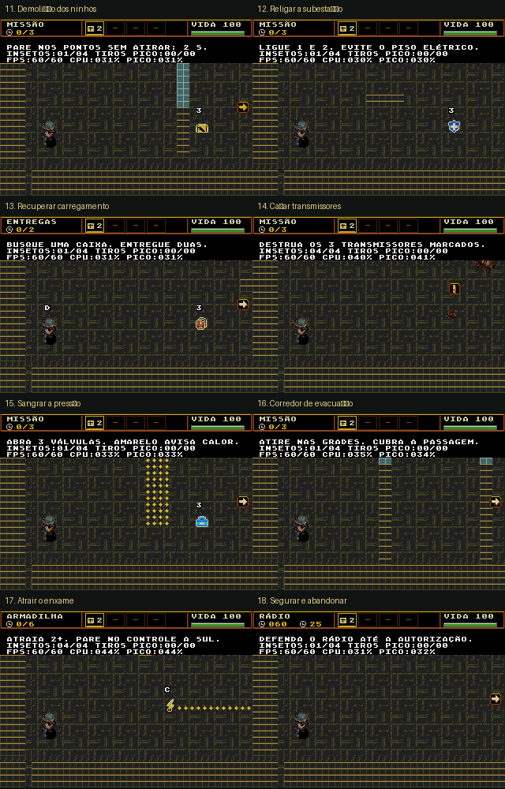

# Missões experimentais — validação anterior à arte própria

Este pacote registra a primeira revisão, anterior aos sprites dedicados. A arte e a validação atuais estão em [objective-sprites-v1](../objective-sprites-v1/README.md). Os números e capturas abaixo são históricos.

A ROM desta revisão contém as oito missões nas salas **11–18** de **FASE TESTE**. A campanha
permanece com seus objetivos e rotas anteriores.

[Regras e controles](../../doc/fases-experimentais.md) ·
[ROM para jogar](../../out/release/Plaguefall.bin) ·
[Relatório NTSC](validation/ntsc/report.json) · [Relatório PAL](validation/pal/report.json)

## Resultado

**112 verificações passaram**, 56 por região, na ROM identificada abaixo.
Conclusão por controle, configuração, pausa, limites dos objetivos, carga e
sondagens de dificuldade foram exercitados no Genesis Plus GX. A conclusão
funcional usa reforços pausados e proteção contra derrota; a sondagem de
pressão usa vida normal. Os cenários de falha e estresse declaram a preparação
de RAM. Na medição do rádio, sua vida e tempo são repostos para sustentar a
carga durante todos os 30 s; sua falha real é verificada separadamente.

Cada uma das 32 medições de desempenho dura 30 s de VBlanks: oito salas,
duas regiões e dois perfis, totalizando 16 minutos emulados. O estresse mantém
quatro insetos e seis projéteis de cada lado, com tiro de cinco projéteis e
velocidade máxima. Os números abaixo são médias da janela; não são mínimos
instantâneos de cada quadro.

| Sala | Normal NTSC | Estresse NTSC | Normal PAL | Estresse PAL | Bot normal NTSC / PAL |
|---|---:|---:|---:|---:|---|
| 11 — Demolição dos ninhos | 59.80 | 59.47 | 50.00 | 49.87 | derrota / venceu (61 HP) |
| 12 — Religar a subestação | 60.00 | 59.30 | 50.00 | 49.63 | venceu (17 HP) / venceu (67 HP) |
| 13 — Recuperar carregamento | 60.00 | 59.63 | 49.93 | 49.70 | venceu (100 HP) / venceu (31 HP) |
| 14 — Caçar transmissores | 59.97 | 59.37 | 50.00 | 49.63 | derrota / derrota |
| 15 — Sangrar a pressão | 59.93 | 59.00 | 50.00 | 49.50 | venceu (5 HP) / venceu (13 HP) |
| 16 — Corredor de evacuação | 60.00 | 58.47 | 50.00 | 49.27 | derrota / derrota |
| 17 — Atrair o enxame | 59.93 | 59.37 | 50.00 | 49.67 | derrota / derrota |
| 18 — Segurar e abandonar | 60.00 | 59.27 | 49.93 | 49.60 | derrota / derrota |

O alvo estrito é 60/50 FPS. As perdas pontuais permanecem visíveis em
`missed_vblanks` e `target_met`; os testes aceitam no mínimo 98% da cadência
normal e 95% no estresse. **A aprovação dos testes não significa zero quedas.**
A evacuação foi a sala mais pesada no estresse NTSC. Não houve ensaio em
hardware físico.

O bot faz o percurso objetivo, não usa itens e não esquiva de forma inteligente.
Suas derrotas indicam pressão sobre esse percurso, sem provar impossibilidade
ou determinar a dificuldade humana. Caça, evacuação, armadilha e defesa com
retirada precisam de atenção especial no playtest; demolição também teve
resultado diferente entre as regiões. As salas oferecem reforços pausados,
cadência normal, pressão contínua, equipamento inicial e proteção de Damião
para isolar esses fatores.

## Regressão e gráficos

Passaram `tools/check.py`, a reprodução dos oito cenários e as regressões de
travessia/escolta e regras de morte. O teste antigo de terreno tinha um endereço
fixo anterior à reserva atual do bornal; foi corrigido para consultar os valores
do cabeçalho de tiles.

Nenhum sprite novo foi inventado: personagens, insetos, itens, marcadores,
cores e barra de progresso são os recursos existentes. As plantas usam o atlas
industrial de testes. Os símbolos dos pontos de missão são provisórios para
validação das regras; a arte narrativa definitiva pode ser discutida após o
playtest.

## Identificação

- Data: 23/10/2026.
- ROM: `game/out/release/Plaguefall.bin`.
- SHA-256: `602309eae1708698c18f868fc3bcd1de5e29d9e4b314e7e2e230f4d031017f68`.
- Tamanho: 1835008 bytes.
- Emulador: Genesis Plus GX; NTSC 60 Hz / PAL 50 Hz.
- Reprodução: `game/tools/test_operations_emulator.py` e `--pal`.
