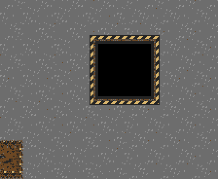
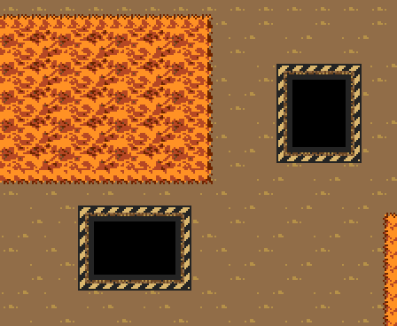

# Bordas de segurança dos buracos

Todos os **20 buracos** das fases de travessia (4, oito buracos) e escolta (6B, doze buracos) recebem uma faixa industrial hachurada de **4 pixels**, em amarelo e preto, com contorno escuro discreto. O contorno cobre os quatro lados e os cantos. As salas de treino correspondentes usam os mesmos mapas e recebem a melhoria automaticamente.

A faixa é pintura do chão ao redor do buraco. O vazio e sua borda interna permanecem; colisões, passagem de tiros, lama/lava e caminhos do jogador e de Dinorah conservam as mesmas regras. O exportador continua verificando o trajeto completo com a área de16×16 do personagem.

As bordas são tiles geométricos nativos em tools/build_route_stages.py, na paleta existente de cada cenário. A faixa de4 pixels ocupa metade da espessura anterior e preserva o desenho do piso nos outros4 pixels de cada tile vizinho. O mapa4 ocupa543 tiles e o mapa6B455, dentro da reserva de640; não há novos sprites, paletas ou DMA por quadro.





## Verificação

A [ROM verificada](../../out/pit-safety/Plaguefall.bin) e seus relatórios estão identificados pelo SHA-256 no [resumo](validation/summary.json). Os [testes NTSC](validation/ntsc/report.json) e [PAL](validation/pal/report.json) verificam travessia completa, rolagem após1536 pixels, colisão dos buracos, passagem de tiros, escolta e seus resultados. As preparações isoladas de estado por RAM estão declaradas no teste; a navegação usa controles reais.

```sh
python3 game/tools/build_route_stages.py --check
arch -x86_64 /usr/bin/python3 game/tools/test_route_objectives_emulator.py --build-dir game/out/pit-safety --output game/art/pit-safety-v1/validation/ntsc
arch -x86_64 /usr/bin/python3 game/tools/test_route_objectives_emulator.py --pal --build-dir game/out/pit-safety --output game/art/pit-safety-v1/validation/pal
python3 game/tools/package_rom.py --output game/out/pit-safety --check
```
