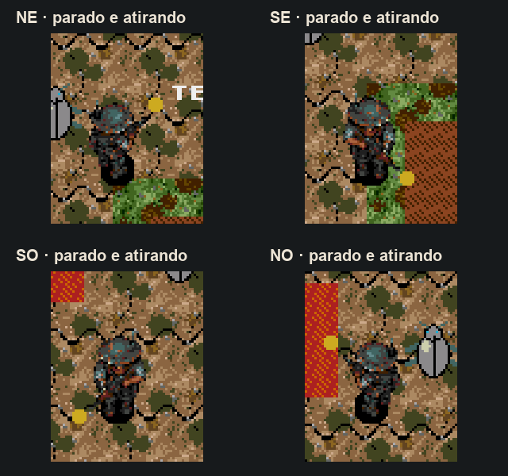

# Parada e disparo nas diagonais

Ao soltar uma diagonal, o controle pode liberar um eixo alguns quadros antes do outro. Antes da correção, esse intervalo substituía a mira diagonal por norte, sul, leste ou oeste. As animações diagonais já existiam; o problema estava na leitura da soltura.

`player.c` agora tolera **80ms** nessa transição, configurados em `PLAYER_DIAGONAL_RELEASE_MS`. O movimento continua imediato. Se os dois eixos forem soltos nessa janela, a mira diagonal fica preservada no idle e nos disparos. Segurar o eixo restante confirma uma mudança para a direção reta; uma nova direção depois de parar responde imediatamente. Não há botão adicional.



[ROM principal](../../out/release/Plaguefall.bin) · [Build e memória](build-validation.json) · [NTSC](ntsc/report.json) · [PAL](pal/report.json).

## Verificação

O teste nativo compila o `player.c` de produção com ASan/UBSan. Foi reproduzida a falha anterior: diagonal noroeste → um quadro segurando oeste → soltar o controle resultava em mira oeste. A correção passa pelas quatro diagonais, nas duas ordens de soltura, com intervalos de um a três quadros, idle prolongado, autofire parado, mudança intencional para direção reta, giro para a direção oposta e reinício do jogador, em 50/60Hz.

O Genesis Plus GX confere **16 cenários por região** na ROM real. O controle entra no sandbox; cada cenário restaura esse ponto por um save state do próprio emulador. Não há escrita na RAM do jogo. São verificados os dois frames de idle diagonal na VRAM, o espelhamento do sprite, a posição parada e os componentes X/Y dos projéteis de produção.

Na raiz do projeto:

```sh
python3 game/tools/test_player_aim.py
arch -x86_64 /usr/bin/python3 game/tools/test_player_aim_emulator.py
arch -x86_64 /usr/bin/python3 game/tools/test_player_aim_emulator.py --pal
```

`game/tools/check.py` inclui o teste nativo de mira, além dos recursos e do áudio existentes.
