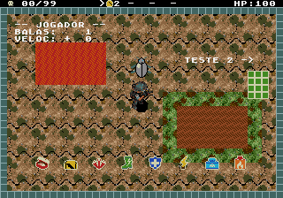
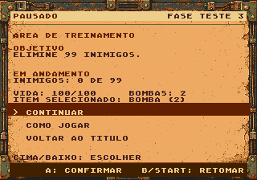
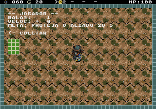
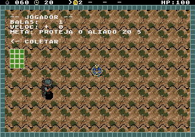

# Verificação das fases de teste — 22/10/2026

> Registro histórico das salas antigas. Elas foram substituídas pelas [seis salas aprovadas](../training-v2/README.md). O comando `test_sandbox_emulator.py` agora executa a validação nova.

A opção **FASE TESTE** do menu abre seis salas, separadas da campanha. A porta direita avança e a esquerda retorna. São arenas clássicas de tela fixa, sem os cenários aprovados das fases da história. O HUD de 24 px continua sendo uma proposta visual e não está aplicado a elas.

| Sala | Conteúdo atual |
|---|---|
| 1 — Teste 1 | Alvo inofensivo com 20 de vida, oito tipos de item com reposição, lava e lama. |
| 2 — Teste 2 | Três alvos frágeis agrupados para experimentar o raio em cadeia. Reaparecem dois segundos após serem eliminados. |
| 3 — Chefe | Escorpião com comportamento de combate e lacaios. Reaparece quando a arena fica sem inimigos. |
| 4 — Sobreviver | Sobreviver por 20 segundos. |
| 5 — Coletar | Recolher três marmitas. |
| 6 — Proteger | Proteger a Santa por 20 segundos; ela começa com 60 de vida. |

As salas 4–6 reiniciam a própria demonstração ao concluir o objetivo ou perder o alvo. A morte de Damião abre o resultado de derrota; repetir conserva a sala e restaura a vida e os equipamentos básicos.

## Problemas encontrados

1. **A falha da proteção não é alcançável por contato dentro dos 20 segundos.** A Santa tem 60 de vida, recebe 12 por contato e usa a invulnerabilidade legada de cinco segundos. Mesmo mantendo um inimigo em contato ininterrupto, a vida passou por **60 → 48 → 36 → 24 → 12**, e o objetivo terminou antes do quinto dano. A demonstração não permite treinar a perda do alvo. O caminho de falha existe e reinicia corretamente quando se prepara a vida do alvo em zero, mas isso não representa uma derrota natural. A configuração está em `src/levels/defs/test.c`; as regras estão em `src/actors/npc.c`.
2. **A pausa apresenta uma meta falsa nas salas 1–3.** `MISSION_goal()` usa o `killTarget=99` do sandbox e escreve “ELIMINE 99 INIMIGOS”, inclusive na sala do chefe. Esse contador mantém a arena aberta; não é uma condição real de conclusão do treino.
3. **Damião e a Santa começam sobrepostos na sala 6.** O jogador nasce em `(152,108)`, e o alvo em `(147,103)`. As áreas de 16×16 e 24×24 se sobrepõem; a imagem do alvo fica encoberta na entrada.
4. **Apresentação ainda legada.** Bordas quadriculadas, terrenos simples, ícones do HUD sem o tratamento opaco das arenas novas e textos de depuração “BALAS/VELOC” sobre o cenário destoam da campanha. Não há cabeçalho claro com nome e instruções da sala durante o combate. A pausa já usa o painel novo.
5. **Documentação desatualizada.** A seção “Fase teste” do GDD descreve três salas; o executável possui seis.

Os problemas foram registrados nesta auditoria. Os fontes e a ROM do jogo não foram alterados.

## O que foi verificado

[Relatório NTSC](validation/ntsc/report.json) · [Relatório PAL](validation/pal/report.json) · [Resumo e evidências](avaliacao.json).

- Entrada pelo menu, dez passagens por portas em cada região e pausa/retomada nas seis salas, usando somente controles. A vida ficou estável durante a pausa.
- Lava causando dano real, lama reduzindo a velocidade e recuperação ao sair. Tiro reduzindo a vida do alvo de 20 para 19.
- Surgimento dos três alvos e eliminação dos três com um disparo após coleta real do raio, seleção com C e ativação com B.
- Escorpião presente e escudo de 8×8 exibido durante a blindagem.
- Reinício das demonstrações de sobrevivência, coleta e proteção. A coleta registrou **1 → 2 → 3 → 0**, sem escrever no contador.
- Derrota por contato real e repetição por START em cada uma das seis salas, nas duas regiões; sala preservada e vida restaurada para 100.
- Ensaio de contato contínuo na proteção, sem escrever na vida nem na invulnerabilidade da Santa, confirmando o limite de quatro danos dentro do objetivo.

Os ensaios isolados usam preparação explícita em RAM: reposicionamento do jogador, inimigos preparados, aceleração de temporizadores em alguns objetivos e vida inicial de Damião em 1 para conferir a derrota. A navegação e as pausas proíbem essas escritas. Não são doze batalhas completas vencidas naturalmente nem uma medição de desempenho sob carga máxima. Os relatórios identificam a ROM por SHA-256 e detalham a preparação de cada caso.









Para reproduzir:

```sh
arch -x86_64 /usr/bin/python3 game/tools/test_sandbox_emulator.py
arch -x86_64 /usr/bin/python3 game/tools/test_sandbox_emulator.py --pal
```
