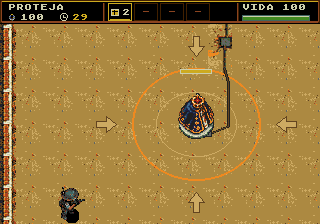

# Santa iso60 v2 — defesa no treino e na campanha

Redesenho solicitado para aproximar a Santa da câmera elevada de 60° dos personagens: topo da coroa aberto e visível, ombros/manto vistos de cima, corpo encurtado pela perspectiva e pedestal compacto. Trata-se de correspondência visual, não de medição de um ângulo 3D em raster.

Arte criada com **image_gen integrado**, sem CLI/API externa. A [fonte final com transparência](originals/santa.png) deriva da [base de câmera](originals/camera-base.png) e do [prompt final exato](prompt-camera-final.txt). A base foi gerada com o [prompt de perspectiva](prompt-camera.txt), usando os sprites do protagonista como referência. As duas tentativas frontais anteriores foram rejeitadas.

O [PNG nativo de 40×48](santa.png) usa índice0 transparente e a paleta PAL3 existente do cenário. A [prévia 8×](santa-8x.png) usa vizinho mais próximo. O exportador apenas recorta, registra, reduz por vizinho mais próximo e indexa a arte gerada.



[Mapa completo com círculos, setas e cabo conectado](ground-layout.png) · [Fase amarela do brilho](validation/ntsc/santa-crown-yellow.png)

A integração remove o recorte antigo de 40×64 em (176,160) com a mesma textura de chão e instala a arte nova em (176,176). A sinalização do chão foi refeita com dois círculos completos e quatro setas voltadas ao centro; o cabo existente continua até a parte opaca do pedestal. Esses sinais são geometria nativa de piso feita pelo exportador, sem redesenhar a arte raster da Santa. O enquadramento inicial mantém as quatro setas abaixo do HUD e dentro da tela, preservando a câmera de acompanhamento quando o jogador se afasta. Os pixels fora da área de sinalização de 208×192 em (96,112) permanecem idênticos. A origem de cenário anterior, em phase05-beacon-v1/hardware, fica preservada; tools/install_stage_art.py aplica explicitamente esta substituição na versão ativa.

O corpo e a base formam uma área sólida de **40×48**, usada também para contato de inimigos pelos quatro lados. Assim o jogador não atravessa a parte superior, e os inimigos não precisam entrar no obstáculo para causar dano. A âncora de perseguição e da onda de choque continua em (196,220). Os tiros passam como antes. Corpo e base piscam juntos; o conjunto desaparece quando cai. O brilho de8×8 acompanha a coroa e alterna vermelho e amarelo, usando exclusivamente os índices3/4 da PAL1, sem tinta branca ou preta. As duas fases ficam residentes no atlas e alternam em um ciclo de um segundo em NTSC e PAL; o efeito fica oculto nos quadros invisíveis da Santa. A barra de vida e o ícone do HUD permanecem.

O atlas da fase5 tem **636 tiles /20.352 bytes**, dentro da reserva de640. O instalador remove apenas padrões sem referências e deduplica os tiles por igualdade exata; não aproxima nem reduz a imagem. Os endereços das outras reservas de VRAM e as paletas permanecem iguais. A troca do mapa usa40 células/80 bytes por mudança de visibilidade. As duas fases do brilho ocupam dois tiles/64 bytes no mesmo atlas e um sprite por quadro visível. A defesa mantém100 HP,12 pontos por contato,2,5s de invulnerabilidade e30s de duração.

## Verificação

A [ROM verificada](../../out/santa-iso60/Plaguefall.bin) é uma cópia identificada pelo SHA-256 no [resumo](validation/summary.json), preservada para que recompilações simultâneas da ROM principal não invalidem estes relatórios.

- [Treino NTSC](validation/ntsc/report.json) e [treino PAL](validation/pal/report.json): bloqueio pelos quatro lados, dano real pelos quatro lados, ambas as fases vermelha/amarela do brilho na posição correta e somente com os índices de cor esperados, ausência do brilho ao piscar, atualização completa das40 células, sucesso pelo temporizador e falha por nove contatos reais. A preparação dos ensaios isolados reposiciona jogador/inimigos; não escreve na vida da Santa.
- [Campanha NTSC](validation/campaign-ntsc/report.json) e [campanha PAL](validation/campaign-pal/report.json): entrada, recursos/VRAM, efeitos, limites, terreno, pausa, uma tentativa comum por região e rotas de sucesso/falha. São ensaios funcionais; não certificam60/50 FPS em toda situação.
- Teste nativo de contato e temporizadores com ASan/UBSan, exportação reproduzível, limites de VRAM e pacote da ROM conferidos.

```sh
python3 game/art/santa-iso60-v2/export_sprite.py --check
python3 game/tools/install_stage_art.py --check
python3 game/tools/test_npc_contact.py
arch -x86_64 /usr/bin/python3 game/tools/test_training_emulator.py --only-santa --build-dir game/out/santa-iso60 --output game/art/santa-iso60-v2/validation/ntsc
arch -x86_64 /usr/bin/python3 game/tools/test_training_emulator.py --only-santa --pal --build-dir game/out/santa-iso60 --output game/art/santa-iso60-v2/validation/pal
arch -x86_64 /usr/bin/python3 game/tools/test_campaign_stages_emulator.py --nodes 6 --matches 1 --no-stress --seconds 60 --build-dir game/out/santa-iso60 --output game/art/santa-iso60-v2/validation/campaign-ntsc
arch -x86_64 /usr/bin/python3 game/tools/test_campaign_stages_emulator.py --pal --nodes 6 --matches 1 --no-stress --seconds 60 --build-dir game/out/santa-iso60 --output game/art/santa-iso60-v2/validation/campaign-pal
python3 game/tools/package_rom.py --check
```
