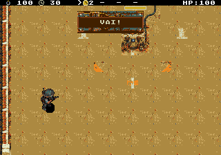
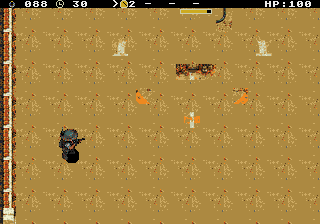
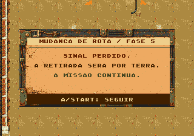

# Santa — visibilidade do objetivo da fase 5

A Santa pintada no cenário passa a ser a única representação do objetivo. O pequeno ícone flutuante foi removido. Uma barra de vida acima da imagem identifica o objeto protegido, e a câmera mantém essa barra abaixo do HUD. O ícone do HUD agora usa a paleta colorida correta e seu fundo opaco.

A própria imagem pisca durante a invulnerabilidade após um acerto. Quando a vida termina, o corpo da Santa desaparece e revela o chão; o pedestal permanece. O resultado da fase captura esse estado destruído antes de limpar a entidade lógica. A arte aprovada em estado íntegro continua idêntica.

O recorte altera apenas 30 células do mapa por mudança de visibilidade. A barra ocupa um sprite de 32×8 e quatro tiles, atualizados somente quando a vida muda. O limite de VRAM é verificado em compilação. O gerador de cenários reproduz esses dados sem editar o atlas raster.

## Validação

Os relatórios [NTSC](validation/ntsc/report.json) e [PAL](validation/pal/report.json) identificam a ROM testada pelo SHA-256. O [resumo](validation/summary.json) registra os resultados e a correspondência com o arquivo distribuído na data do teste.

- Seis tentativas comuns, três por região, usando apenas controles após a preparação inicial: todas terminaram em derrota do jogador, sem travamento ou tempo esgotado. Os caminhos de sucesso e falha do objetivo foram verificados separadamente.
- Contato real de inimigo reduz a vida de 100 para 88, diminui a barra e alterna a imagem da Santa com o chão. Contatos repetidos chegam a zero sem escrever na vida pelo teste.
- Conferência da VRAM e da lista de sprites: ícone opaco na paleta correta, barra presente, ausência do ícone flutuante e remoção das 30 células do corpo antes do resultado.
- Limites, tiros junto às paredes, circulação, pausa e retomada passaram nas duas regiões.
- Quatro ensaios de carga de 300 quadros, com rolagem horizontal/vertical, quatro inimigos e seis tiros por grupo: 60 FPS em NTSC e 50 FPS em PAL. Essa medição se refere aos ensaios controlados; as médias das tentativas comuns constam nos relatórios.
- Testes nativos de contato, pedestal, invulnerabilidade e temporizadores passaram com ASan/UBSan. Exportação dos cenários e pacote da ROM conferidos.







Para reproduzir os testes no macOS com Genesis Plus GX instalado:

```sh
arch -x86_64 /usr/bin/python3 game/tools/test_campaign_stages_emulator.py --nodes 6 --matches 3 --output game/art/santa-objective-feedback-v1/validation/ntsc
arch -x86_64 /usr/bin/python3 game/tools/test_campaign_stages_emulator.py --pal --nodes 6 --matches 3 --output game/art/santa-objective-feedback-v1/validation/pal
python3 game/tools/test_npc_contact.py
python3 game/tools/install_stage_art.py --check
python3 game/tools/package_rom.py --check
```
