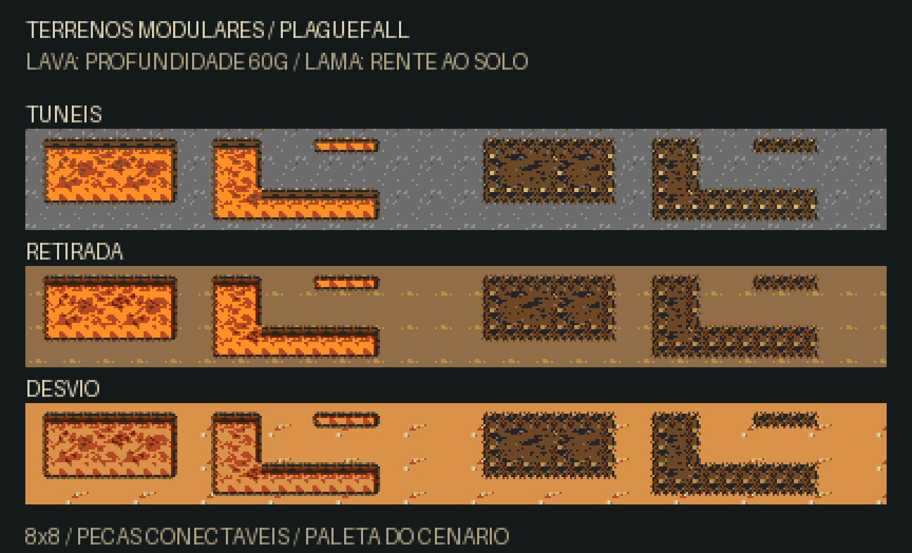

# Lava e lama modulares

Peças nativas de 8×8, com cantos, margens, canais estreitos e oito variações de miolo. Retângulos do mesmo material se conectam: a junção perde a borda interna e pode formar áreas em L. A lava deriva da textura nativa da retirada (fase 6B); a lama reaproveita o granulado de terra do desvio (fase 2B), escurecido para parecer úmido. A lava possui uma borda de rocha com relevo: faixa distante de 6 px, corte interno escuro, luz no topo e lábio próximo de 2 px para leitura na câmera de 60°. Nos canais de apenas um tile de altura, o corte é reduzido para manter a lava visível. A lama conserva margens irregulares e transparentes, sem parede ou sombra de altura, para parecer no mesmo nível do solo. As cores se adaptam à paleta do cenário.



## Arquivos

- [Atlas transparente](atlas.png): 23 peças por linha, duas linhas de lava e uma de lama. [Ampliação sem suavização](atlas-nearest.png).
- [Lava, dois quadros em 4bpp](lava-frames.bin) e [lama em 4bpp](mud.bin), em ordem de tiles. [Formato e vizinhanças](layout.json).
- Arte e prévias: `game/tools/build_terrain_modules.py`. Export para o jogo: `game/src/elements/terrain_art.h`.
- Renderização: `game/src/elements/terrain.c`. Posicionamento e efeitos usam os mesmos `TileRect` da fase.

## Aplicação em uma fase

As coordenadas e dimensões são em tiles de 8 px. Use um piso limpo por baixo: os materiais são uma camada própria, sem recortes de paredes, vegetação ou terreno de outra arena.

```c
static const TileRect lava[] = {
    {20, 12, 8, 4},
    {28, 14, 4, 2}, // toca a primeira área e forma uma extensão
};
static const TileRect mud[] = {{8, 18, 7, 4}};

const LevelDef EXAMPLE_def = {
    .modularTerrain = TRUE,
    .lava = lava, .lavaCount = 2,
    .mud = mud, .mudCount = 1,
    // .arena, objetivo, inimigos e outras regras da fase
};
```

O renderer acompanha a câmera e o anel de 64×32 do VDP, inclusive em mapas de 2048 px. Os cantos ficam dentro dos retângulos; a transparência revela o piso existente. Posicione as áreas sem sobrepor paredes, buracos ou materiais diferentes.

As peças continuam independentes do mapa: os mesmos módulos são adaptados à PAL3 do cenário, sem alterar suas cores. O desenho mantém os agrupamentos de pixels das texturas nativas, com oito miolos combinados em uma área de 32×16 px. Em pisos legados sem paleta de cenário, existe um fallback para PAL1. São 46 tiles residentes (1472 bytes), 2208 bytes de pixels na ROM e 992 bytes de buffers estáticos para remapeamento de cor, sem alocação dinâmica nem sprites adicionais. A lava troca 23 tiles a 5 quadros por segundo, respeitando o orçamento de DMA; a lama permanece estática. Pausa e menus restauram a camada e seus tiles. Sangue não apaga partes de uma área perigosa.

## Integração

Aplicada à sala **4. Colisões e perigos**, à travessia dos túneis (**fase 4 / sala 7**) e à retirada com Dinorah (**fase 6B / sala 8**). Os mapas dessas áreas fornecem o piso; lava e lama são sobrepostas a partir dos dados de jogabilidade. Dano progressivo, lentidão, trajetos e condições de vitória são mantidos.

## Verificação

```sh
python3 game/tools/build_terrain_modules.py --check
python3 game/tools/test_terrain_modules.py
arch -x86_64 /usr/bin/python3 game/tools/test_training_emulator.py --only-terrain
arch -x86_64 /usr/bin/python3 game/tools/test_training_emulator.py --only-terrain --pal
```

Os testes nativos exercitam uniões, canais, lacunas, coordenadas além de 1024 px, sangue e animação sob pressão de DMA. A validação em emulador confere o atlas, a camada visual, a rolagem, a pausa e os efeitos físicos em NTSC/PAL. Relatórios e capturas: [NTSC](depth-validation/ntsc/report.json) e [PAL](depth-validation/pal/report.json).

A revisão de estilo substitui os padrões geométricos e o uso fixo de PAL1 da primeira versão. As capturas em `validation/` registram aquela versão anterior.

A revisão de profundidade modifica apenas a borda da lava. Os pixels da lama e as áreas físicas de dano/lentidão são preservados. As faces de rocha não animam junto com a superfície quente. `style-validation/` preserva a revisão anterior das texturas.
