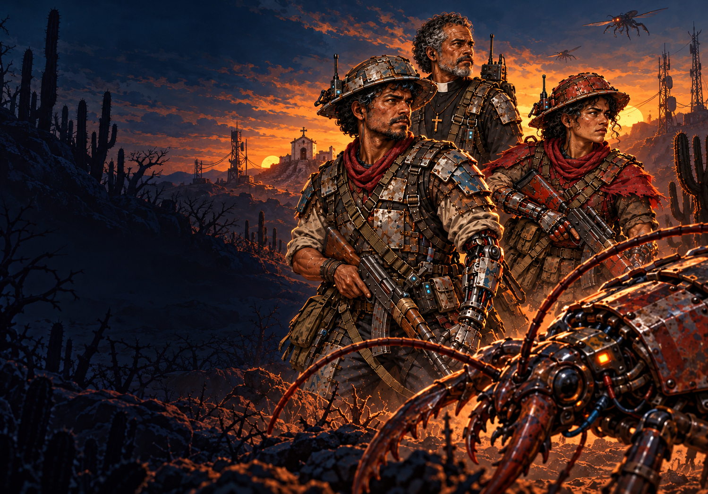

# Tela de seleção — caatinga e resistência



Nova arte do menu principal de Plaguefall: Damião, Dinorah e o padre Comando na caatinga, com mandacarus, vegetação seca, capela, torres de comunicação e insetos biomecânicos. O padre mantém a cabeça descoberta. A área escura à esquerda recebe as opções existentes do jogo; o nome e as opções são texto do VDP, separados da imagem.

O nome oficial do jogo é **Plaguefall**. O menu exibe **PLAGUEFALL**, e os títulos doméstico e internacional do cabeçalho da ROM usam o mesmo nome.

Criada com **image_gen integrado**, usando os concepts aprovados dos três personagens e dos serra-paus como referência de identidade e materiais. O [prompt completo](prompt.txt) registra a composição e as referências. A fonte tem 1499×1049 pixels, com fundo opaco.

## No Mega Drive

- [Imagem nativa 320×224](title-native.png) / [prévia ampliada 3×](title-3x.png).
- [Menu Plaguefall capturado no emulador](emulator/plaguefall-menu-2x.png) / [resolução nativa](emulator/plaguefall-menu.png).
- [Logo reconstruído capturado no emulador](../intro-monologo-v1/emulator-ntsc/logo-2x.png).
- [ROM atual](../../out/release/rom.bin).

O menu oferece **NOVO JOGO / COMO JOGAR / PERSONAGENS / FASE TESTE**. O subtítulo ARENA SHOOTER foi removido. Todo o texto fica à esquerda em branco, incluindo o título e o cursor `>` que identifica a opção selecionada. A arte usa PAL1 e PAL2, com uma paleta de16 cores por tile e23 cores RGB efetivamente presentes nesta exportação. O texto usa PAL0; as paletas do jogo são restauradas ao sair do menu.

A tela continua usando1120 tiles /35840 bytes temporários de VRAM. A conversão agrupa tiles entre duas paletas e aproxima as cores aos oito níveis RGB do hardware. O exportador já empacota os pixels em palavras4bpp; `TITLEBG_load` faz DMA direto da ROM, eliminando a montagem pixel a pixel e o buffer temporário na chegada ao menu. A imagem nativa permanece idêntica. Redimensionamento e quantização são técnicos; o script não desenha personagens, cactos ou insetos.

## Logo FinalQuest

O logo foi [redesenhado com image_gen](../finalquest-logo-v2/README.md) a partir da marca original, preservando o controle inclinado e a exclamação laranja. Usa moldura192×128 com traços e letras mais legíveis,384 tiles temporários e exposição de1s entre fades de0,2s. O exportador desta pasta delega ao novo exportador do logo, evitando voltar à antiga redução. O char-map histórico está em `legacy/logo_data.h`.

## Reprodução e validação

```sh
python3 game/art/title-caatinga-v1/export_title.py
python3 game/art/title-caatinga-v1/export_title.py --check
```

O exportador usa Pillow e NumPy e gera `logo_data.h` / `titlebg_data.h`. O [relatório de assets](validation.json) registra paletas, dimensões e hashes. A [verificação atual do boot](../intro-monologo-v1/build-validation.json) inclui o novo logo, o menu sem subtítulo e o carregamento empacotado. O [relatório original da ROM](build-validation.json) e o [teste original do Genesis Plus GX](emulator/report.json) preservam a auditoria da primeira versão do menu.

A conferência inclui a abertura, as quatro opções, ajuda, galeria, sandbox e início da campanha. O teste compara os pixels da arte ao retornar ao menu. A entrada da tela restaura o backdrop preto, evitando que o fundo cinza da galeria altere as áreas transparentes da imagem.
