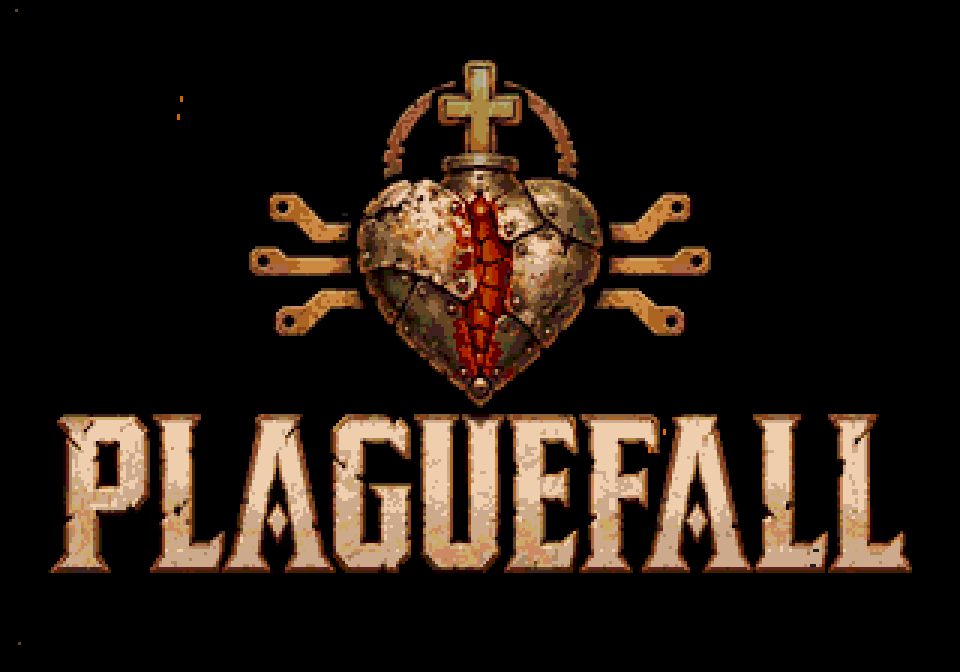

# PLAGUEFALL — título ex-voto, opção B



Abertura: **logo da desenvolvedora → APRESENTA → PLAGUEFALL → monólogo → menu**. O logo da desenvolvedora conserva o asset FinalQuest já usado no projeto. APRESENTA aparece sozinho, branco e centralizado sobre preto por 1,2s, com fades. O título permanece por 4s, com fades de 0,25s e duas respirações de luz no interior do coração. Não há personagens, subtítulos nem instruções na tela.

- [Prévia de 10 segundos, capturada no emulador](abertura-titulo.mp4).
- [ROM atualizada](../../out/release/rom.bin).
- [Imagem nativa 320×224](title-native.png) e [ampliação](title-3x.png).
- [Concept B original aprovado](../concepts/titulo-v1/b-ex-voto.png), produzido com **image_gen integrado**, e [prompt original](../concepts/titulo-v1/prompts/b-ex-voto.txt). A integração preserva essa imagem; não foi necessário gerar outro desenho.

O exportador faz apenas redução, quantização por tile e empacotamento 4bpp. São 1120 tiles, duas paletas de 16 cores e três tintas reservadas em cada paleta para a fenda. O [mapa do núcleo](core-mask.png) contém 715 pixels. O pulsar varia a intensidade entre 75% e 100% das tintas quentes durante ciclos de 2s; no VDP isso resulta em cinco combinações de brilho. Metal, cruz e letras mantêm as cores fixas. Não há movimentação da câmera nem upload da imagem por quadro.

As 12 partículas de poeira, brasa e fuligem usam o mesmo módulo `src/system/video/dust.c` do monólogo, três tiles e PAL3. Acumulam posições em frações de pixel para deslocamento visível de no máximo um pixel por quadro. Na tela do título, percorrem 320×216; no monólogo, ficam acima da legenda. Tempos e velocidades mantêm a duração em PAL e NTSC.

Somente START pula a abertura e segue ao menu, a partir de APRESENTA, do logo Plaguefall ou do monólogo. A, B e C são ignorados. Segurar START não confirma ações no menu. A [trilha contínua](../audio-abertura-v2/README.md) começa na aparição do logo Plaguefall e segue pelo monólogo sem reinícios nas mudanças de imagem. A abertura ocorre somente no boot.

## Reprodução e validação

```sh
python3 game/art/title-exvoto-v1/export_title.py --check
python3 game/art/title-exvoto-v1/verify_pixels.py
```

[Exportação](export.json), [comparação de pixels](pixel-validation.json) e [compilação/memória](build-validation.json). Compilação release isolada com SGDK, sem novos avisos além dos campos fixos preexistentes do cabeçalho da ROM.

O teste compartilhado [verify_emulator.py](../intro-monologo-v1/verify_emulator.py) exerce a ROM real no Genesis Plus GX em PAL e NTSC. Confere a ordem das telas, cinco estados de brilho, movimento das partículas, controles, os 12 planos, menu, galeria, missão e partida. As oito capturas de título têm zero diferenças fora do núcleo e dos sprites. A comparação dos 48 fundos do monólogo e das 24 legendas também passou. Nenhum estado é injetado na RAM.
