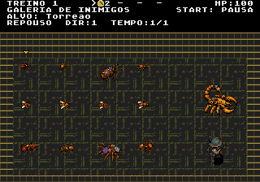
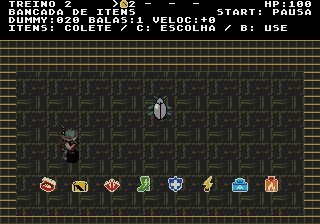
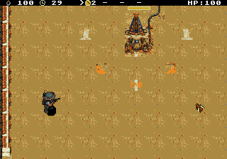
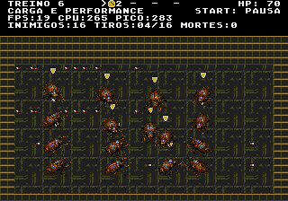

# Salas de teste — versão 2

> Atualização posterior: o [HUD de 24 px foi integrado](../hud-resistencia-v1/integracao/README.md) às fases e aos treinos. A ROM e as capturas deste diretório preservam a validação anterior das salas.

O menu atual oferece dez salas; as capturas e a ROM históricas deste diretório registram as seis salas originais. No título, entre em **FASE TESTE** e escolha diretamente uma sala.

Validação das oito salas em 22/10/2026: [NTSC](validation/eight-rooms/ntsc/report.json) e [PAL](validation/eight-rooms/pal/report.json). A suíte cobre os percursos completos com controles, espera por cobertura, pausa, sucesso/falha congelados, reinício e regressão das seis salas originais. Os relatórios registram o hash da ROM principal testada. [Menu atual](validation/eight-rooms/ntsc/room-selector.png).

**START** abre a pausa: continuar, configurar teste, reiniciar sala, trocar sala, como jogar e voltar ao título. Na configuração, cima/baixo escolhe o campo, esquerda/direita ajusta, **A** aplica e reinicia e **B/START** cancela as alterações. O comando **MOSTRAR MORTE** da galeria reproduz a morte ao retornar à arena. Durante o jogo, **A** atira, **C** seleciona o item e **B** usa o selecionado.

A limpeza dos cenários de deslocamento e escolta remove as pontas de paredes internas e os recortes de entulho herdados da repetição da arena fechada. Piso, bordas externas e áreas de perigo usam os tiles nativos; buracos, rotas e colisões permanecem nos lugares definidos. Validação específica: [NTSC](validation/route-cleanup/ntsc/report.json) e [PAL](validation/route-cleanup/pal/report.json), com 15 pontos de regressão visual, conferência do mapa em VRAM e percursos completos. Para reproduzir: `test_training_emulator.py --only-routes` (acrescente `--pal` para PAL).

## As dez salas atuais

| Sala | Conteúdo | Ajustes |
|---|---|---|
| **1. Galeria de inimigos** | Os 12 inimigos comuns e o Escorpião ficam em posições fixas, com animações reais. A seta dourada identifica o selecionado. | Repouso ou caminhada no lugar; direção fixa ou oito direções automáticas; animação a 1×, ½× ou ¼×; inimigo selecionado; morte única ou repetida. |
| **2. Bancada de itens** | Dummy central, oito tipos de item e reposição. Coleta, inventário e acertos usam as regras do jogo. | Dummy com 1/20/100 HP, dois alvos vizinhos para o raio, reposição ligada/desligada e vida inicial 25/50/100. |
| **3. Defesa da Santa** | Cenário real da fase 5, [Santa iso60 v2](../santa-iso60-v2/README.md) na posição da campanha, colisão de 40×48, piscar completo e brilho na coroa, 100 HP, objetivo de 30 segundos, mesma música e limites de inimigos/projéteis. | Ataques pausados, campanha ou pressão contínua; Damião com vida normal ou sem derrota. O resultado fica congelado para inspeção até reiniciar/trocar sala. |
| **4. Colisões e perigos** | Arena de 512×384: cantos de muros, paredes internas, corredor de 32 px, obstáculo baixo azul, lava e lama. | Vida inicial 25/50/100. Muros bloqueiam pés e tiros; o obstáculo azul bloqueia pés e permite tiros. Lava causa dano progressivo; lama reduz a velocidade e o efeito acaba ao sair. |
| **5. Comportamento e chefe** | IA de combate real. O Escorpião se move, ataca e invoca seus lacaios. | Tipo específico ou misto, 1/4/8/16 inimigos, vida normal ou sem derrota. Selecionar o chefe gera um chefe mais suas invocações. |
| **6. Carga e performance** | Medidores de FPS, carga de CPU, pico, inimigos, tiros de cada lado e mortes em execução. | 1/4/8/16 inimigos, tipo ou misto, 0/6/16 tiros **por grupo**, status natural/escudo/gelo/fogo, mortes em sequência e modo sem derrota. |
| **7. Deslocamento** | Travessia dos túneis da fase 4, com percurso de 2048 px, buracos, lama, câmera e saída sinalizada. Vence ao chegar à saída, sem meta de mortes. | Ataques pausados, campanha (ondas duplas) ou pressão contínua; Damião com vida normal ou sem derrota. |
| **8. Proteger Dinorah** | Escolta da retirada da fase 6B, com lava, buracos e saída sinalizada. Dinorah espera por cobertura e ajuda a atirar; os dois devem chegar juntos. | Ataques pausados, campanha ou pressão contínua; Damião com vida normal ou sem derrota. Dinorah continua vulnerável. |
| **9. Animações de morte** | Damião e Dinorah lado a lado, com as quatro poses reais de queda. A sala abre reproduzindo a morte dos dois em loop. | Personagem, queda à direita/esquerda, tempo 1×/½×/¼× e repetição. **A** reproduz novamente; **C** alterna o alvo entre Damião, Dinorah e os dois; **START → Configurar teste** ajusta a prévia. |
| **10. Regras de morte** | Treino sem inimigos, com as três políticas reais da campanha e coleta do bornal. Mostra tiro, velocidade, itens, bombas e número de mortes. | Etapas 1–5/6–11/12–16; tiro inicial de 1–5 projéteis, velocidade de 0–5 melhorias, 0–3 itens e 0–3 bombas. **A** provoca morte; **B** repõe a configuração; **C** troca de trecho e repõe. |

### Testar as regras de morte

Entre em **FASE TESTE → 10. REGRAS DE MORTE**. No seletor, CIMA a partir da
primeira sala chega diretamente à décima; a lista rola para mantê-la visível.

O padrão é cinco projéteis, +100% de velocidade, três itens e duas bombas.
**A** causa dano fatal e mostra a animação e a tela de derrota reais.
**START** na derrota repete com equipamento básico e uma bolsa. Caminhe até
ela para recuperar os valores calculados a partir do que tinha antes da queda:

- **Etapas 1–5:** recupera tudo ao recolher.
- **Etapas 6–11:** recupera com uma melhoria de tiro e uma de velocidade a menos,
  sem piso 3, e um item a menos (depois dos itens, uma bomba). Mortes sucessivas
  com coleta chegam ao básico, inventário e bombas vazios.
- **Etapas 12–16:** recupera até +1 projétil e +20%, somente para os bônus que
  existiam. Configure nenhum bônus, só tiro ou só velocidade para conferir.

Outra morte substitui a bolsa anterior usando os valores da última queda;
se morrer sem recolher, não recupera os valores da bolsa perdida. A bolsa
vazia também aparece e não concede melhorias novas. O painel mostra BOLSA
enquanto há conteúdo no chão; inventário cheio mantém os itens guardados.

**B** na arena repõe a configuração inicial e zera o contador de mortes.
**C** alterna o trecho e também repõe a configuração. **START → CONFIGURAR
TESTE** ajusta o equipamento inicial; isso permite conferir que atributos
a recuperação é condicional aos bônus existentes antes da morte. Aplicar ou reiniciar sala começa um
novo experimento; cancelar a configuração, pausar e abrir a ajuda preservam
os valores atuais. Trocar de sala limpa a bolsa. As demais salas conservam
suas regras próprias de reinício.

A sala usa `DEATH_capture`, `DEATH_retry`, `DEATH_startPhase` e `DEATH_recover`, os mesmos serviços da
campanha, mantendo `currentLevel=0`: o ensaio não avança rotas nem marca fases
como visitadas. Validação usando **apenas controles**, sem preparar atributos
ou morte por RAM: [NTSC](../bolsa-recuperacao-v1/validation/bag-rules-v2/training-ntsc/report.json)
e [PAL](../bolsa-recuperacao-v1/validation/bag-rules-v2/training-pal/report.json).

```sh
arch -x86_64 /usr/bin/python3 game/tools/test_training_emulator.py --only-death-rules
arch -x86_64 /usr/bin/python3 game/tools/test_training_emulator.py --only-death-rules --pal
```

As salas 7 e 8 usam os mesmos mapas e regras da campanha. Sucesso ou falha congela o treino; START permite reiniciar, configurar ou trocar a sala.

Matar um inimigo nas salas com posições fixas permite observar sua animação de morte real; ele reaparece após dois segundos. Há quatro efeitos de morte simultâneos no motor. A prévia do menu aguarda os efeitos existentes para preservar a visualização do inimigo selecionado. A câmera lenta da galeria afeta as animações, sem reduzir a resposta dos controles.

As configurações ficam na sessão de treino. Entrar em um novo treino pelo título restaura os padrões. As definições da campanha não são alteradas. A defesa e as salas de deslocamento/escolta usam os cenários da campanha; os ensaios técnicos usam um chão nativo com apenas 20 tiles. A ROM preservada nesta validação antecede a integração do HUD de 24 px.









## ROM e validação

[ROM testada](rom/Plaguefall.bin) · [Resumo dos resultados](validation/summary.json) · [Treino NTSC](validation/ntsc/report.json) · [Treino PAL](validation/pal/report.json)

Os testes usam Genesis Plus GX via libretro, com ROM e símbolos preservados juntos em `rom/`. Essa cópia identifica exatamente o executável testado; `out/release` é compartilhado com outros trabalhos e pode receber builds posteriores.

- Entrada, seleção das seis salas, configuração, cancelamento, reinício e prévias da galeria usam controles do emulador. Foram verificadas as 13 animações em repouso e caminhada, oito direções, mortes de inimigo pequeno/grande/chefe e reaparecimento.
- A bancada verifica os oito tipos, cura, divisor de tiros, velocidade, raio em dois vizinhos, gelo e fogo no dummy e reposição. A preparação isolada reposiciona o jogador; coleta, ativação, disparo e efeitos são reais.
- A Santa vence pelo temporizador real de 30 segundos com ataques pausados. A falha usa contatos reais sucessivos, sem escrever na vida da Santa: **100 → 88 → 76 → 64 → 52 → 40 → 28 → 16 → 4 → 0**. Os resultados ficam congelados.
- Lava, lama, bloqueio dos pés, bloqueio por muro e passagem de tiros pelo obstáculo baixo foram verificados com preparação explícita de posições em RAM. O modo sem derrota é confrontado com o modo de vida normal usando projétil letal isolado.
- Regressão: 16 casos de mira/tiro diagonal por região, resultados e repetição nas 20 fases do grafo por região, mais três tentativas comuns em cada uma das fases 3 e 5 por região — **12 tentativas**, com controle de escritas em RAM durante as partidas. Houve vitórias e derrotas; não são 12 partidas vencidas.
- Exportação dos cenários, pacote da ROM, verificações nativas e consistência do código também foram conferidos.

### Limites de desempenho observados

A sexta sala permite exceder deliberadamente o orçamento de um quadro. No ensaio com **16 inimigos grandes, 16 tiros do jogador e 16 tiros inimigos, com escudos**, o contador marcou aproximadamente **19 FPS em NTSC e 18 FPS em PAL**. O indicador de CPU pode ultrapassar 100%: ele mostra carga em relação ao orçamento de um quadro. Isso expõe sobrecarga; não significa desempenho estável nessa configuração.

Na regressão da campanha, o teste pesado da fase da Santa com quatro inimigos e seis tiros por grupo registrou **293 atualizações em 300 VBlanks: 58,6 FPS em NTSC**, abaixo da meta automatizada de 99% dos quadros. Esse teste permanece marcado como falha no [relatório NTSC da campanha](validation/campaign-ntsc/report.json). O equivalente PAL passou a 50 FPS, e os ensaios funcionais de proteção, colisão e transições passaram nas duas regiões. Uma ROM anterior preservada de integração de combate passou a 60 FPS nesse ensaio; há outras alterações simultâneas no projeto, portanto essa comparação não atribui a causa exclusivamente ao treino.

## Reproduzir

```sh
arch -x86_64 /usr/bin/python3 game/tools/test_training_emulator.py --build-dir game/art/training-v2/rom
arch -x86_64 /usr/bin/python3 game/tools/test_training_emulator.py --build-dir game/art/training-v2/rom --pal
python3 game/art/training-v2/export_scene.py --check
```

O nome antigo `game/tools/test_sandbox_emulator.py` delega à mesma suíte nova. A [auditoria anterior](../sandbox-audit-v1/README.md) fica preservada como registro histórico.
