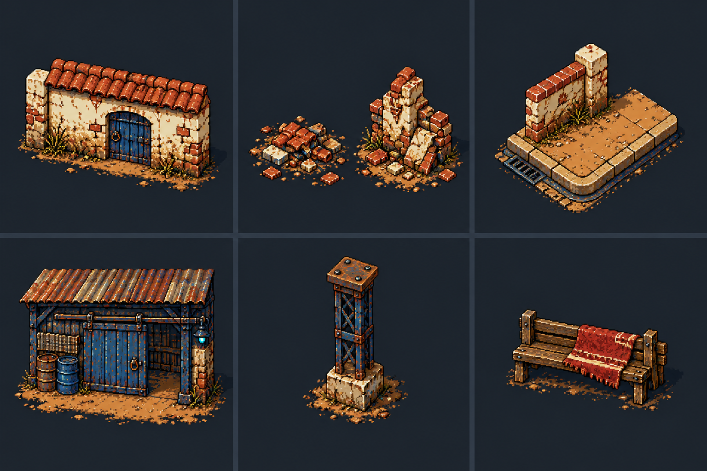
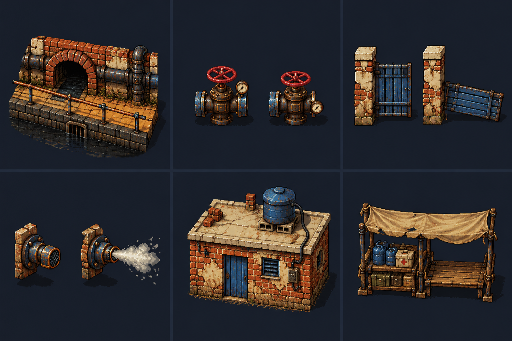
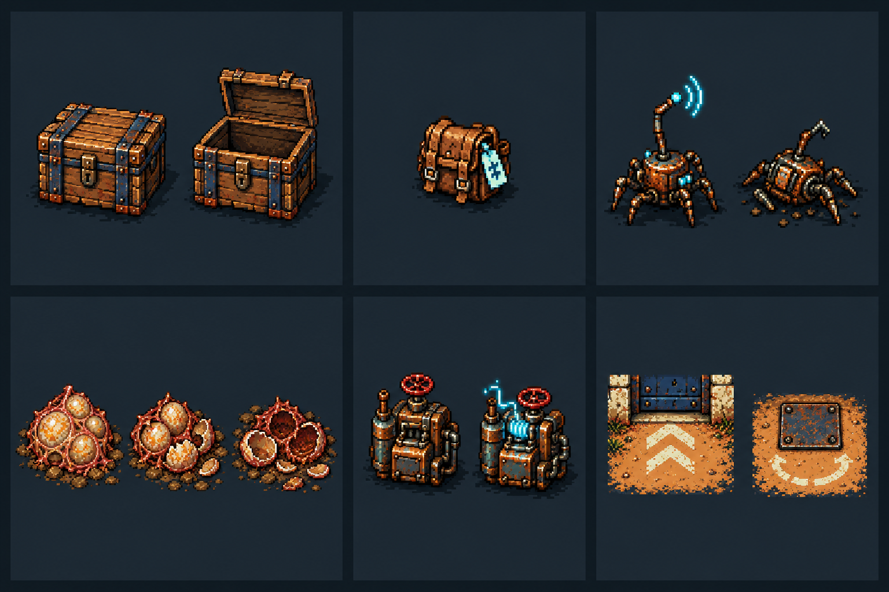
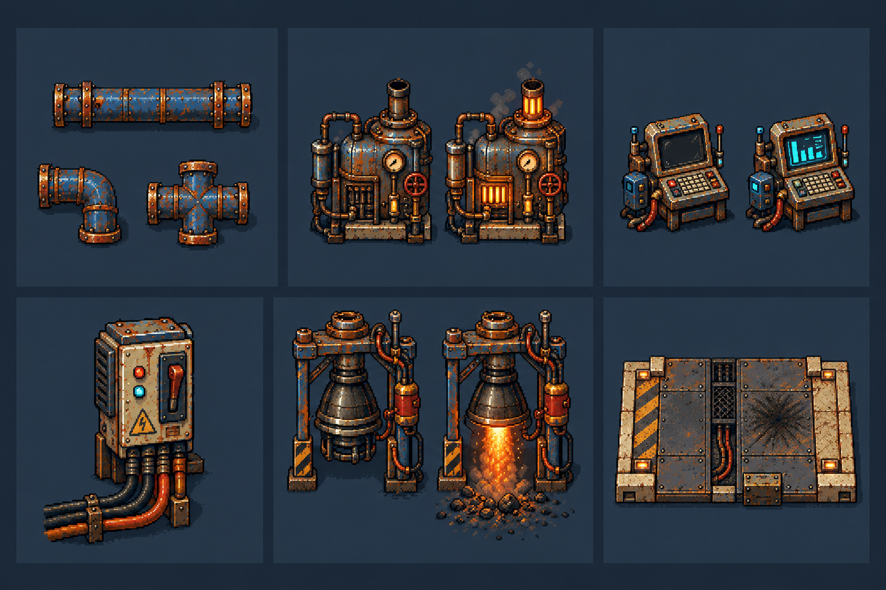
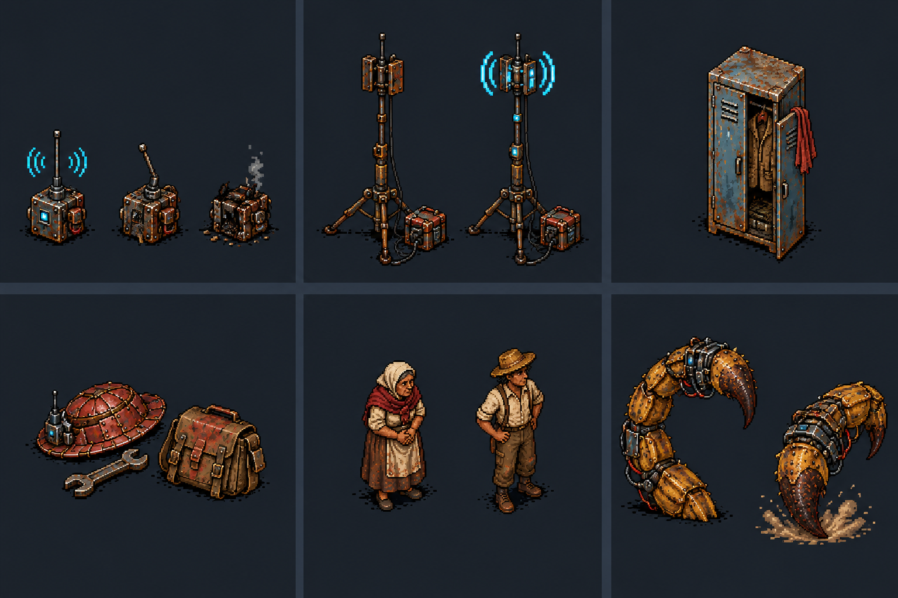

# Guia de produção visual de cada fase

Proposta para aprovação em 23 de outubro de 2026. São 19 fichas de fase, cinco kits ilustrados e 30 famílias de elementos de referência. O guia parte das primeiras fases aprovadas e considera os objetivos e a [história completa](tratamento-proposto.md). A produção e a implementação das fases ficam para depois da aprovação do usuário.

[PDF para revisão](../../../output/pdf/plaguefall-guia-producao-visual-fases-v1.pdf) · [Imagens e prompts](../../art/guia-assets-campanha-v1/README.md) · [Storyboard da história](storyboard-campanha.md)

## Como ler

**Reutilizar:** recurso existente que resolve a função. **Adaptar:** montagem, estados, objetivo ou leitura precisam mudar. **Criar:** arte ausente. Os kits são estudos ampliados; não são folhas nativas prontas para ROM. As dimensões são caixas propostas, a conferir em 1x/2x com os atores e o cenário real.

A câmera final segue o pátio e os personagens existentes, com visão ortográfica elevada próxima de 60° acima do chão. As peças geradas ainda precisam de normalização de câmera, escala, paleta, âncora e colisão. Não aprovar uma peça só por funcionar ampliada.

## Padrão técnico e visual

- Tiles de 8x8; atores humanos em 32x48; Santa existente em 40x48; carga de bornal em 16x16.
- Cenário em PAL3; objetos/inimigos em PAL1; Damião e Dinorah em PAL2; texto e flashes em PAL0, conforme o arranjo atual. Não prever paleta adicional.
- Separar chão, arquitetura alta, decoração baixa, objetos de objetivo, sprites móveis, efeitos e HUD. Cada elemento declara se bloqueia pés, tiros, ambos ou nenhum.
- A reserva de 640 tiles do cenário é compartilhada com o caminho atual de objetos animados. Não somar 640 de cenário a outros 560 como se fossem memória livre.
- 32x32 em seis poses: até 96 tiles; 48x48: 216; 64x64: 384. São custos sem deduplicação, calculados por família. Cinco instâncias de um gerador compartilham seus quadros.
- Portão + válvula, com seis poses atuais, somam até 480 tiles e deixam 160 nessa faixa. A Santa atual já ocupa cenário de 636/640. Esses casos pedem planejamento de atlas/carga antes de integração.
- O renderizador de objetivos atual tem sete slots visuais. Dez ovos exigem estado lógico dos dez alvos separado dos visuais ativos; cinco cargas, fontes e depósito também precisam de planejamento.
- Quatro insetos comuns e três na escolta são pontos de partida conservadores das missões experimentais, não o limite global do vetor. Seis tiros por lado e tiros aliados de Dinorah precisam entrar na medição integrada.
- Corredores de 2.560/3.072 px usam módulos, marcos e rolagem circular; não uma nova textura inteira residente nem a repetição evidente da mesma sala.

## Inventário do que já existe

| Código | Recurso | Aplicação | Fonte |
|---|---|---|---|
| R01 | Abertura existente | 14 planos, 18 cartelas e 101 s; preservar ordem e falas. | [Fonte](../../art/intro-monologo-v2/README.md) |
| R02 | Pátio aprovado | 512x384, igreja intacta/danificada, muros, banco e chão. | [Fonte](../../art/phase01-courtyard-v2/README.md) |
| R03 | Primeiros cenários | Módulos de rua, abrigo, túneis, resgate e retirada; remapear para o novo roteiro. | [Fonte](../../art/phases02-06-v1/README.md) |
| R04 | Percursos contínuos | Corredores de 2.048 px como base técnica; novos comprimentos são 2.560 e 3.072 px. | [Fonte](../../art/routes-2048-v2/README.md) |
| R05 | Santa iso60 | 40x48; brilho, barra, contato pelos quatro lados e alvo existente. | [Fonte](../../art/santa-iso60-v2/README.md) |
| R06 | Objetos de missão | Ninho, gerador, caixa, transmissor, válvula, grade e rádio, com seis poses por arte no pacote atual. | [Fonte](../../art/objective-sprites-v1/README.md) |
| R07 | Dinorah | Célula 32x48, paleta dos humanos, direções e animações existentes; consultar também o ator atual. | [Fonte](../../art/cangaco-parceira-iso60-v1/README.md) |
| R08 | Morte dos protagonistas | Quatro poses de 32x48 por ator; reutilizar na perda de Dinorah. | [Fonte](../../art/actor-deaths-v1/README.md) |
| R09 | Bornal | Sprite 16x16 existente; carga da missão deve ter identidade e regra separadas da recuperação de morte. | [Fonte](../../art/bolsa-recuperacao-v1/README.md) |
| R10 | Retratos | Damião, padre e Dinorah já possuem retratos; expressões novas não são requisito de cada fase. | [Fonte](../../art/dialogue-portraits-v1/README.md) |
| R11 | Protótipos de objetivo | Transporte, energia, caça de emissores, válvulas, escolta e rádio já têm referências de funcionamento. | [Fonte](../fases-experimentais.md) |
| R12 | História e impactos | Fonte dos objetivos, três bifurcações e oito combinações de epílogo. | [Fonte](tratamento-proposto.md) |

## Kits de pequenos elementos de referência

### Kit 1 Igreja rua e galpão

Ordem: A, B e C no alto; D, E e F embaixo. Pares ou trios na mesma célula representam estados da mesma família.

| ID | Elemento | Caixa nativa proposta | Fases | Situação | Leitura |
|---|---|---|---|---|---|
| K1A | Porta e parede da igreja | 96x64 | 1, 2A, 2B | Adaptar | Reboco, telhas, porta azul; encaixe modular. |
| K1B | Destroços da igreja | 64x48 | 2B e epílogo | Novo | Separar entulho baixo atravessável de bloco alto sólido. |
| K1C | Esquina e piso urbano | 64x64 | 3 e 9 | Adaptar | Sarjeta e quina; leitura clara da rua. |
| K1D | Entrada do galpão | 96x64 | 3, 4 e 5 | Adaptar | Mesmo portão e mesmos materiais nas três fases. |
| K1E | Pilar industrial | 32x64 | 4, 10, 11 e 13 | Adaptar | Base de colisão pequena, topo visível. |
| K1F | Banco e barricada baixa | 48x32 | 1, 2 e 5 | Reutilizar | Cobertura visual sem inventar bloqueio de tiro. |

### Kit 2 Esgotos e favela

Ordem: A, B e C no alto; D, E e F embaixo. Pares ou trios na mesma célula representam estados da mesma família.

| ID | Elemento | Caixa nativa proposta | Fases | Situação | Leitura |
|---|---|---|---|---|---|
| K2A | Arco e canal de esgoto | 96x64 | 6A e 6B | Novo | Borda seca, canal e parede com encaixes. |
| K2B | Válvula de pressão | 32x32 | 6B e 11 | Adaptar | Fechada, acionando, aberta; ponto de uso ao sul. |
| K2C | Portão e batentes | 64x64 | 6B e 12 | Adaptar | Folha estreita no muro; batentes permanecem após abertura. |
| K2D | Bocal e vapor | 32x32 + FX | 6B e 11 | Novo | Vapor anunciado antes de bloquear ou ferir. |
| K2E | Módulo de casa da favela | 96x64 | 7 e 8 | Novo | Tijolo, laje, caixa d'água; preservar espaço de combate. |
| K2F | Depósito de entrega | 64x48 | 7 | Adaptar | Recebendo carga e completo; diferente das cinco coletas. |

### Kit 3 Objetivos e sinais de interação

Ordem: A, B e C no alto; D, E e F embaixo. Pares ou trios na mesma célula representam estados da mesma família.

| ID | Elemento | Caixa nativa proposta | Fases | Situação | Leitura |
|---|---|---|---|---|---|
| K3A | Caixa de suprimentos | 32x32 | 7 | Adaptar | Fechada, abrindo e vazia; cinco instâncias, uma família. |
| K3B | Carga transportada | 16x16 | 7 | Adaptar | Bornal com marca de missão; não recuperar inventário de morte. |
| K3C | Inseto transmissor | 32x32 | 8 | Reutilizar | Pulsando, atingido, antena quebrada. |
| K3D | Conjunto de ovos | 48x48 | 10 | Adaptar | Intacto, atingido, rompendo, destruído persistente. |
| K3E | Gerador de energia | 32x32 | 14 | Reutilizar | Desligado, acionando e energizado; cinco instâncias. |
| K3F | Marco de saída e interação | 16x16 | 3, 6, 7, 9 e 12 | Adaptar | Marcas de piso discretas e coerentes com o HUD existente. |

### Kit 4 Fábrica e estaleiro

Ordem: A, B e C no alto; D, E e F embaixo. Pares ou trios na mesma célula representam estados da mesma família.

| ID | Elemento | Caixa nativa proposta | Fases | Situação | Leitura |
|---|---|---|---|---|---|
| K4A | Tubulação modular | 64x48 | 6, 10, 11 e 14 | Adaptar | Retas, curva e junção com mesmas bordas. |
| K4B | Caldeira da fábrica | 64x64 | 10 e 11 | Novo | Fria e quente; cascas vazias não viram ovos novos. |
| K4C | Painel de manutenção | 48x48 | 11, 13A, 13B e 14 | Adaptar | Desligado, preparado e ativo. |
| K4D | Quadro de distribuição | 48x48 | 14 e 15 | Novo | Condutores e alavanca; distingue energia de ignição. |
| K4E | Bocal de motor do foguete | 96x96 | 15 e 16 | Novo | Apagado e aceso; grande estrutura no cenário. |
| K4F | Piso de lançamento | 96x64 | 12, 14, 15 e 16 | Novo | Placa repetível, canal técnico e manchas queimadas. |

### Kit 5 Defesa estados e consequências

Ordem: A, B e C no alto; D, E e F embaixo. Pares ou trios na mesma célula representam estados da mesma família.

| ID | Elemento | Caixa nativa proposta | Fases | Situação | Leitura |
|---|---|---|---|---|---|
| K5A | Rádio de controle | 32x32 | 5 e 15 | Reutilizar | Transmitindo, danificado e destruído; distinguir missão de decoração. |
| K5B | Mastro de sinal | 48x64 | 5 e 15 | Novo | Complementar o comunicador; Santa existente preservada. |
| K5C | Armário dos trabalhadores | 48x64 | 13A e 13B | Novo | Mesmo cômodo nas duas rotas; decoração fora do corredor. |
| K5D | Chapéu e ferramentas de Dinorah | 32x32 | 13B e epílogo | Novo | Somente na rota de morte; sem fantasma ou fala nova. |
| K5E | Civis para interlúdios | 32x48 | abertura, 5 e epílogo | Adaptar | Silhuetas distintas; cenas de evacuação, não nova escolta jogável. |
| K5F | Ferrão e aviso de impacto | 48x48 + FX | 16 | Adaptar | Manter Escorpião; referência de leitura do ataque, sem redesenhar o chefe. |

## Guia por fase

### Fase 1 Até o último sair

**Objetivo:** Sobreviver por 1min30s; apenas um tipo básico de inseto.

**Mundo:** 512x384 px; aproveitar o pátio aprovado.

**História:** Começa depois da animação existente, do menu e da chamada curta. O padre retira o povo e leva a Santa.

**Reutilizar**

- Pátio da igreja, Damião, inimigo básico, tiro, HUD e retratos existentes.
- Abertura integrada: 14 planos e 18 cartelas, sem novas imagens.

**Adaptar**

- Estado da igreja após a bomba, para corresponder à destruição que será vista na 2B.
- Objetivo e avisos de retirada de 90 s no HUD e nas falas.

**Criar**

- Somente complementos ausentes do cenário: marca do caminho de fuga e último vestígio de saída; usar tiles existentes antes de desenhar novos.

**Estados e animações**

- Igreja intacta → destruída se qualquer bomba for usada; resultado persiste.
- Partículas de poeira e queda só na transformação, sem novos civis controláveis.

**Colisão e leitura:** Centro livre como no pátio aprovado. Separar limites dos pés e dos tiros; bancos baixos não viram paredes invisíveis.

**HUD e sinais:** Cronômetro de 90 s e objetivo de resistir; não usar contador de mortes como condição de vitória.

**Consequência:** Sem bomba → 2A. Com bomba → 2B. Todos os civis saem nesta etapa.

**Entrega mínima:** Mapa intacto e variante destruída com mesma base; lista de tiles alterados; imagem 1x/2x com saída visível.

**Atenção de produção:** A destruição precisa estar pronta para as fases 1 e 2B e para o epílogo, sem consumir outra paleta.

**Referências visuais:** K1A, K1F.

### Fase 2A A igreja de pé

**Objetivo:** Eliminar 15 insetos; apresentar o primeiro atirador.

**Mundo:** 512x384 px propostos; o MESMO pátio da fase 1.

**História:** O padre agradece pela proteção do povo e da igreja. A saída do bairro continua necessária.

**Reutilizar**

- Mapa intacto e módulos da fase 1, inimigo básico e um atirador já existente.
- Projéteis, impactos, carcaças e retratos existentes.

**Adaptar**

- Posições de entrada e composição para que o primeiro disparo seja legível.
- A antiga rua de serviço da 2A fornece módulos, mas não define o novo local.

**Criar**

- Nenhum novo tipo de inimigo obrigatório; apenas pequeno sinal de retirada se faltar.

**Estados e animações**

- Fachada permanece intacta até o retorno.
- Atirador usa os estados já existentes de mover, disparar, receber dano e morrer.

**Colisão e leitura:** Preservar caminhos do pátio. A apresentação do tiro deve ocorrer com espaço de esquiva.

**HUD e sinais:** Contador 0/15 e aviso visual curto da nova ameaça; não inventar novos ícones de arma.

**Consequência:** Seguir para 3; registrar igreja preservada.

**Entrega mínima:** Planta de combate da 2A sobre o pátio intacto; quadro de apresentação do atirador e do objetivo.

**Atenção de produção:** Não produzir uma rua nova para uma fase que agora continua no pátio.

**Referências visuais:** K1A, K1F.

### Fase 2B Entre os escombros

**Objetivo:** Eliminar 15 insetos no pátio destruído.

**Mundo:** 512x384 px propostos; mesma geometria externa de 1 e 2A.

**História:** O padre lamenta a igreja; Damião afirma que vidas valem mais que prédios. Não acrescentar mortos civis à bomba.

**Reutilizar**

- Igreja danificada, muros e piso existentes como base; mesmos insetos da 2A.
- Poeira, impactos e carcaças existentes.

**Adaptar**

- Ampliar o dano atual, se necessário, para mostrar igreja destruída conforme o roteiro.
- Destroços do antigo desvio para o interior do pátio.

**Criar**

- Família de entulho baixo, bloco de alvenaria alto e telhas partidas, com variações de 32x32/64x48.
- Remendos de chão revelados após a queda.

**Estados e animações**

- Entulho persistente, sem cair novamente a cada pausa.
- Sem estado de restauração automática depois da vitória.

**Colisão e leitura:** Marcar quais pilhas são sólidas e quais são decoração. Deixar desvios contínuos, sem prender o jogador.

**HUD e sinais:** Contador 0/15. O cenário, e não um texto longo, comunica a consequência da bomba.

**Consequência:** Seguir para 3; igreja destruída permanece no epílogo.

**Entrega mínima:** Comparativo 2A/2B no mesmo enquadramento; mapa de entulho e colisão; módulos de ruína identificados.

**Atenção de produção:** Dano narrativo maior pode exigir novos módulos, mas não um segundo cenário inteiro em outra escala.

**Referências visuais:** K1A, K1B.

### Fase 3 Abram caminho

**Objetivo:** Alcançar o galpão por uma rua de 2.560 px.

**Mundo:** 2560x320 px propostos; comprimento de 2.560 px definido no roteiro.

**História:** Damião avança primeiro; o padre mantém o povo atrás da zona de combate.

**Reutilizar**

- Piso, sarjeta, casas e portões dos mapas urbanos; motor de travessia.
- Rádio e retratos; não criar uma fila de civis em combate.

**Adaptar**

- Sistema de percurso contínuo hoje usado nos corredores de 2.048 px.
- Combinar módulos com marcos próprios, evitando repetir a mesma sala.

**Criar**

- Entrada reconhecível do galpão; esquina, veículo abandonado e trecho de muro como marcos de navegação.
- Limiar de chegada que combine com a fase 4.

**Estados e animações**

- Saída fechada ao perigo visualmente ou ponto de chegada claro; conclusão ao alcançar o destino.
- Marcos estáticos, sem animações exclusivas obrigatórias.

**Colisão e leitura:** Rua deve comportar esquiva e não esconder buracos no piso. Obstáculos do desenho coincidem com a base sólida.

**HUD e sinais:** Indicador de destino e chegada; sem meta obrigatória de matar tudo.

**Consequência:** Confirmar rua livre pelo rádio e entrar na 4; interior ainda ocupado.

**Entrega mínima:** Planta integral de 2.560 px e recortes 320x224 da entrada, meio e chegada.

**Atenção de produção:** Aumentar o comprimento do mapa não autoriza aumentar o número de tiles únicos residentes.

**Referências visuais:** K1C, K1D, K3F.

### Fase 4 Um teto para a noite

**Objetivo:** Eliminar 20 insetos dentro do galpão.

**Mundo:** 512x384 px propostos; arena interior.

**História:** O povo espera do lado de fora. Limpar o prédio permite abrigo temporário e contato com o resgate.

**Reutilizar**

- Módulos do abrigo de manutenção existente: estrutura azul, redes, farmácia e água.
- Inimigos, caixas e retratos existentes.

**Adaptar**

- O antigo cenário da fase 3 é a principal fonte visual desta nova fase 4.
- Retirar a Santa do interior se sua presença antecipar ou duplicar o objetivo da fase 5.

**Criar**

- Piso interno, face interna do portão, pilares e pilhas baixas coerentes com a fachada da fase 3.
- Ponto de acolhimento visível no fundo, fora da arena.

**Estados e animações**

- Galpão ocupado → limpo, mostrado no encerramento por luz e acesso liberado.
- Suprimentos decorativos não se confundem com cargas coletáveis da fase 7.

**Colisão e leitura:** Pilares com base legível; materiais no perímetro; miolo permite circular e recuar.

**HUD e sinais:** Contador 0/20; sem barra de civis ou objetivo de escolta.

**Consequência:** Abrigar o povo e apresentar a oportunidade de resgate; seguir para 5.

**Entrega mínima:** Planta interna e fachada compartilhada; catálogo de cobertura baixa e obstáculos altos.

**Atenção de produção:** Não reaproveitar lava do mapa antigo como perigo obrigatório sem motivo no novo galpão.

**Referências visuais:** K1D, K1E, K1F.

### Fase 5 O sinal da santa

**Objetivo:** Proteger Santa e comunicador por 2 minutos.

**Mundo:** 512x384 px propostos; pátio em frente ao mesmo galpão.

**História:** Dinorah chega. O padre revela o comunicador escondido; o primeiro grupo embarca antes do cronômetro.

**Reutilizar**

- Santa iso60 40x48, pedestal, brilho, dano e barra existentes.
- Rádio, retratos e transporte humano já representado no resgate.

**Adaptar**

- Arena de defesa existente para a fachada do galpão e quatro aproximações.
- Sinal ativo, confirmação de embarque e consequência de queda; defesa passa de 30 para 120 s.

**Criar**

- Mastro/cabo de apoio se necessário; imagem curta de embarque e de evacuação parcial.
- Malas abandonadas e vestígios de perdas na variante de falha, apenas no interlúdio.

**Estados e animações**

- Comunicação transmitindo → confirmação, ou falha → equipamento quebrado.
- Santa não pode aparecer duplicada no mapa; evitar nova versão frontal.

**Colisão e leitura:** Conservar a base de contato 40x48 como referência existente e quatro lados atacáveis. Novas alterações exigem revisão.

**HUD e sinais:** Tempo 120 s, vida do objetivo, avisos curtos de embarque; reaproveitar HUD e fonte.

**Consequência:** Sucesso → 6A, todos salvos. Falha → 6B, perdas parciais. Dinorah permanece nas duas rotas.

**Entrega mínima:** Arena com Santa legível em 320x224; estados de sinal, sucesso e falha; cena do primeiro embarque.

**Atenção de produção:** Os 636 tiles do cenário atual quase preenchem os 640; não somar uma folha animada inteira sem recompor o orçamento.

**Referências visuais:** K5A, K5B, K1D.

### Fase 6A Pela passagem de baixo

**Objetivo:** Escoltar Dinorah por 3.072 px até O Último Chão.

**Mundo:** 3072x320 px propostos; esgoto com caminho seco.

**História:** Após resgate completo, Dinorah comemora e indica a base onde buscar recursos.

**Reutilizar**

- Dinorah completa, espera por cobertura, caminhada, tiros e morte existentes.
- Paredes, tubulações e piso dos túneis; motor de escolta.

**Adaptar**

- O antigo túnel de manutenção fornece o kit; a antiga 6A de embarque não é o novo cenário.
- Percurso de 3.072 px com pontos de espera e câmera legível.

**Criar**

- Arco de esgoto, canal de água, passarela seca, acesso à favela e poucos marcos próprios.
- Uma pose técnica nova de Dinorah é opcional; não necessária para escoltar.

**Estados e animações**

- Dinorah andando, esperando, protegida, atingida e chegada; reutilizar o que já existe.
- Água pode ter um ciclo curto de 2-4 poses, opcional e contido.

**Colisão e leitura:** Passarela contínua para dois atores. Dinorah não se prende em quinas nem atravessa água marcada como bloqueio.

**HUD e sinais:** Vida da escoltada e distância/chegada; sem outro tipo de civil.

**Consequência:** Morte de Dinorah aqui reinicia a missão. Chegada viva → 7.

**Entrega mínima:** Planta integral, rota e pontos de espera; recortes de entrada, meio e saída com os dois atores.

**Atenção de produção:** Usar três insetos como ponto de partida da escolta experimental, sem prometer desempenho antes do ensaio integrado.

**Referências visuais:** K2A, K3F.

### Fase 6B O peso dos que ficaram

**Objetivo:** Escoltar Dinorah por 3.072 px com portões e válvulas.

**Mundo:** 3072x320 px propostos; ramal alternativo do mesmo esgoto.

**História:** Damião lamenta as mortes; Dinorah tenta continuar; o padre fala de fé pelo rádio.

**Reutilizar**

- Todo o kit de 6A, Dinorah e animações de morte.
- Portão com batentes e queda; válvula e reação de vapor das missões experimentais.

**Adaptar**

- Montagem do portão ao eixo do muro e caminho após a abertura.
- Válvula combinada à escolta; sugerir dois bloqueios compostos, sujeitos ao desenho final.

**Criar**

- Tubulação de pressão ligada visualmente ao bloqueio; bocal de vapor e indicação do lado seguro.
- Variações de arco e manutenção para distinguir o ramal difícil.

**Estados e animações**

- Portão fechado → dano → queda → passagem aberta; batentes persistem.
- Pressão alta → aviso → alívio → travessia segura; progresso não se perde ao recuar.

**Colisão e leitura:** Vapor não é uma parede invisível. Mostrar área de perigo e manter espaço protegido para Dinorah.

**HUD e sinais:** Vida de Dinorah e progresso local de interação; não criar três novos controles de botão.

**Consequência:** Dinorah morta reinicia, como na 6A. Chegada viva → 7; perdas civis continuam na história.

**Entrega mínima:** Rota completa, encaixes de portão, válvula associada e quadro de antes/depois de cada bloqueio.

**Atenção de produção:** Portão de seis poses custa até 384 tiles e válvula 96: juntos usam 480 da mesma reserva de 640 do cenário, antes da deduplicação.

**Referências visuais:** K2A, K2B, K2C, K2D.

### Fase 7 O que ainda resta

**Objetivo:** Recuperar suprimentos em cinco pontos e entregar cinco cargas.

**Mundo:** 768x384 px propostos; abrigo na favela, com retorno ao depósito.

**História:** A base também foi invadida. Os recursos recuperados mantêm a resistência viva.

**Reutilizar**

- Baú que abre, carga de bornal, transporte e descarga já experimentados.
- Estrutura urbana, água e materiais dos abrigos.

**Adaptar**

- De três coletas de teste para cinco pontos; cada ponto precisa guardar seu estado.
- Distinguir visualmente carga da missão e bolsa de recuperação de morte, mesmo que compartilhem desenho-base.

**Criar**

- Kit de tijolo/laje/escada; depósito central reconhecível; marca discreta de carga da missão.
- Decoração de abrigo evacuado, sem bloquear todas as rotas.

**Estados e animações**

- Caixa fechada → aberta → vazia; carga no chão → carregada → entregue.
- Depósito recebe cinco entregas; nada reaparece ao revisitar.

**Colisão e leitura:** Sempre existir percurso de ida e volta com a carga. Saída não conclui a fase antes da quinta entrega.

**HUD e sinais:** Contador 0/5 entregas e indicação de carga; vida e tiro existentes permanecem legíveis.

**Consequência:** Fala de alívio se resgate completo ou de luto se parcial; seguir para 8.

**Entrega mínima:** Mapa com cinco coletas e um depósito; estados da caixa/bolsa e legenda do objeto carregado.

**Atenção de produção:** Planejar cinco fontes + depósito + carga com o limite de sete visuais; estado lógico e objeto desenhado não são a mesma coisa.

**Referências visuais:** K2E, K2F, K3A, K3B.

### Fase 8 Cortar o chamado

**Objetivo:** Eliminar insetos prioritários e reduzir reforços; sugestão de três alvos.

**Mundo:** 768x384 px propostos; perímetro da favela, compartilhando o kit da 7.

**História:** O padre alerta sobre o gasto dos suprimentos; Dinorah pede que Damião ataque quem chama o enxame.

**Reutilizar**

- Inseto transmissor 32x32 e estados vivo/morto; IA e tiros existentes.
- Módulos da favela e cabos da fase 7.

**Adaptar**

- Contraste da antena e animação de pulso sem depender de marca flutuante.
- Posicionamento dos alvos para priorização, sem transformar o objetivo em matar todos.

**Criar**

- Só módulos de perímetro ausentes: muro quebrado, torre de cabo e acesso à rua industrial.

**Estados e animações**

- Antena pulsando → atingida → quebrada; carcaça permanece reconhecível.
- Cada alvo morto reduz reforços; todos concluídos liberam a passagem.

**Colisão e leitura:** Alvos alcançáveis por mais de uma aproximação; antenas não escondem tiros na mesma faixa de cor.

**HUD e sinais:** Contador de prioritários, não de mortes totais; total inicial 3 é proposta de balanceamento.

**Consequência:** A ameaça imediata diminui; a base continua comprometida; ir à fábrica.

**Entrega mínima:** Mesma linguagem da 7 com três posições sugeridas; leitura dos emissores em 1x.

**Atenção de produção:** Não criar uma nova espécie para cumprir uma função que já possui arte e comportamento de teste.

**Referências visuais:** K3C, K2E.

### Fase 9 O caminho dos ovos

**Objetivo:** Alcançar a fábrica por um corredor de 2.560 px.

**Mundo:** 2560x320 px propostos; rua industrial.

**História:** O padre associa a fábrica aos primeiros relatos dos ovos. Damião decide abrir caminho até lá.

**Reutilizar**

- Motor e kit urbano da fase 3; veículos, muros, piso e projéteis.
- Portões industriais e tubulação dos cenários existentes.

**Adaptar**

- Mudar os marcos urbanos para a aproximação fabril e aumentar a pressão dos encontros.
- Variação de materiais e fundo; não gerar outra biblioteca inteira de ruas.

**Criar**

- Fachada/silhueta da fábrica e acesso de serviço que reaparecem em 10 e 11.
- Dois ou três marcos industriais exclusivos, sem repetição de sala a cada trecho.

**Estados e animações**

- Chegada abre transição ao interior; decoração estática e poucos efeitos de máquinas paradas.

**Colisão e leitura:** Corredor de deslocamento com áreas de esquiva e marcos que não camuflam saída ou bloqueio.

**HUD e sinais:** Destino e indicador de chegada; sofrer dano não gera outra fase 10.

**Consequência:** Todos seguem para uma única fase 10.

**Entrega mínima:** Percurso de 2.560 px, vista da fábrica ao longe e encaixe visual do portão com o interior.

**Atenção de produção:** Não produzir 10A/10B a partir de nomes antigos do projeto; não há essa bifurcação no roteiro atual.

**Referências visuais:** K1C, K4A, K3F.

### Fase 10 O berçário

**Objetivo:** Destruir dez conjuntos de ovos.

**Mundo:** 768x384 px propostos; fábrica com dez pontos distribuídos.

**História:** O grupo encontra muitos ovos e reconhece a ligação de serviço com os foguetes.

**Reutilizar**

- Ninho 48x48 como referência de escala, impactos, cascas e inimigos existentes.
- Módulos fabris e piso industrial; retratos de todos os aliados vivos nesta etapa.

**Adaptar**

- Trocar a leitura de demolição por tiro/dano direto nos ovos, conforme o objetivo.
- Membrana, casca e estado destruído com alvo de contato preciso.

**Criar**

- Conjunto de ovos em 48x48: intacto, atingido, ruptura e cascas persistentes.
- Detalhe de acesso ao estaleiro e depósito de cascas fora das áreas de alvo.

**Estados e animações**

- Quatro estados mínimos; dois quadros intermediários de ruptura são opcionais.
- Destruído permanece destruído ao sair e voltar à tela.

**Colisão e leitura:** Separar barreira industrial de alvo destrutível; ovos não podem ficar atrás de volumes inatingíveis.

**HUD e sinais:** Contador 0/10 conjuntos; matar defensores não conta como ovo.

**Consequência:** Os dez conjuntos não reaparecem na 11. Os foguetes continuam como origem regional.

**Entrega mínima:** Mapa dos dez alvos, folha de estados e comparativo intacto/destruído em 1x.

**Atenção de produção:** Há sete slots visuais no renderizador atual. Dez alvos pedem estados lógicos separados e visuais por câmera ou outra solução explícita, não dez sprites permanentes assumidos.

**Referências visuais:** K3D, K1E, K4A, K4B.

### Fase 11 Acender a isca

**Objetivo:** Liberar válvulas e reativar a fábrica; sugestão inicial de três válvulas.

**Mundo:** 512x384 px propostos; setor de máquinas ligado à fase 10.

**História:** Damião lembra que insetos procuram calor. Padre propõe a isca; Dinorah verifica os comandos.

**Reutilizar**

- Válvula animada, interação pelo lado sul, vapor e pulsos de máquina.
- Kit de fábrica da 10; cascas vazias preservadas.

**Adaptar**

- Ordenar módulos em setores frios e aquecidos; cada acionamento modifica uma parte do ambiente.
- Usar animação localizada em vez de trocar toda a paleta de jogadores e projéteis.

**Criar**

- Caldeira fria/quente, canal de exaustão e indicadores de pressão necessários à leitura.
- Um painel preparado e ativo, derivado da família técnica existente.

**Estados e animações**

- Válvula fechada → giro → aberta; caldeira fria → aquecendo → quente.
- Luz/vapor e comportamento do enxame comunicam o calor; ovos não se regeneram.

**Colisão e leitura:** Indicar ponto de interação ao sul; o corpo de Damião não encobre o volante nem fica preso no vapor.

**HUD e sinais:** Contagem de válvulas e progresso local; manter A/B/C conforme o controle existente.

**Consequência:** A fábrica atrai parte do enxame e abre a janela para 12. A distração é temporária.

**Entrega mínima:** Mesma sala em frio e quente; localização das válvulas e fluxo dos cabos/tubos.

**Atenção de produção:** Animações de pressão e calor precisam coexistir com o cenário dentro do orçamento; três válvulas compartilham a mesma arte.

**Referências visuais:** K2B, K2D, K4A, K4B, K4C.

### Fase 12 A última travessia

**Objetivo:** Escoltar Dinorah por 3.072 px até a sala dos trabalhadores.

**Mundo:** 3072x320 px propostos; corredor de serviço do estaleiro.

**História:** Dinorah volta a acompanhar Damião fisicamente para alcançar o setor que conhece.

**Reutilizar**

- Dinorah e Damião, animações de escolta e quatro quadros de morte já produzidos.
- Tubos, piso e marcos de corredor; foguetes de fundo existentes como referência.

**Adaptar**

- Rota de escolta para o comprimento de 3.072 px e maior pressão perto da chegada.
- Transição de falha após a morte de Dinorah, com Damião vivo; não é só uma nova imagem.

**Criar**

- Fachada da sala dos trabalhadores, limiar de chegada e infraestrutura do estaleiro.
- Imagem curta da perda pode reutilizar a última pose de morte, sem exigir novo corpo.

**Estados e animações**

- Chegada com Dinorah viva ou queda com corpo persistente até a transição.
- Prioridade para derrota se Damião morrer junto; nenhuma fala nova dela após a morte.

**Colisão e leitura:** Pontos de espera protegidos e caminho para dois atores; chegada não pode se disparar sem Dinorah.

**HUD e sinais:** Vida da escoltada e indicação de saída. Tempo não determina 13A/13B.

**Consequência:** Viva → 13A. Morta com Damião vivo → 13B. Não alterar a regra de reinício das escoltas da fase 6.

**Entrega mínima:** Rota e pontos de cobertura, fachada comum às duas fases 13 e quadro de chegada/perda.

**Atenção de produção:** A arte de morte já existe; a nova continuação narrativa da falha ainda precisa ser integrada após aprovação.

**Referências visuais:** K4A, K4F, K3F.

### Fase 13A Velhos piquetes

**Objetivo:** Eliminar 30 insetos na sala de descanso.

**Mundo:** 512x384 px propostos; mesmo cômodo da 13B.

**História:** Dinorah reconhece a sala dos piquetes e se abriga no compartimento técnico.

**Reutilizar**

- Pilares, bancos, mesas, retratos e Dinorah existente.
- Painel de manutenção que será usado na preparação final.

**Adaptar**

- Composição da sala para combate e um compartimento protegido, sem nova barra de escolta.
- Faixas e memória sindical pelo espaço; textos extensos ficam nos diálogos.

**Criar**

- Armários de trabalhadores, mesa compartilhada e pano/faixa sem texto ilegível.
- Variante de console pronto; pose de operação é opcional, não requisito de um NPC novo.

**Estados e animações**

- Sala ocupada → limpa; Dinorah viva no interlúdio, depois no rádio.
- Painel apagado → preparado; sem ignição antes da 15.

**Colisão e leitura:** Dinorah no compartimento seguro, fora da arena e sem nova condição de morte. Móveis não fecham todas as rotas.

**HUD e sinais:** Contador 0/30, sem cronômetro novo ou vida da escoltada.

**Consequência:** Ela participa das conversas 14, 15, 16 e do epílogo.

**Entrega mínima:** Mapa-base da sala, compartimento técnico e versão limpa para a conversa.

**Atenção de produção:** 30 é total acumulado, não número de insetos simultâneos. A diferença de rota não exige outro tileset.

**Referências visuais:** K5C, K4C.

### Fase 13B Um lugar vazio

**Objetivo:** Eliminar 45 insetos na mesma sala.

**Mundo:** 512x384 px propostos; usar o MESMO mapa da 13A.

**História:** Damião lamenta não ter protegido Dinorah. O padre continua como única voz aliada.

**Reutilizar**

- Mapa, armários e console da 13A; retratos de Damião e padre.
- Mesmas famílias de inimigos; não criar novos inimigos para justificar 45 mortes.

**Adaptar**

- Somente a encenação: ausência de Dinorah, mesa vazia e objetos pessoais discretos.
- Conversa e número de eliminações; preservar o mesmo lugar reconhecível.

**Criar**

- Pequeno arranjo de chapéu vermelho, ferramentas e bolsa de Dinorah para o interlúdio.
- Retrato novo de tristeza é opcional; texto e pausa já podem comunicar o luto.

**Estados e animações**

- Objetos pessoais só nesta rota; Dinorah não reaparece viva, em mensagem nova ou fantasma.
- Console configurado por Damião após a limpeza.

**Colisão e leitura:** A mesma base sólida da 13A. Objeto de memória é decorativo e fica fora do corredor.

**HUD e sinais:** Contador 0/45. Não usar número de mortes como justificativa para 45 inimigos simultâneos.

**Consequência:** Fases finais com Damião e padre; sequência automática preparada por Damião.

**Entrega mínima:** Comparativo da mesma sala com e sem Dinorah; sprite/prop de memória pequeno e folha de falas correspondente.

**Atenção de produção:** Criar um cenário inteiro diferente apagaria a leitura da ausência no mesmo lugar.

**Referências visuais:** K5C, K5D, K4C.

### Fase 14 Devolver a força às máquinas

**Objetivo:** Ativar cinco máquinas de energia.

**Mundo:** 768x384 px propostos; subestação do estaleiro.

**História:** Viva, Dinorah orienta circuitos e prepara ignição. Morta, Damião configura e padre confere o perímetro.

**Reutilizar**

- Gerador 32x32, seis poses e pulso energizado das missões experimentais.
- Cabos, console e piso industrial da família fabril.

**Adaptar**

- De dois geradores e um painel no protótipo para cinco máquinas nesta missão.
- Mostrar conexões e o destino da energia sem desenhar cinco modelos diferentes.

**Criar**

- Quadro de distribuição e ligações de cabo legíveis; base de instalação se o gerador parecer solto.
- Imagem de foguetes ainda apagados ao fundo.

**Estados e animações**

- Cada máquina desligada → acionando → energizada; todas mantêm estado ao revisitar.
- Painel pronto não significa motor aceso.

**Colisão e leitura:** Interação pelo lado sul e rotas que permitam circular entre as cinco máquinas; cabos são piso, não muros.

**HUD e sinais:** Contador 0/5 máquinas e progresso de ativação; manter índice/forma além da cor.

**Consequência:** Cinco ligadas liberam 15; ainda não há fogo dos motores.

**Entrega mínima:** Mapa de circuitos com cinco pontos; folha desligado/acionando/ligado; variante de conversa com e sem Dinorah.

**Atenção de produção:** Cinco instâncias compartilham os mesmos frames de gerador; o custo não deve ser multiplicado por cinco na arte residente.

**Referências visuais:** K3E, K4A, K4C, K4D.

### Fase 15 Não deixem o sinal cair

**Objetivo:** Proteger o rádio por 2 minutos enquanto os motores acendem.

**Mundo:** 512x384 px propostos; posto de comunicação do estaleiro.

**História:** Dinorah viva conduz a ignição de um ponto protegido; sem ela, sequência automática e padre no rádio.

**Reutilizar**

- Rádio 32x32, pulso, curto e destroço; barra e contador de defesa.
- Console e linguagem de cabos da 14; impactos e inimigos existentes.

**Adaptar**

- O enlace de controle precisa ser reconhecível como alvo central, separado de rádios decorativos.
- Cabine mostra Dinorah apenas na rota de sobrevivência; câmera deve proteger a leitura da arena.

**Criar**

- Motor/bocal do foguete no cenário; chama localizada e estados de partida/ignição concluída.
- Variação da cabine ocupada ou vazia; nenhuma nova Dinorah controlável.

**Estados e animações**

- Rádio transmitindo → confirmação ou curto → destruído.
- Motores apagados → acendimento escalonado → fogo nos criadouros; até a fase 14 estavam apagados.

**Colisão e leitura:** Quatro aproximações e recuo; fogo de fundo não aplica dano invisível ao piso. Perigos ativos precisam de área anunciada.

**HUD e sinais:** 120 s, vida do rádio e marcos de ignição; não esconder projéteis com clarões ou texto longo.

**Consequência:** Sucesso → 16. Rádio cai → reinício desta missão; não cria outra rota.

**Entrega mínima:** Arena com alvo em 320x224, sequência de ignição e comparação de cabine com/sem Dinorah.

**Atenção de produção:** Chamas, rádio, cenário e boss da fase seguinte usam recursos finitos; carregar por etapa e medir o conjunto após aprovação.

**Referências visuais:** K5A, K5B, K4C, K4E.

### Fase 16 A voz do enxame

**Objetivo:** Derrotar Escorpião e liberar a retirada.

**Mundo:** 512x384 px propostos; núcleo do duelo deve permanecer legível na tela.

**História:** Escorpião sai do incêndio e fala pela primeira vez. Dinorah viva reage e orienta pelo rádio; morta, ficam Damião e padre.

**Reutilizar**

- Design, sprite/segmentos e ataques existentes de Escorpião; retrato e barra de chefe.
- Piso e motores da 15; carcaças/cascas já queimadas.

**Adaptar**

- Entrada do chefe entre as chamas e contraste do corpo amarelo no fogo.
- Avisos de ferrão, investida e janela de ataque mantendo a identidade do chefe.

**Criar**

- Só efeitos ausentes: sombra/anel de impacto, cascas queimadas e saída de serviço legível.
- Pose inédita do chefe só se necessária após revisão do pacote existente, não redesenho completo.

**Estados e animações**

- Emergir → lutar → dano → queda; estado final libera saída.
- Fogo continua como consequência da 15; os ovos da fábrica continuam destruídos.

**Colisão e leitura:** Evitar ataques decisivos originados fora da visão; saída e piso seguro legíveis, sem chamas que escondem a base do ator.

**HUD e sinais:** Barra do chefe e avisos curtos. Primeira fala alienígena não deve competir com ataque sem aviso.

**Consequência:** Não há missão de plantar cargas depois. Retirada e limpeza dos focos levam ao epílogo com três estados independentes.

**Entrega mínima:** Arena, entrada do chefe, leitura de ataques e saída; versões de conversa com e sem Dinorah.

**Atenção de produção:** Chefe é composição de múltiplas peças; novos frames e efeitos exigem contagem de sprites, tiles e DMA, sem prometer desempenho pela imagem.

**Referências visuais:** K4E, K4F, K5F.

## Abertura e epílogo

A história começa com a animação existente: 14 planos, 18 cartelas e 101 s. Preservar ordem, texto e imagens. Depois vêm menu, nova partida, chamada curta e fase 1; não criar outro prólogo na oficina.

O epílogo combina igreja inteira/destruída, resgate completo/parcial e Dinorah viva/morta. Reutilizar o cenário da igreja e produzir componentes de retorno, reparos e memória, sem oito mapas independentes. Civis novos em interlúdios são opcionais; não introduzem escolta de multidão. O chapéu e as ferramentas de Dinorah só aparecem como memória na rota em que ela morreu.

## Pacote de produção depois da aprovação

1. Normalizar os elementos na câmera do jogo e conferir 1x/2x ao lado dos atores existentes.
2. Preparar PNGs nativos indexados, paletas, folhas de estados, âncoras, base de colisão, tileset e metadados; preservar fontes ampliadas e prompts.
3. Montar mapas, pontos de objetivo, rotas, perigos, estados persistentes e conversas conforme a ficha de cada fase.
4. Validar a combinação de cenário/objetivos em VRAM, colisões, rolagem, pausa, reinício, falhas narrativas e desempenho no emulador NTSC/PAL.

**Lotes sugeridos:** 1-5 (igreja/rua/galpão/resgate), 6-8 (esgotos/favela), 9-11 (fábrica) e 12-16 (estaleiro). A aprovação deste pacote orienta a produção; as imagens desta entrega são referências, não fases já implementadas.
