# Storyboard revisado — o sonho atendido

**Status:** aprovado e integrado à rom em 21/10/2026.

**Duração:** 1min41s de monólogo, com 14 planos ilustrados e 18 cartelas de texto. Logos anteriores não entram nessa conta. A execução foi conferida no Genesis Plus GX em 50/60Hz; veja os relatórios da integração.

O texto segue integralmente a última versão enviada pelo usuário, incluindo as duas perguntas sobre o Diabo. O ritmo passa por provocação, sonho, ofício, retorno das naves, ovos, ausência, invasores, custo pessoal, proteção, reza, rádio e decisão.

## Pranchas

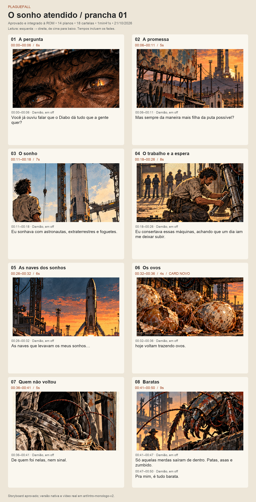

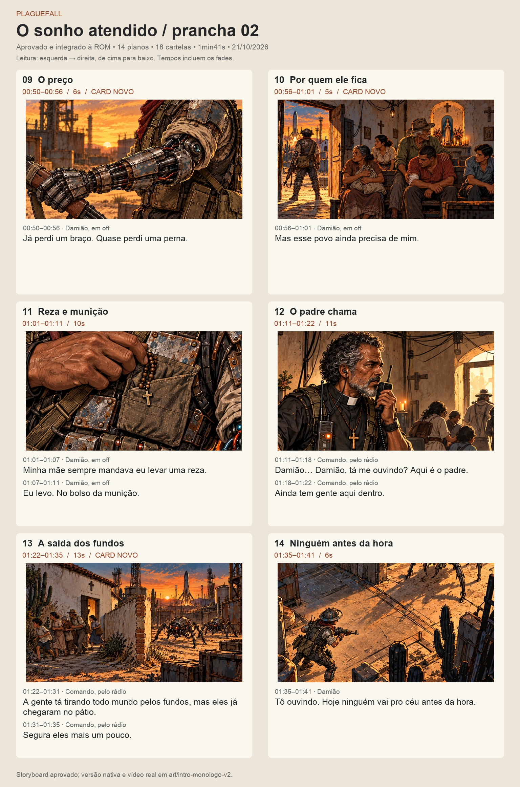

[Prévia com tempos e navegação](../../art/storyboard-abertura-v2/revisao.html) · [Fonte das falas e tempos](../../art/storyboard-abertura-v2/storyboard.json)

## Ritmo e leitura

- Os tempos abaixo já incluem entrada e saída visual de 0,4s por plano; não somar fades novamente.
- Nos planos 08, 11, 12 e 13, trocar somente a legenda no instante indicado, conservando a imagem e a música. São 14 imagens e 18 cartelas, não 18 cargas de imagem.
- As falas foram separadas em blocos de até 36 colunas × 4 linhas. A simulação usa a cadência atual de 36 caracteres por segundo e conserva pelo menos 1,5s após completar cada bloco; a janela útil depende também da leitura durante a digitação.
- Prévia sem áudio. Voz, chiado e efeitos descritos são direção, não gravações produzidas nesta etapa. A ROM atual apresenta as falas em texto.
- A mãe permanece fora de quadro e sem indícios que confirmem vida ou morte. Na lembrança de trabalho, Damião tem dois braços biológicos; no presente, a prótese é esquerda. O padre fica sem chapéu.

## Montagem plano a plano

### 01 · A pergunta · 00:00–00:06

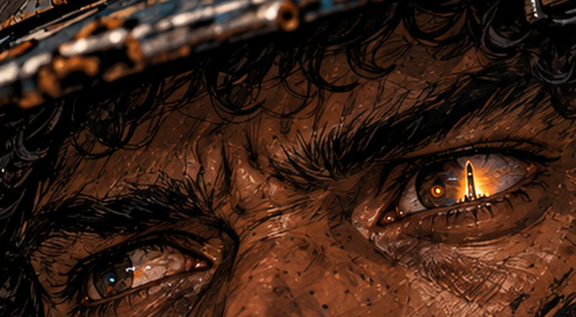

**Imagem e ação:** Close nos olhos sob o chapéu. Abrir direto na pergunta, com o rosto parcialmente em sombra. O Diabo pertence à fala; não mostrar uma entidade ou um pacto.

**Damião, em off — 00:00–00:06 (6s):**

> Você já ouviu falar que o Diabo dá tudo que a gente quer?

**Quebra proposta para a tela:**

```text
VOCE JA OUVIU FALAR QUE O DIABO DA
TUDO QUE A GENTE QUER?
```

**Som e interpretação:** Vento seco e chiado discreto como direção sonora. Trilha contida, sem acento de susto.

**Arte:** arte existente com novo lugar na sequência ou novo enquadramento.

### 02 · A promessa · 00:06–00:11

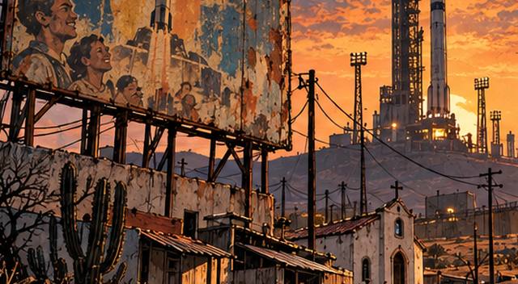

**Imagem e ação:** Anúncio espacial gasto sobre as casas e a capela, com o complexo industrial ao fundo. A imagem responde à pergunta: a promessa foi vendida à comunidade. Não acrescentar texto ao anúncio nesta revisão.

**Damião, em off — 00:06–00:11 (5s):**

> Mas sempre da maneira mais filha da puta possível?

**Quebra proposta para a tela:**

```text
MAS SEMPRE DA MANEIRA MAIS FILHA DA
PUTA POSSIVEL?
```

**Som e interpretação:** Pequena pausa depois da pergunta; o palavrão recebe amargura, sem efeito de comédia.

**Arte:** arte existente com novo lugar na sequência ou novo enquadramento.

### 03 · O sonho · 00:11–00:18


**Imagem e ação:** Lembrança quente: Damião adulto, ainda trabalhador, olha o foguete além da cerca. Dois braços biológicos e roupa de serviço; a distância da nave deve permanecer clara.

**Damião, em off — 00:11–00:18 (7s):**

> Eu sonhava com astronautas, extraterrestres e foguetes.

**Quebra proposta para a tela:**

```text
EU SONHAVA COM ASTRONAUTAS,
EXTRATERRESTRES E FOGUETES.
```

**Som e interpretação:** O tema ganha um pouco de luminosidade; motor distante, ainda associado à admiração.

**Arte:** arte existente com novo lugar na sequência ou novo enquadramento.

### 04 · O trabalho e a espera · 00:18–00:26

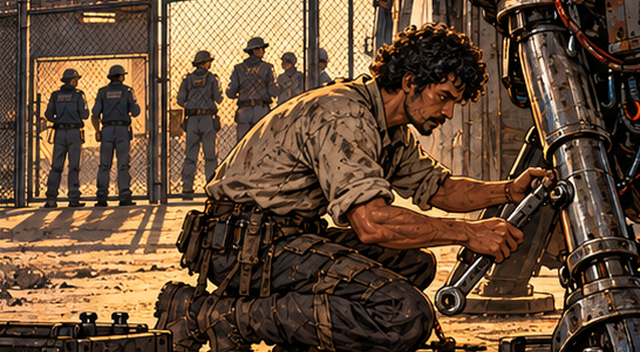

**Imagem e ação:** Manutenção do trem de pouso. Damião permanece do lado de fora do portão enquanto os tripulantes passam ao fundo. O ofício agora vem imediatamente depois do sonho, sem retorno tardio ao passado.

**Damião, em off — 00:18–00:26 (8s):**

> Eu consertava essas máquinas, achando que um dia iam me deixar subir.

**Quebra proposta para a tela:**

```text
EU CONSERTAVA ESSAS MAQUINAS,
ACHANDO QUE UM DIA IAM ME DEIXAR
SUBIR.
```

**Som e interpretação:** Ferramentas e vibração de metal como intenção sonora, deixando a fala respirar depois de máquinas.

**Arte:** arte existente com novo lugar na sequência ou novo enquadramento.

### 05 · As naves dos sonhos · 00:26–00:32


**Imagem e ação:** Corte para o presente: foguete de retorno sobre os telhados. Reenquadrar a parte alta do antigo plano 07 para não antecipar os ovos da carga. Sustentar a reticência até o corte seguinte.

**Damião, em off — 00:26–00:32 (6s):**

> As naves que levavam os meus sonhos…

**Quebra proposta para a tela:**

```text
AS NAVES QUE LEVAVAM OS MEUS
SONHOS...
```

**Som e interpretação:** O mesmo motivo de motor perde a qualidade admirável e ganha peso. A música continua no corte.

**Arte:** arte existente com novo lugar na sequência ou novo enquadramento.

### 06 · Os ovos · 00:32–00:36

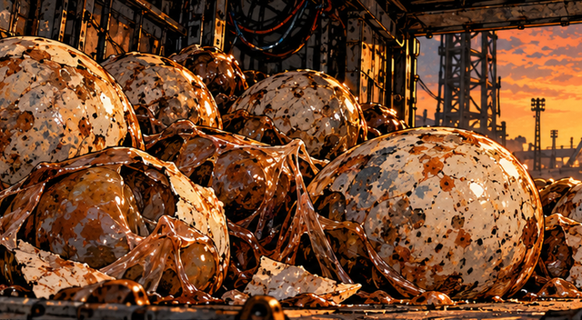

**Imagem e ação:** Novo close no interior da carga. Ovos manchados, cascas rompidas e metal enferrujado; os ovos devem dominar a leitura. A troca de imagem completa a frase iniciada no plano anterior.

**Damião, em off — 00:32–00:36 (4s):**

> hoje voltam trazendo ovos.

**Quebra proposta para a tela:**

```text
HOJE VOLTAM TRAZENDO OVOS.
```

**Som e interpretação:** Motor abafado, um ruído orgânico discreto como proposta. Sem interromper a trilha.

**Arte:** card novo de pré-produção.

### 07 · Quem não voltou · 00:36–00:41

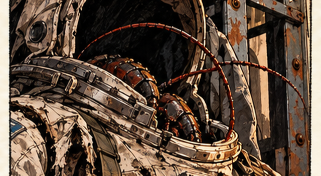

**Imagem e ação:** Traje de astronauta vazio, capacete escuro e estrutura de carga. O traje funciona como vestígio de quem partiu, sem confirmar destino dos tripulantes e sem cadáver em quadro.

**Damião, em off — 00:36–00:41 (5s):**

> De quem foi nelas, nem sinal.

**Quebra proposta para a tela:**

```text
DE QUEM FOI NELAS, NEM SINAL.
```

**Som e interpretação:** Reduzir a densidade musical e dar espaço à ausência.

**Arte:** arte existente com novo lugar na sequência ou novo enquadramento.

### 08 · Baratas · 00:41–00:50

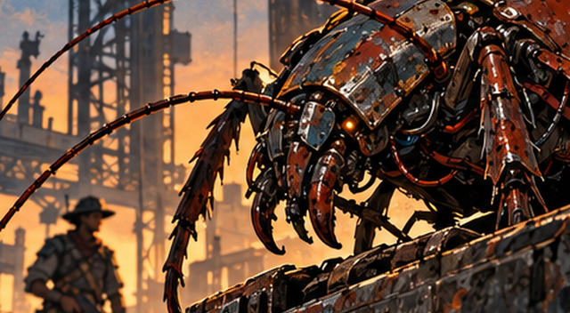

**Imagem e ação:** Um único plano do inseto biomecânico atravessando a carga, com Damião ao fundo. Trocar apenas a legenda aos seis segundos, sem fade ou recarga da imagem. O apelido barata encerra o bloco com humor seco.

**Damião, em off — 00:41–00:47 (6s):**

> Só aquelas merdas saíram de dentro. Patas, asas e zumbido.

**Quebra proposta para a tela:**

```text
SO AQUELAS MERDAS SAIRAM DE DENTRO.
PATAS, ASAS E ZUMBIDO.
```

**Damião, em off — 00:47–00:50 (3s):**

> Pra mim, é tudo barata.

**Quebra proposta para a tela:**

```text
PRA MIM, E TUDO BARATA.
```

**Som e interpretação:** Patas no metal e zumbido como direção de som. Pequena suspensão antes da segunda cartela.

**Arte:** arte existente com novo lugar na sequência ou novo enquadramento.

### 09 · O preço · 00:50–00:56

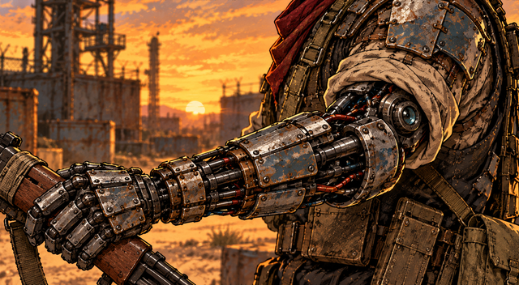

**Imagem e ação:** Close da prótese esquerda, com ombro, cotovelo, antebraço e mão mecânica visíveis numa diagonal central. A mão segura uma pequena parte da arma; o rosto fica fora do quadro e o torso é secundário. A fala sobre a perna não implica amputação. A imagem enfatiza o custo pessoal sem ferimento gráfico.

**Damião, em off — 00:50–00:56 (6s):**

> Já perdi um braço. Quase perdi uma perna.

**Quebra proposta para a tela:**

```text
JA PERDI UM BRACO. QUASE PERDI UMA
PERNA.
```

**Som e interpretação:** Estalo discreto do mecanismo como intenção. Tom contido e duas pausas curtas.

**Arte:** card novo de pré-produção.

### 10 · Por quem ele fica · 00:56–01:01

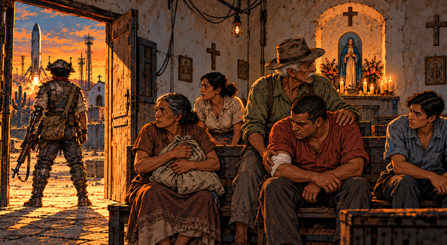

**Imagem e ação:** Interior da capela: civis abrigados nos bancos, um homem com o antebraço enfaixado sendo amparado e pessoas aguardando a saída. Os três homens têm aparências distintas: um idoso de cabelo e bigode brancos, camisa verde e chapéu; um adulto de cabelo curto, sem barba e camisa ferrugem; e um jovem de cabelo liso, sem barba e camisa azul. A comunidade ocupa o centro e a direita da imagem. Damião aparece pequeno e de costas, guardando a porta à esquerda, com a arma baixa. É a espera antes da retirada do plano 13; nenhuma pessoa é identificada como a mãe dele.

**Damião, em off — 00:56–01:01 (5s):**

> Mas esse povo ainda precisa de mim.

**Quebra proposta para a tela:**

```text
MAS ESSE POVO AINDA PRECISA DE MIM.
```

**Som e interpretação:** O pulso começa a se afirmar, sem transformar o gesto em pose triunfal.

**Arte:** card novo de pré-produção.

### 11 · Reza e munição · 01:01–01:11

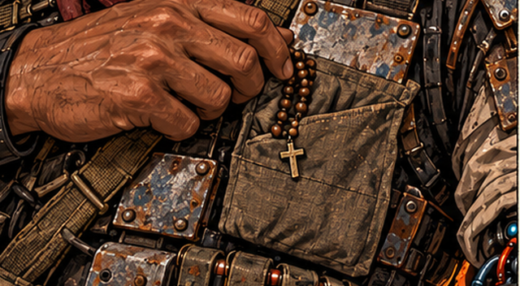

**Imagem e ação:** Detalhe da mão direita biológica junto ao terço e às bolsas de munição. Manter a mesma imagem nas duas cartelas. Não mostrar a mãe, retrato, túmulo ou lembrança que sugira se está viva. O passado está apenas na fala.

**Damião, em off — 01:01–01:07 (6s):**

> Minha mãe sempre mandava eu levar uma reza.

**Quebra proposta para a tela:**

```text
MINHA MAE SEMPRE MANDAVA EU LEVAR
UMA REZA.
```

**Damião, em off — 01:07–01:11 (4s):**

> Eu levo. No bolso da munição.

**Quebra proposta para a tela:**

```text
EU LEVO. NO BOLSO DA MUNICAO.
```

**Som e interpretação:** Intimidade na lembrança. Nos últimos 0,5s, sugerir entrada de chiado de rádio para preparar o padre; é direção sonora para a futura implementação.

**Arte:** arte existente com novo lugar na sequência ou novo enquadramento.

### 12 · O padre chama · 01:11–01:22

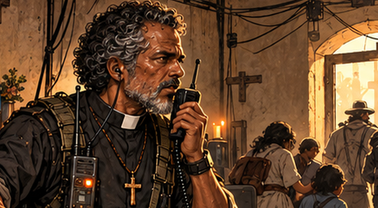

**Imagem e ação:** Comando no abrigo da capela, cabelo grisalho descoberto e colarinho romano. Civis ao fundo dão contexto ao pedido. Sem trocar a imagem entre as duas cartelas: primeiro contato, depois o que está em risco.

**Comando, pelo rádio — 01:11–01:18 (7s):**

> Damião… Damião, tá me ouvindo? Aqui é o padre.

**Quebra proposta para a tela:**

```text
DAMIAO... DAMIAO, TA ME OUVINDO?
AQUI E O PADRE.
```

**Comando, pelo rádio — 01:18–01:22 (4s):**

> Ainda tem gente aqui dentro.

**Quebra proposta para a tela:**

```text
AINDA TEM GENTE AQUI DENTRO.
```

**Som e interpretação:** Rádio, passos e vozes ao fundo como intenção de direção. A prévia permanece sem áudio e não pressupõe nova dublagem.

**Arte:** arte existente com novo lugar na sequência ou novo enquadramento.

### 13 · A saída dos fundos · 01:22–01:35

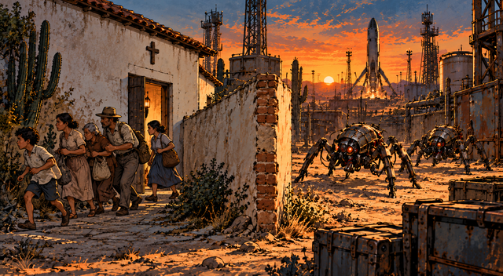

**Imagem e ação:** Novo plano que mostra a rota de retirada junto à parede lateral/traseira da capela. Todos os civis estão fora da soleira, com rostos e passos voltados para a esquerda, afastando-se da porta; uma quina de muro os separa dos insetos no pátio, à direita. A frase longa recebe nove segundos; o pedido final fica sozinho por mais quatro, sem trocar o desenho.

**Comando, pelo rádio — 01:22–01:31 (9s):**

> A gente tá tirando todo mundo pelos fundos, mas eles já chegaram no pátio.

**Quebra proposta para a tela:**

```text
A GENTE TA TIRANDO TODO MUNDO PELOS
FUNDOS, MAS ELES JA CHEGARAM NO
PATIO.
```

**Comando, pelo rádio — 01:31–01:35 (4s):**

> Segura eles mais um pouco.

**Quebra proposta para a tela:**

```text
SEGURA ELES MAIS UM POUCO.
```

**Som e interpretação:** Pulso ganha urgência e o rádio continua sobre a nova imagem. Ainda não há tiro.

**Arte:** card novo de pré-produção.

### 14 · Ninguém antes da hora · 01:35–01:41

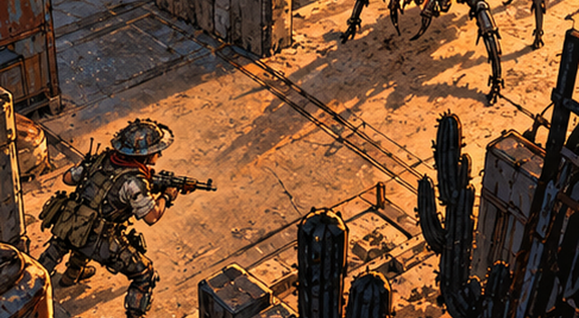

**Imagem e ação:** Enquadramento elevado existente: Damião entre a retirada dos civis e os invasores. A resposta fecha a provocação inicial sobre o Diabo e transforma o desabafo numa ação de proteção. Encerrar antes do primeiro tiro; na montagem do boot, seguir para o menu.

**Damião — 01:35–01:41 (6s):**

> Tô ouvindo. Hoje ninguém vai pro céu antes da hora.

**Quebra proposta para a tela:**

```text
TO OUVINDO. HOJE NINGUEM VAI PRO CEU
ANTES DA HORA.
```

**Som e interpretação:** Última frase firme, sem grito. Saída musical apenas no encerramento da sequência.

**Arte:** arte existente com novo lugar na sequência ou novo enquadramento.

## Integração ao jogo

A montagem foi aprovada e integrada em 21/10/2026. O exportador usa este JSON para gerar 14 imagens e 18 cartelas, com duas legendas sobre uma mesma imagem nos planos 08, 11, 12 e 13.

A trilha foi reordenada e estendida para 4s de logo, 101s de monólogo e 3s de sustentação. A música não reinicia nas trocas de imagem ou texto.

[Implementação, vídeo e verificação em 50/60Hz](../../art/intro-monologo-v2/README.md). Os testes conferem as 18 cartelas e os 14 planos, incluindo a limpeza do texto anterior, START, menu e início da fase 1.
