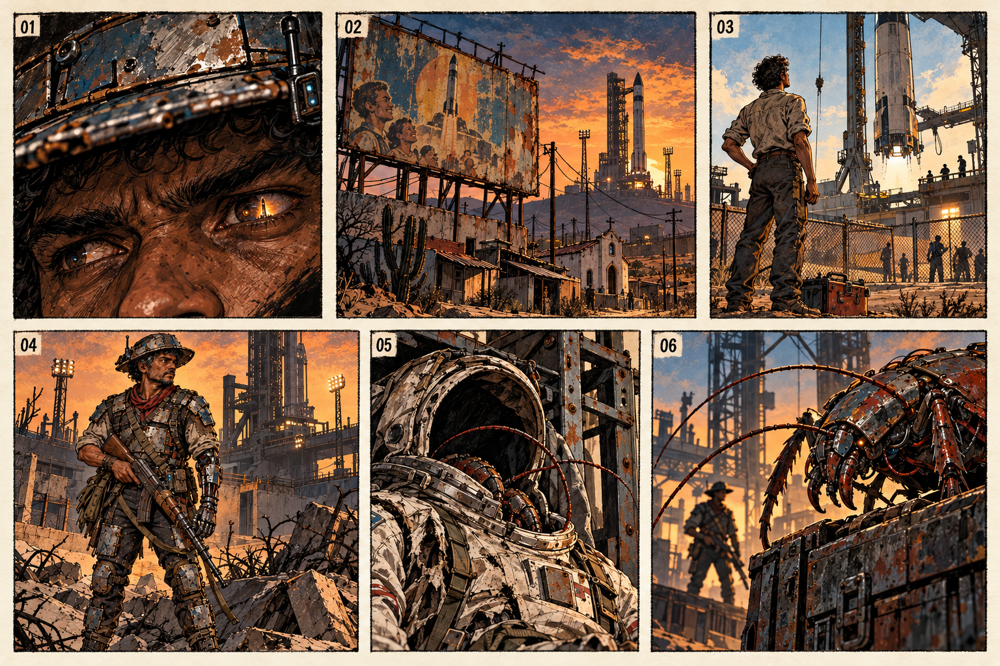
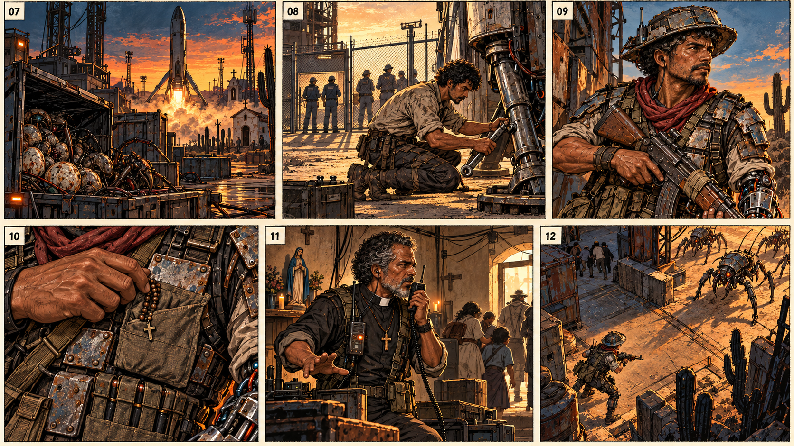

# Storyboard de abertura — o sonho atendido

**Personagem:** Damião. **Duração de referência:** 1min29s, ajustável à interpretação. **Formato:** 12 planos em duas pranchas, leitura da esquerda para a direita e de cima para baixo. Baseado no [monólogo completo](abertura.md), preservando suas falas.

## Intenção da sequência

A voz começa íntima, como uma conversa atravessada por estática. Damião recorda o futuro que lhe venderam e mostra o que voltou do espaço. O humor perde espaço quando o padre chama: a última imagem transforma o desabafo numa decisão de proteger pessoas. As lembranças têm luz quente e menos contraste; o presente tem sombras azuladas, ferrugem e calor dos motores.

O Diabo fica na fala de Damião. A sequência não apresenta uma entidade nem um pacto. O passado mostra Damião adulto trabalhando na manutenção, com os dois braços biológicos; o presente mantém o rosto exposto, o chapéu metálico com rádio, o lenço vermelho, as placas azul-acinzentadas e a prótese **esquerda**. Comando tem cabelo grisalho descoberto e colarinho romano. Dinorah mantém sua apresentação por rádio antes da fase 7, conforme o roteiro atual.

## Prancha 1 — o sonho e a chegada

### 01 · A pergunta · 00:00–00:05

**Imagem e câmera:** primeiríssimo plano dos olhos cansados de Damião sob a aba do chapéu. Um pequeno reflexo de uma transmissão antiga de foguete. O resto do rosto fica na sombra. Aproximação quase imperceptível.

**Damião, em off:** “Você já ouviu falar que o Diabo dá tudo que a gente quer?”

**Som e corte:** rádio de pouso indistinto, chiado e vento seco. Pausa curta após “quer?”. A voz segue sobre o corte para o plano 02.

### 02 · A promessa · 00:05–00:10

**Imagem e câmera:** plano geral do porto espacial cercado, maior que as casas do entorno. Uma propaganda de foguete se desfaz acima de telhas, fios, mandacarus e uma capela. Um movimento lento para baixo mostra quem ficou vivendo sob a promessa. A arte da prancha deixa o anúncio sem letras; numa arte final, a frase existente no universo pode ser aplicada separadamente: “ASCENSÃO: O CÉU É PARA TODOS”.

**Damião, em off:** “Mas sempre da maneira mais filha da puta possível?”

**Som e corte:** a transmissão falha. Pequeno silêncio após o palavrão; entrada do ruído de um motor na lembrança seguinte.

### 03 · O sonho · 00:10–00:18

**Imagem e câmera:** lembrança em plano médio aberto. Damião mais jovem, já adulto, com uniforme de manutenção e caixa de ferramentas, olha um foguete retornando à base além da cerca. Seus dois braços ainda são biológicos. A câmera acompanha seu olhar para cima; ele continua do lado de fora.

**Damião, em off:** “Eu sonhava com astronautas, extraterrestres e foguetes.”

**Som e corte:** motor limpo, quase admirável. Corte seco antes de o pouso completar.

### 04 · Agora · 00:18–00:22

**Imagem e câmera:** presente. Plano de corpo inteiro de Damião no pátio, arma baixa, prótese esquerda, roupa remendada e chapéu com antena. Repete a direção do olhar do plano anterior, mas agora ele olha para o perigo ao nível do chão. Segurar a imagem, sem pose triunfal.

**Damião, em off:** “... É. agora tô assim.”

**Som e corte:** o motor vira um ronco distante; pequeno estalo da mão mecânica. Dar espaço para o jogador reconhecer o personagem.

### 05 · Quem não voltou · 00:22–00:29

**Imagem e câmera:** plano próximo de um traje de astronauta abandonado numa estrutura de carga. O capacete está escuro, sem rosto. Uma antena e uma pata segmentada surgem pela gola. Aproximação lenta até perceber o movimento.

**Damião, em off:** “As naves voltaram. Quem foi nelas, não.”

**Som e corte:** tecido raspando, peça de metal batendo e um primeiro clique de inseto. O traje vazio representa quem partiu nas naves e não voltou, sem cadáver em quadro.

### 06 · Baratas · 00:29–00:37

**Imagem e câmera:** câmera baixa junto à carga. Um inseto biomecânico de seis patas passa por cima da caixa; antenas, mandíbulas e placas recuperadas definem a silhueta. Damião observa ao fundo. O foco passa das patas para o homem.

**Damião, em off:** “Aquelas merdas vieram também. Cheio de patas, asas e aquele zumbido. Pra mim, é tudo barata.”

**Som e corte:** patas no metal, zumbido de asas e breve pausa antes de “barata”. O ronco de um pouso atravessa o corte seguinte.

## Prancha 2 — o preço e a decisão

### 07 · A carga de retorno · 00:37–00:47

**Imagem e câmera:** plano geral. Um foguete pousa verticalmente atrás do povoado. No primeiro plano, uma carga já descarregada está aberta: casulos, patas e movimento dentro do contêiner. A luz do motor revela os ninhos. O mesmo enquadramento reúne a capacidade técnica do pouso e sua consequência no chão.

**Damião, em off:** “E os foguetes pousam de pé, no mesmo lugar de onde saíram. A diferença é que agora descarregam ninhos.”

**Som e corte:** motor forte, travas da carga, ruído orgânico baixo. Cortar do trem de pouso atual para o mesmo componente na lembrança de Damião.

### 08 · O trabalhador que ficou · 00:47–00:56

**Imagem e câmera:** lembrança em plano médio aberto. Damião trabalha com uma chave no trem de pouso. Ao fundo, tripulantes atravessam um portão fechado para ele. A câmera fica do seu lado da cerca. Dois braços biológicos, roupa de serviço, sem armadura de combate.

**Damião, em off:** “Eu consertava essas máquinas. Achava que um dia iam me deixar subir. Subi foi na lista de quem eles querem matar.”

**Som e corte:** ferramentas e vibração da carcaça. O clique da chave vira o clique do mecanismo da arma no presente.

### 09 · O preço de ficar · 00:56–01:06

**Imagem e câmera:** plano próximo de três quartos pelo lado esquerdo de Damião. A mão mecânica sustenta a arma remendada; a mão direita, biológica, confere a empunhadura. Um deslocamento curto da câmera sobe do braço até a antena e seu rosto. A prancha registra a composição principal desse movimento.

**Damião, em off:** “Já foi um braço e quase uma perna, mas esse povo precisa de mim!”

**Som e corte:** servo do braço e trava da arma em volume baixo. A fala parte do ferimento e termina na decisão de proteger a comunidade, sem efeito de comédia.

### 10 · Reza e munição · 01:06–01:13

**Imagem e câmera:** detalhe da mão direita de Damião guardando um pequeno terço no bolso de tecido, acima da bolsa de munição. O objeto cabe junto ao equipamento. Nada brilha ou manifesta poder. Plano fixo, gesto rápido e habitual.

**Damião, em off:** “Minha mãe ainda manda eu levar uma reza. Eu levo. Junto com a munição.”

**Som e corte:** contas do terço e tecido. O rádio interrompe a última pausa e muda a urgência da cena.

### 11 · O chamado · 01:13–01:24

**Imagem e câmera:** plano médio aberto do abrigo numa capela. Comando, sem chapéu, fala no rádio enquanto indica a saída dos fundos a algumas pessoas. Cabelo grisalho, colarinho branco e crucifixo reconhecíveis. Uma pequena imagem de Nossa Senhora Aparecida e os cabos da estação pertencem ao mesmo espaço de cuidado. A câmera acompanha seu gesto até a porta.

**Comando, pelo rádio:** “Damião. Aqui é o padre. Tá me ouvindo? Eles chegaram no pátio. Tem gente saindo pelo fundo.”

**Som e corte:** voz comprimida pelo rádio, passos e porta. A trilha abandona a lembrança e ganha pulso. O movimento dos civis estabelece o que Damião precisa proteger.

### 12 · Ficar no chão · 01:24–01:29

**Imagem e câmera:** começa próximo de Damião ouvindo o rádio; ele ergue a arma e entra na passagem. A câmera sobe para uma visão elevada a aproximadamente 60° acima do chão. Damião fica abaixo à esquerda; os insetos chegam pela direita e a passagem de retirada fica atrás dele. O último enquadramento das pranchas registra o fim desse movimento, já com leitura de arena.

**Damião:** “Tô ouvindo. Hoje ninguém vai pro céu antes da hora.”

**Som e corte:** a fala ocupa a primeira parte do plano; o restante dá tempo ao gesto, à subida da câmera e à leitura do caminho. O rádio fecha com um clique. Encerrar antes do primeiro tiro; na futura implementação, fazer a passagem para a apresentação do objetivo da fase 1, mantendo as regras atuais de preparação da arena.

## Relação com a abertura já implementada

Este é o **storyboard ilustrado do monólogo completo**, agora integrado à [animação antes do menu](../../art/intro-monologo-v1/README.md). O texto abaixo das pranchas orienta a exportação dos 12 planos. A imagem final de cada plano é um recorte da prancha para o campo visível de 320×176, com enquadramento estável, transição em fade e texto centralizado. Os movimentos de câmera descritos na direção original acima não são executados na versão atual.

| Fala da versão anterior, com sete caixas | Planos correspondentes na animação |
|---|---|
| 1 · Pergunta sobre o Diabo | 01 |
| 2 · Maneira cruel de atender o desejo | 02 |
| 3 · Astronautas, extraterrestres e foguetes | 03 |
| 4 · Corpo, chapéu e Brasil ocupado | 04, 06, 09 |
| 5 · Foguetes, ninhos e a carona | 05, 07, 08 |
| 6 · Chamado do padre | 11 |
| 7 · Resposta e entrada em ação | 12 |

O plano 10 mantém o gesto religioso e sua fala do monólogo extenso. Os 12 planos tocam automaticamente no boot, respeitando a duração prevista de 89 segundos mais os poucos quadros de carga entre imagens. A não completa nem avança as legendas; somente START pula a abertura. O quadro 12 conserva a composição elevada da ilustração, sem rolagem.

As pranchas originais permanecem como material de direção. A [exportação para o VDP](../../art/intro-monologo-v1/export.json) usa 924 tiles por imagem com recorte lateral fixo, duas paletas por quadro e texto branco centralizado sobre preto, sem nome, numeração ou instruções de controle. A arte tem uma borda inferior em fade para evitar um retângulo marcado. A abertura toca após FinalQuest e antes de PLAGUEFALL; ao terminar ou pular, restaura paletas, fonte, sprites e rolagem antes de inicializar os recursos do jogo.

Na campanha, [levels/story.c](../../src/levels/story.c) conserva apenas o chamado do padre e a resposta de Damião antes da fase 1. O monólogo não é repetido após escolher NOVO JOGO. A animação de boot não leva diretamente à arena: termina no menu solicitado.

A trilha original [O Sonho Atendido](../../art/audio-abertura-v2/README.md) começa na aparição do logo Plaguefall e acompanha continuamente esse arco: pergunta contida, sonho mais luminoso, ninhos com tensão industrial, reza com vozes sustentadas e decisão final com pulso. As mudanças de imagem não reiniciam nem silenciam a música. START encerra o som antes do menu; A, B e C são ignorados.

## Arquivos de produção

- [Pranchas, referências e prompts](../../art/storyboard-abertura-v1/README.md).
- [Monólogo original e versão da ROM](abertura.md).
- [Universo e continuidade](universo.md).
