# Storyboard da campanha de Plaguefall

A história começa com a animação que já abre o jogo: 14 planos, 18 cartelas e 1min41s, preservados abaixo com capturas da ROM. Depois vêm o menu, a chamada curta de missão e as sete pranchas com 28 quadros da campanha. São 19 versões de fase e 16 fases por partida.

[PDF para revisão](../../../output/pdf/plaguefall-storyboard-campanha-v1.pdf) · [História completa](tratamento-proposto.md) · [Prompts e arquivos de produção](../../art/storyboard-campanha-v1/README.md)

## Início da história com a animação existente

FinalQuest → APRESENTA → logo Plaguefall → animação de abertura → menu → nova partida → chamada curta do padre → fase 1. A animação toca uma vez por boot e pode ser pulada com START, conforme o fluxo existente. O monólogo não se repete ao começar a fase.

[Vídeo da animação no jogo](../../art/intro-monologo-v2/emulator-ntsc/abertura.mp4) · [Storyboard aprovado da abertura](storyboard-abertura-v2.md)

### Plano 01 A pergunta

**Tempo:** 00:00-00:06 (6 s).

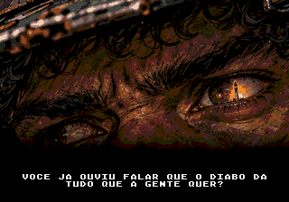

**Damião, em off (6 s):** Você já ouviu falar que o Diabo dá tudo que a gente quer?

**Encenação existente:** Close nos olhos sob o chapéu. Abrir direto na pergunta, com o rosto parcialmente em sombra. O Diabo pertence à fala; não mostrar uma entidade ou um pacto.

### Plano 02 A promessa

**Tempo:** 00:06-00:11 (5 s).

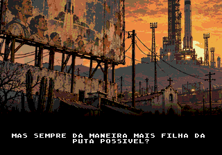

**Damião, em off (5 s):** Mas sempre da maneira mais filha da puta possível?

**Encenação existente:** Anúncio espacial gasto sobre as casas e a capela, com o complexo industrial ao fundo. A imagem responde à pergunta: a promessa foi vendida à comunidade. Não acrescentar texto ao anúncio nesta revisão.

### Plano 03 O sonho

**Tempo:** 00:11-00:18 (7 s).

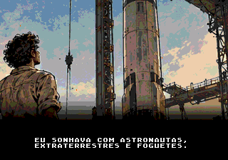

**Damião, em off (7 s):** Eu sonhava com astronautas, extraterrestres e foguetes.

**Encenação existente:** Lembrança quente: Damião adulto, ainda trabalhador, olha o foguete além da cerca. Dois braços biológicos e roupa de serviço; a distância da nave deve permanecer clara.

### Plano 04 O trabalho e a espera

**Tempo:** 00:18-00:26 (8 s).

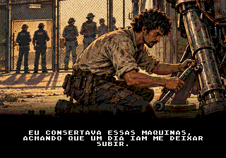

**Damião, em off (8 s):** Eu consertava essas máquinas, achando que um dia iam me deixar subir.

**Encenação existente:** Manutenção do trem de pouso. Damião permanece do lado de fora do portão enquanto os tripulantes passam ao fundo. O ofício agora vem imediatamente depois do sonho, sem retorno tardio ao passado.

### Plano 05 As naves dos sonhos

**Tempo:** 00:26-00:32 (6 s).

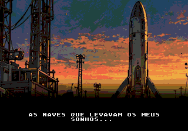

**Damião, em off (6 s):** As naves que levavam os meus sonhos…

**Encenação existente:** Corte para o presente: foguete de retorno sobre os telhados. Reenquadrar a parte alta do antigo plano 07 para não antecipar os ovos da carga. Sustentar a reticência até o corte seguinte.

### Plano 06 Os ovos

**Tempo:** 00:32-00:36 (4 s).

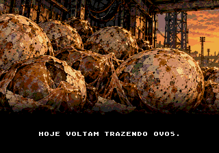

**Damião, em off (4 s):** hoje voltam trazendo ovos.

**Encenação existente:** Novo close no interior da carga. Ovos manchados, cascas rompidas e metal enferrujado; os ovos devem dominar a leitura. A troca de imagem completa a frase iniciada no plano anterior.

### Plano 07 Quem não voltou

**Tempo:** 00:36-00:41 (5 s).

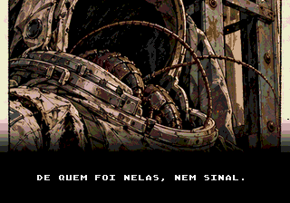

**Damião, em off (5 s):** De quem foi nelas, nem sinal.

**Encenação existente:** Traje de astronauta vazio, capacete escuro e estrutura de carga. O traje funciona como vestígio de quem partiu, sem confirmar destino dos tripulantes e sem cadáver em quadro.

### Plano 08 Baratas

**Tempo:** 00:41-00:50 (9 s).

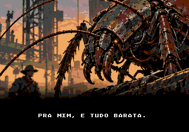

**Damião, em off (6 s):** Só aquelas merdas saíram de dentro. Patas, asas e zumbido.

**Damião, em off (3 s):** Pra mim, é tudo barata.

**Encenação existente:** Um único plano do inseto biomecânico atravessando a carga, com Damião ao fundo. Trocar apenas a legenda aos seis segundos, sem fade ou recarga da imagem. O apelido barata encerra o bloco com humor seco.

### Plano 09 O preço

**Tempo:** 00:50-00:56 (6 s).

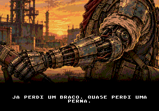

**Damião, em off (6 s):** Já perdi um braço. Quase perdi uma perna.

**Encenação existente:** Close da prótese esquerda, com ombro, cotovelo, antebraço e mão mecânica visíveis numa diagonal central. A mão segura uma pequena parte da arma; o rosto fica fora do quadro e o torso é secundário. A fala sobre a perna não implica amputação. A imagem enfatiza o custo pessoal sem ferimento gráfico.

### Plano 10 Por quem ele fica

**Tempo:** 00:56-01:01 (5 s).

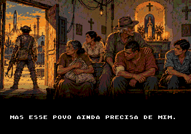

**Damião, em off (5 s):** Mas esse povo ainda precisa de mim.

**Encenação existente:** Interior da capela: civis abrigados nos bancos, um homem com o antebraço enfaixado sendo amparado e pessoas aguardando a saída. Os três homens têm aparências distintas: um idoso de cabelo e bigode brancos, camisa verde e chapéu; um adulto de cabelo curto, sem barba e camisa ferrugem; e um jovem de cabelo liso, sem barba e camisa azul. A comunidade ocupa o centro e a direita da imagem. Damião aparece pequeno e de costas, guardando a porta à esquerda, com a arma baixa. É a espera antes da retirada do plano 13; nenhuma pessoa é identificada como a mãe dele.

### Plano 11 Reza e munição

**Tempo:** 01:01-01:11 (10 s).

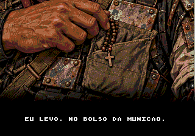

**Damião, em off (6 s):** Minha mãe sempre mandava eu levar uma reza.

**Damião, em off (4 s):** Eu levo. No bolso da munição.

**Encenação existente:** Detalhe da mão direita biológica junto ao terço e às bolsas de munição. Manter a mesma imagem nas duas cartelas. Não mostrar a mãe, retrato, túmulo ou lembrança que sugira se está viva. O passado está apenas na fala.

### Plano 12 O padre chama

**Tempo:** 01:11-01:22 (11 s).

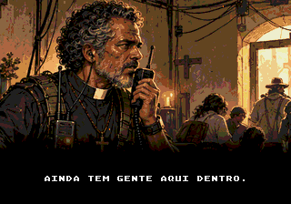

**Comando, pelo rádio (7 s):** Damião… Damião, tá me ouvindo? Aqui é o padre.

**Comando, pelo rádio (4 s):** Ainda tem gente aqui dentro.

**Encenação existente:** Comando no abrigo da capela, cabelo grisalho descoberto e colarinho romano. Civis ao fundo dão contexto ao pedido. Sem trocar a imagem entre as duas cartelas: primeiro contato, depois o que está em risco.

### Plano 13 A saída dos fundos

**Tempo:** 01:22-01:35 (13 s).

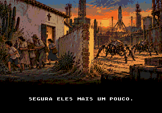

**Comando, pelo rádio (9 s):** A gente tá tirando todo mundo pelos fundos, mas eles já chegaram no pátio.

**Comando, pelo rádio (4 s):** Segura eles mais um pouco.

**Encenação existente:** Novo plano que mostra a rota de retirada junto à parede lateral/traseira da capela. Todos os civis estão fora da soleira, com rostos e passos voltados para a esquerda, afastando-se da porta; uma quina de muro os separa dos insetos no pátio, à direita. A frase longa recebe nove segundos; o pedido final fica sozinho por mais quatro, sem trocar o desenho.

### Plano 14 Ninguém antes da hora

**Tempo:** 01:35-01:41 (6 s).

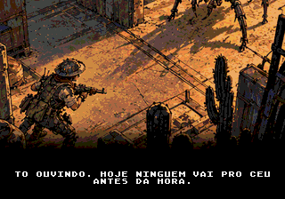

**Damião (6 s):** Tô ouvindo. Hoje ninguém vai pro céu antes da hora.

**Encenação existente:** Enquadramento elevado existente: Damião entre a retirada dos civis e os invasores. A resposta fecha a provocação inicial sobre o Diabo e transforma o desabafo numa ação de proteção. Encerrar antes do primeiro tiro; na montagem do boot, seguir para o menu.

### Do menu à primeira fase

O plano 14 encerra a animação e leva ao menu. Ao escolher nova partida, o padre retoma a missão com a fala curta: “Damião, aqui é o padre. Segure o pátio. Tem gente fugindo pelo fundo.” Damião responde: “Tô indo. Hoje ninguém vai pro céu antes da hora.” A primeira prancha começa nessa retomada, sem outro prólogo na oficina.

## Leitura das pranchas da campanha

A: alto à esquerda. B: alto à direita. C: embaixo à esquerda. D: embaixo à direita. Variantes indicadas como alternativas não acontecem uma depois da outra. Duração e distância nas legendas são parâmetros da missão, não tempo de cutscene. As pranchas seguintes são conceitos; as imagens da abertura acima são capturas do jogo.

## Prancha 1 A retirada da igreja

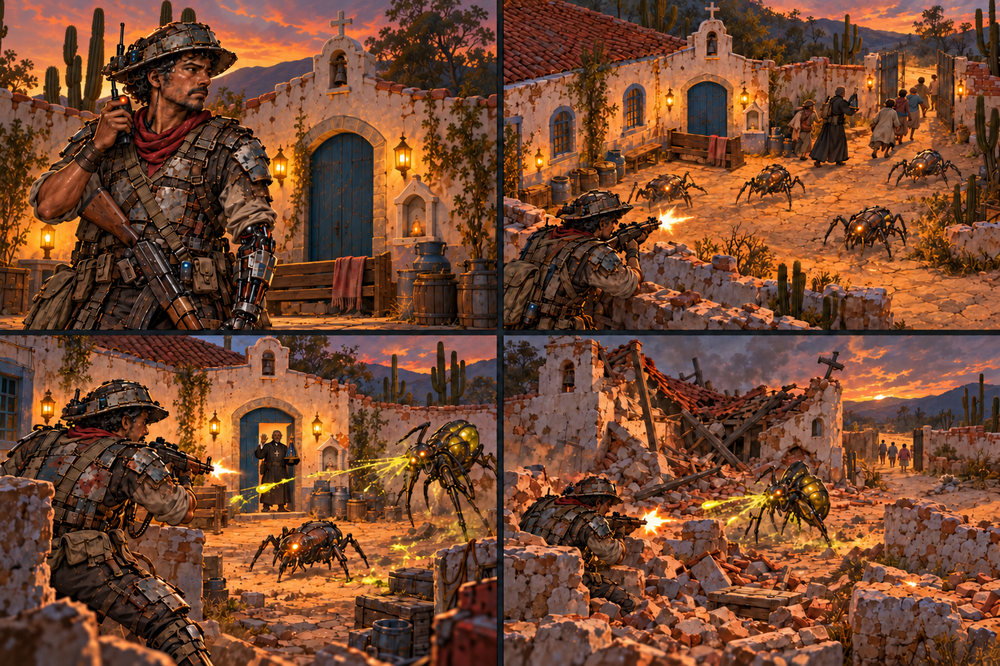

### A Chamada da missão Retomada no pátio

**Câmera:** Plano médio de Damião já no pátio da igreja, atendendo ao rádio.

**Ação:** Depois da animação existente e do menu, a nova partida retoma a defesa da retirada. Sem outra cena na oficina.

**Objetivo:** Ligar a abertura já exibida à fase 1, sem repetir o monólogo.

**Fala:** Padre: “Damião, aqui é o padre. Segure o pátio. Tem gente fugindo pelo fundo.” Damião: “Tô indo. Hoje ninguém vai pro céu antes da hora.”

**Impacto e corte:** A abertura completa aparece antes, nos 14 planos preservados. A chamada curta termina e começa a defesa de 1min30s.

### B Fase 1 Até o último sair

**Câmera:** Plano geral elevado; acompanhar a linha de defesa.

**Ação:** Damião segura insetos básicos enquanto o padre retira os últimos civis e leva a santa.

**Objetivo:** Sobreviver por 1min30s; um único tipo de inimigo.

**Fala:** Padre: “Uma explosão aqui pode derrubar a igreja.”

**Impacto e corte:** Rádio marca a saída do último civil. Sem bomba, cortar para 2A; com qualquer bomba, para 2B.

### C Fase 2A A igreja de pé

**Câmera:** Repetir o eixo do pátio com a fachada inteira.

**Ação:** Um inseto de disparo aparece ao lado dos inimigos de contato; Damião termina a limpeza.

**Objetivo:** Eliminar 15 insetos.

**Fala:** Padre: “Você protegeu nosso povo e manteve a igreja de pé.”

**Impacto e corte:** Alternativa a 2B. A igreja permanece inteira no epílogo. Os civis já saíram; seguir para a rua.

### D Fase 2B Entre os escombros

**Câmera:** Mesmo eixo de 2A; destacar o desvio entre destroços.

**Ação:** Parede e telhado caídos mudam circulação e cobertura. Damião enfrenta os mesmos tipos da 2A.

**Objetivo:** Eliminar 15 insetos, contornando bloqueios.

**Fala:** Damião: “Vidas valem mais que prédios, padre.”

**Impacto e corte:** Alternativa a 2A. Não há mortes civis por esta escolha. A igreja continua destruída no retorno; seguir para a rua.

## Prancha 2 Abrigo e resgate

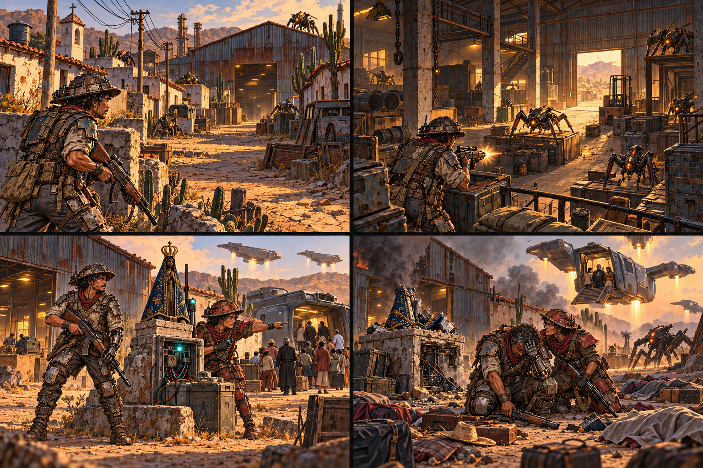

### A Fase 3 Abram caminho

**Câmera:** Plano geral em perspectiva; deslocamento rumo ao galpão.

**Ação:** Damião avança pela rua. O povo e o padre aguardam atrás da zona de combate.

**Objetivo:** Alcançar o galpão em um corredor de 2.560 pixels.

**Fala:** Padre: “Vá na frente e abra caminho.” Damião: “Só venham quando eu avisar.”

**Impacto e corte:** Passos e tiros conduzem ao portão. Chegar basta; não exigir eliminar todos os insetos da rua.

### B Fase 4 Um teto para a noite

**Câmera:** Plano geral do interior; pilares criam profundidade.

**Ação:** Damião limpa o galpão antes da entrada das famílias, ainda protegidas do lado de fora.

**Objetivo:** Eliminar 20 insetos.

**Fala:** Padre: “Precisamos de um teto para esta noite.”

**Impacto e corte:** Após a limpeza, os civis entram. Pelo rádio surge a possibilidade de resgate antes da noite.

### C Fase 5 O sinal da santa

**Câmera:** Plano aberto com santa em primeiro plano e embarque ao fundo.

**Ação:** Damião defende o comunicador. Dinorah chega e organiza o embarque. O padre acompanha o povo.

**Objetivo:** Proteger a santa e o comunicador por 2 minutos.

**Fala:** Padre: “O primeiro grupo já embarcou. Precisamos manter o sinal.”

**Impacto e corte:** Chamado e primeiro embarque acontecem antes do cronômetro. Sucesso salva todos e leva à 6A.

### D Fase 5 falha O sinal interrompido

**Câmera:** Repetir a composição anterior; aproximar o equipamento quebrado.

**Ação:** A posição cai. Uma nave sai com sobreviventes; malas e corpos cobertos mostram as perdas no chão.

**Objetivo:** Falha do objetivo com Damião vivo permite continuar.

**Fala:** Padre: “Quem já embarcou conseguiu sair… Perdemos gente aqui embaixo.”

**Impacto e corte:** Alternativa ao resgate completo. Não morreram todos. Dinorah fica; o padre segue na nave e no rádio. Cortar para 6B.

## Prancha 3 Os esgotos e O Último Chão

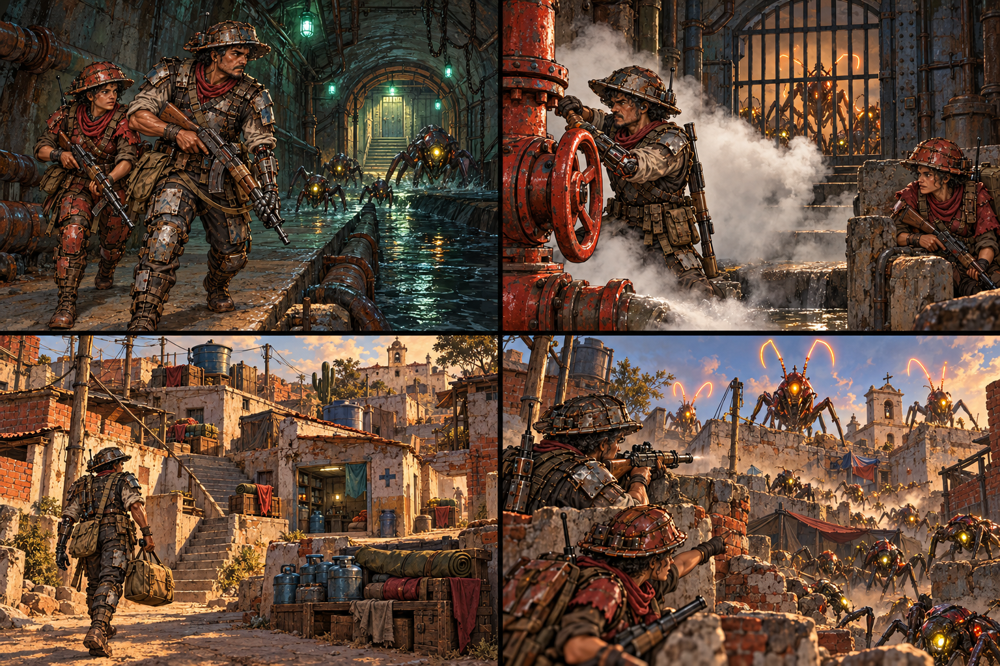

### A Fase 6A Pela passagem de baixo

**Câmera:** Plano geral do esgoto; seguir a dupla pelo caminho seco.

**Ação:** Damião abre espaço para Dinorah, que espera cobertura e mantém distância segura.

**Objetivo:** Escoltar Dinorah por 3.072 pixels até o abrigo.

**Fala:** Dinorah: “Agora me leve até a base e eu arranjo recursos.”

**Impacto e corte:** Resgate completo. Percurso simples. Se Dinorah morrer aqui, reiniciar; chegar viva leva à 7.

### B Fase 6B O peso dos que ficaram

**Câmera:** Plano de conjunto; válvula em primeiro plano e portão adiante.

**Ação:** Damião libera pressão e abre barreiras. Dinorah aguarda em cobertura; o padre fala pelo rádio.

**Objetivo:** Escoltar por 3.072 pixels, com portões e válvulas.

**Fala:** Damião: “Eram meu povo…” Padre: “Agora precisamos seguir com fé.”

**Impacto e corte:** Resgate parcial. Manter espaço para o choro antes da resposta. Morte de Dinorah reinicia; chegada leva à 7.

### C Fase 7 O que ainda resta

**Câmera:** Plano amplo da favela; destacar coleta, transporte e depósito.

**Ação:** Damião carrega uma carga por vez. Dinorah coordena o recolhimento dos suprimentos espalhados.

**Objetivo:** Recuperar e entregar cargas de 5 pontos.

**Fala:** Damião: “Esses suprimentos mantêm a resistência viva.”

**Impacto e corte:** A quinta entrega encerra. Acrescentar alívio se todos foram resgatados ou lembrança dos mortos se houve perdas.

### D Fase 8 Cortar o chamado

**Câmera:** Plano aberto com profundidade; emissores se distinguem pelo brilho.

**Ação:** Damião prioriza os insetos que chamam reforços, evitando gastar tudo em inimigos comuns.

**Objetivo:** Eliminar alvos prioritários; sugestão inicial: 3.

**Fala:** Dinorah: “Use a cabeça. Mate quem está chamando o resto.”

**Impacto e corte:** Cada emissor morto reduz reforços. A base continua comprometida. Cortar para a investigação na fábrica.

## Prancha 4 A fábrica e a última travessia

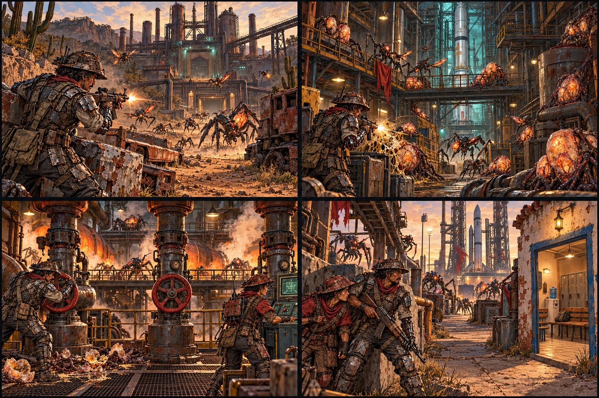

### A Fase 9 O caminho dos ovos

**Câmera:** Plano geral longitudinal; fábrica como destino reconhecível.

**Ação:** Damião atravessa a rua industrial entre emboscadas e inimigos de disparo. Aliados ficam no rádio.

**Objetivo:** Alcançar a fábrica; corredor de 2.560 pixels.

**Fala:** Padre: “Foi naquela fábrica que ouvi os primeiros relatos sobre os ovos.”

**Impacto e corte:** Chegar leva à fase 10 única. Dano sofrido não cria 10A ou 10B nesta campanha.

### B Fase 10 O berçário

**Câmera:** Plano geral elevado com ovos distribuídos entre máquinas.

**Ação:** Damião destrói conjuntos de ovos protegidos por insetos e reconhece a ligação de serviço ao estaleiro.

**Objetivo:** Destruir 10 conjuntos de ovos.

**Fala:** Damião: “Nunca vi tanto ovo junto.” Dinorah: “Vai ficar olhando com medo?”

**Impacto e corte:** Cada conjunto destruído conta uma unidade. O fluxo de insetos revela os foguetes como próximo alvo.

### C Fase 11 Acender a isca

**Câmera:** Plano de conjunto dos circuitos; calor e vapor crescem por setor.

**Ação:** Damião abre válvulas. A fábrica aquece e atrai insetos, deixando o caminho ao estaleiro menos pressionado.

**Objetivo:** Liberar válvulas; sugestão inicial: 3.

**Fala:** Padre: “Podemos fazer desta fábrica um chamado para elas.”

**Impacto e corte:** Ovos destruídos não reaparecem. Os insetos tentam formar novo ninho. O ruído das máquinas cria uma janela de travessia.

### D Fase 12 A última travessia

**Câmera:** Plano geral do acesso; sala dos trabalhadores ao fundo.

**Ação:** Dinorah se reúne com Damião e atravessa o trecho exposto sob sua proteção.

**Objetivo:** Escoltar Dinorah por 3.072 pixels até a sala.

**Fala:** Dinorah: “Me leve até a sala do sindicato. Conheço aquele setor.”

**Impacto e corte:** Chegar viva leva à 13A. Sua morte com Damião vivo leva à 13B; morte de Damião, inclusive simultânea, reinicia.

## Prancha 5 A preparação do ataque final

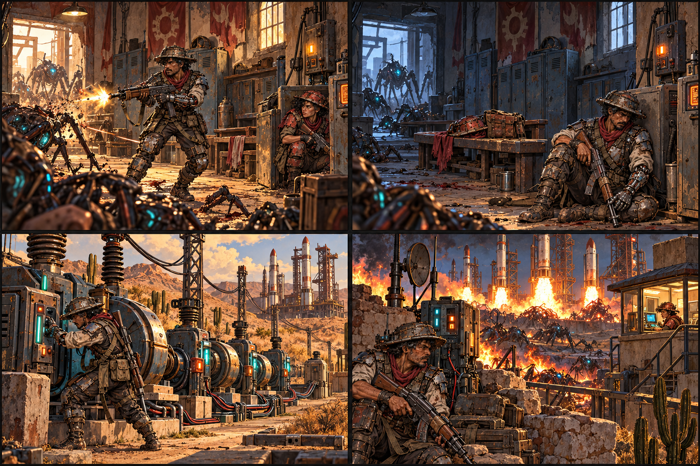

### A Fase 13A Velhos piquetes

**Câmera:** Plano aberto da sala com compartimento lateral protegido.

**Ação:** Damião limpa a sala. Dinorah viva se abriga junto ao painel e reconhece o lugar de seus piquetes.

**Objetivo:** Eliminar 30 insetos.

**Fala:** Dinorah: “Fiz muito piquete saindo dessa sala.”

**Impacto e corte:** Alternativa a 13B. Depois da limpeza, ela assume o painel. A proteção da vida dela não vira novo objetivo na arena.

### B Fase 13B Um lugar vazio

**Câmera:** Repetir o espaço da 13A com enquadramento mais vazio.

**Ação:** Damião entra sozinho. Chapéu e ferramentas de Dinorah no banco marcam sua ausência; o rádio do padre segue ativo.

**Objetivo:** Eliminar 45 insetos acumulados.

**Fala:** Damião: “Ela era grosseira… Mas eu respeitava aquela mulher.”

**Impacto e corte:** Dinorah morreu na escolta. Não aparece viva nem em fantasma. Damião prepara os comandos técnicos; seguir para 14.

### C Fase 14 Devolver a força às máquinas

**Câmera:** Plano amplo da subestação; cabos conduzem aos foguetes.

**Ação:** Damião ativa cinco máquinas. As luzes voltam por setor, com motores ainda apagados.

**Objetivo:** Ativar 5 máquinas de energia.

**Fala:** Viva, Dinorah: “Ligue as cinco máquinas e eu preparo o comando de ignição.”

**Impacto e corte:** Sem Dinorah, Damião prepara a sequência e o padre coordena o perímetro. Não há incêndio antes da fase 15.

### D Fase 15 Não deixem o sinal cair

**Câmera:** Plano aberto do rádio com lançamento ao fundo.

**Ação:** Damião protege o enlace enquanto os motores acendem. A cabine mostra a rota com Dinorah viva, operando de um ponto seguro.

**Objetivo:** Proteger o rádio por 2 minutos.

**Fala:** Viva, Dinorah: “Primeiro motor aceso. Segure mais um pouco!”

**Impacto e corte:** Sem Dinorah, cabine vazia, sequência automática preparada por Damião e falas do padre. Rádio destruído reinicia; sucesso leva à 16.

## Prancha 6 Escorpião e o destino de Dinorah

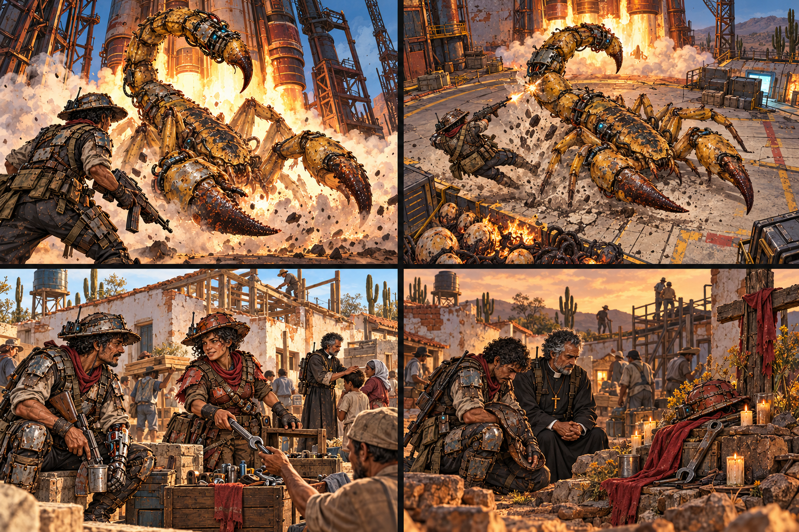

### A Fase 16 chegada A voz do enxame

**Câmera:** Plano geral baixo; Damião pequeno diante do Escorpião.

**Ação:** O chefe emerge do fogo com pinças e ferrão. A primeira fala alienígena chega pelo rádio.

**Objetivo:** Apresentar o chefe e iniciar o confronto.

**Fala:** Escorpião: “Este mundo já estava podre antes de chegarmos.”

**Impacto e corte:** Viva, Dinorah reage: “Essa coisa está falando?” Morta, somente padre e Damião respondem. Não mostrar Dinorah fisicamente na arena.

### B Fase 16 combate Nossa casa

**Câmera:** Plano geral elevado; saída de serviço visível no limite da arena.

**Ação:** Damião evita investida e ferrão, explora uma janela de ataque. O fogo queima os ninhos sob os foguetes.

**Objetivo:** Derrotar Escorpião.

**Fala:** Damião: “Estranho é você achar que a gente ia entregar nossa casa.”

**Impacto e corte:** Dinorah viva orienta a saída pelo rádio; morta, o padre acompanha. Chefe derrotado permite fuga; não há instalação posterior de cargas.

### C Epílogo Dinorah viva O trabalho continua

**Câmera:** Plano de conjunto após passagem de tempo; rostos e ferramentas.

**Ação:** Dinorah e Damião se reencontram e ajudam a organizar reparos. O padre reúne as famílias.

**Objetivo:** Confirmar sobrevivência e papel na reconstrução.

**Fala:** Dinorah: “Agora dá trabalho reconstruir.” Damião: “Quero ver você fugir do serviço.”

**Impacto e corte:** Usar depois de 13A, com qualquer igreja e qualquer resultado de resgate. Ela participou das fases 14, 15 e 16.

### D Epílogo Dinorah morta A ausência permanece

**Câmera:** Plano de conjunto sóbrio; memorial dos trabalhadores em primeiro plano.

**Ação:** Damião e padre homenageiam Dinorah. Seu chapéu e suas ferramentas ficam no memorial, sem imagem sobrenatural.

**Objetivo:** Preservar o luto depois da vitória.

**Fala:** Damião: “Ela devia estar aqui para ver.”

**Impacto e corte:** Usar depois de 13B. Nenhuma fala nova de Dinorah. O memorial dela não determina se houve perdas entre os civis.

## Prancha 7 O que permanece depois da vitória

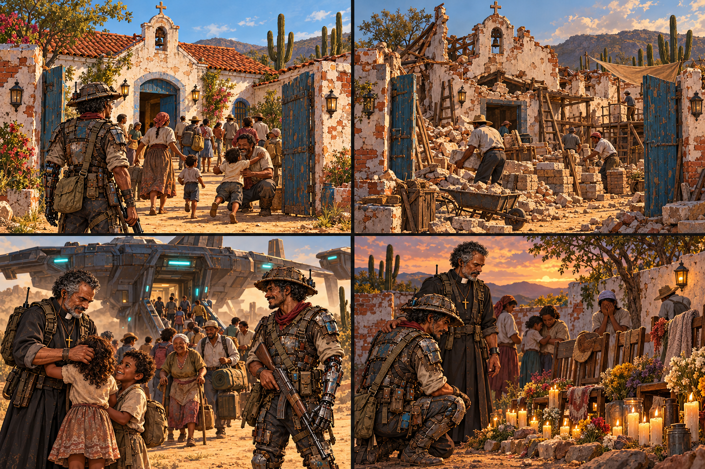

### A Epílogo igreja inteira Um lugar para voltar

**Câmera:** Repetir a fachada do prólogo em luz de dia.

**Ação:** Famílias reabrem o portão da igreja intacta, agora num bairro libertado e em reparos.

**Objetivo:** Mostrar a consequência de não usar bomba na fase 1.

**Fala:** Padre: “A igreja continua de pé. Agora precisamos fazer o bairro voltar a viver.”

**Impacto e corte:** Combinar com resgate completo ou parcial e Dinorah viva ou morta. Igreja preservada não significa ausência de perdas.

### B Epílogo igreja destruída Levantar as paredes

**Câmera:** Mesmo eixo do quadro A; ruínas reconhecíveis e materiais novos.

**Ação:** Sobreviventes retiram escombros e começam a reconstrução. O telhado ainda não voltou.

**Objetivo:** Mostrar a consequência de usar bomba na fase 1.

**Fala:** Padre: “Primeiro, cuidar de quem voltou.”

**Impacto e corte:** Alternativa ao quadro A. Não restaurar magicamente a igreja; combinar de forma independente com os demais resultados.

### C Epílogo resgate completo O retorno do povo

**Câmera:** Plano amplo do desembarque; aproximar os reencontros.

**Ação:** Transportes humanos trazem as famílias salvas. Crianças e idosos reencontram a comunidade.

**Objetivo:** Confirmar que todos os civis daquela retirada sobreviveram.

**Fala:** Damião: “Todo mundo que saiu daquela igreja conseguiu voltar.”

**Impacto e corte:** Não significa que Dinorah sobreviveu. Combinar com seu destino e com a igreja. Evitar afirmar que toda a guerra foi sem perdas.

### D Epílogo resgate parcial Os nomes que faltam

**Câmera:** Plano de conjunto, cadeiras vazias e flores em primeiro plano.

**Ação:** Sobreviventes retornam e lembram as vítimas civis. O padre acolhe as famílias; Damião reconhece as ausências.

**Objetivo:** Confirmar perdas da fase 5, apesar da libertação.

**Fala:** Damião: “Ainda vai faltar gente quando chamarem os nomes.”

**Impacto e corte:** Não usar objetos de Dinorah neste memorial: ela pode estar viva. Combinar com seu destino e com o estado da igreja.

## Composição dos encerramentos

Esta composição está integrada à ROM como [sequência de três slides](../../art/ending-slides-v1/README.md): 8 segundos para a igreja, 7 para a população e 10 para Dinorah. Os quadros têm fades, legendas e partículas como na introdução; START pula para a tela de vitória. As oito combinações foram verificadas em NTSC/PAL.

| Igreja | Resgate | Dinorah | Quadros |
|---|---|---|---|
| Preservada | Completo | Viva | 07A + 07C + 06C |
| Preservada | Completo | Morta | 07A + 07C + 06D |
| Preservada | Parcial | Viva | 07A + 07D + 06C |
| Preservada | Parcial | Morta | 07A + 07D + 06D |
| Destruída | Completo | Viva | 07B + 07C + 06C |
| Destruída | Completo | Morta | 07B + 07C + 06D |
| Destruída | Parcial | Viva | 07B + 07D + 06C |
| Destruída | Parcial | Morta | 07B + 07D + 06D |

A igreja, as perdas civis e o destino de Dinorah são independentes. Dinorah viva participa das conversas e da operação nas fases 14, 15 e 16; morta, Damião e padre conduzem a etapa final. A morte dela na fase 6 reinicia a missão; na 12, com Damião vivo, leva à 13B. A morte de Damião sempre tem prioridade de derrota.

As quantidades de três transmissores na fase 8 e três válvulas na fase 11 são sugestões de balanceamento. A ilustração de quantidades é indicativa; os contadores e as legendas definem os totais da missão. Os quadros amplos são direção de encenação e ambiente, sem definir a câmera final ou a escala de sprites do Mega Drive.
